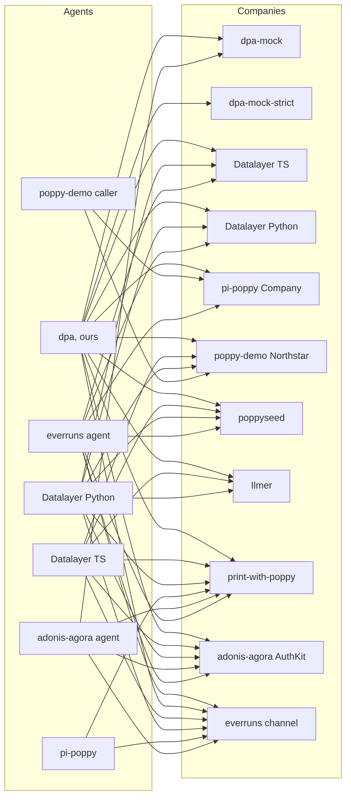

# The Poppy ecosystem

A map of everything around [Poppy, the Personal Agent Protocol](https://personalagentprotocol.org/), as of **12 October 2026**, three days after Draft 0.1 was published. It is meant to be kept up to date: each row says where it comes from and when it was last checked, and [the last section](#how-to-update-this-map) says how to check again.

The detail lives elsewhere. Every implementation, with licences and maturity, is in [implementations.md](implementations.md); what we found in their code is in [poppy-issues.md](poppy-issues.md); the spec's problems are in [spec-issues.md](spec-issues.md), with our chosen readings in [readings.md](readings.md); how our harness pairs them is in [interop-testing.md](interop-testing.md), and its last run in [interop-results/](interop-results/README.md). This page is the index.

**Method.** Read-only: GitHub (repositories, code, issues and pull requests), npm, PyPI, crates.io, web search, and the community lists. We read other projects' code at a pinned commit and run it only in Docker. We fetch no business's `poppy.json` beyond what [implementations.md](implementations.md) already records; the live Companies below come from those records and from public directories. Nothing is posted to other projects.

## The spec

| Item | State on 12 October | Source | Checked |
| --- | --- | --- | --- |
| Draft 0.1, "Updated Oct 9, 2026" | The only version. Nine pages: home (with walkthroughs), overview, spec, extensions, Operations extension v1, Guides, open topics, licence, contributions. | [personalagentprotocol.org](https://personalagentprotocol.org/) | 12 Oct, `node scripts/spec-snapshot.mjs`: no text changes since our snapshot |
| Authors | Led by Sierra and Meta, with 35 named design partners (Sierra's post) | [sierra.ai/blog/poppy](https://sierra.ai/blog/poppy) | 12 Oct |
| Licence | Apache 2.0 for the specification, documentation and examples; not the names, logo or site design. Feedback is licensed to all members and users. | [licence](https://personalagentprotocol.org/license), [contributions](https://personalagentprotocol.org/license/contributions) | 12 Oct |
| Where it lives | Only on the website. No public source repository, issue tracker, changelog or `llms.txt`. A copy of the source is in poppyseed's `spec/`. | [spec-issues.md](spec-issues.md#how-we-found-them) | 12 Oct |
| Our copy | A dated snapshot of every page, for citing | [spec/draft-0.1-2026-10-09](../spec/draft-0.1-2026-10-09/README.md), [spec/grounding.md](../spec/grounding.md) | Snapshot taken 12 Oct |
| Change tracking | `node scripts/spec-snapshot.mjs` compares the live site with the newest snapshot (read-only); `--save` stores a new dated one | [`scripts/spec-snapshot.mjs`](../scripts/spec-snapshot.mjs) | Run 12 Oct |

## Promised, not released

| Item | State | Source | Checked |
| --- | --- | --- | --- |
| Sierra's reference implementation | Promised "over the next month", with design workshops. Not published. Sierra's GitHub organisation is [sierra-inc](https://github.com/sierra-inc) (7 public repositories, all SDKs and forks; none for Poppy). | [Sierra's post](https://sierra.ai/blog/poppy) | 12 Oct |
| Partner launches | None of the launch or design partners we know of serves a `poppy.json`: we checked Sierra and seven partners on 11 October ([implementations.md](implementations.md#not-found)), and PAP Checker's author checked them on 11 October too. | [dev.to article](https://dev.to/benjifisher/what-is-poppyjson-a-personal-agent-protocol-example-and-how-to-validate-yours-3d5m) | 12 Oct (no new fetch) |
| Muse with Redfin and Rocket | A video demo; no code, no endpoints, no spec version | [video](https://x.com/SierraPlatform/status/2108245197440307584), via [poppy.md](https://poppy.md/implementations) | 11 Oct |
| A shared conformance suite | None exists, and the draft doesn't mention one: its open topics are payments, push notifications and attachments. Datalayer's 124 JSON cases are the nearest thing. | [open topics](https://personalagentprotocol.org/docs/open-topics), [our copy](../spec/draft-0.1-2026-10-09/pages/open-topics.md) | 12 Oct |

## Personal Agents

"Grid" is whether our harness runs it ([`interop/registry.json`](../interop/registry.json)).

| Project | What | Language, licence | Grid | Source | Checked |
| --- | --- | --- | --- | --- | --- |
| This project (dpa) | A hosted Personal Agent per User, on Durable Objects | TypeScript, none chosen | Yes | [adewale/dpa](https://github.com/adewale/dpa) | 12 Oct |
| Datalayer SDK | Client side of a both-sides SDK | Python, TypeScript; BSD-3-Clause | Yes, pinned at `0c048aa` (0.10.0; was `12d7187`, 0.6.0) | [datalayer/personal-agent-protocol](https://github.com/datalayer/personal-agent-protocol) | 12 Oct |
| pi-poppy | An extension for the pi coding agent | TypeScript, MIT | Yes | [richardanaya/pi-poppy](https://github.com/richardanaya/pi-poppy) | 12 Oct (no commits since 10 Oct) |
| adonis-agora agent | `poppy-client`, `poppy-agent` bin and "connections" in an AdonisJS agent library | TypeScript, MIT | Yes | [DavideCarvalho/adonis-agora-agent](https://github.com/DavideCarvalho/adonis-agora-agent) | 12 Oct |
| nestjs-agent | `@dudousxd/nestjs-agent-poppy` (0.1.1 in the repository, not on npm): a NestJS port of the adonis-agora agent. Its client is a verbatim copy of adonis-agora's `poppy-client`, plus connections and a `poppy-agent` CLI | TypeScript, MIT | No | [DavideCarvalho/nestjs-agent](https://github.com/DavideCarvalho/nestjs-agent) | 12 Oct |
| poppy-demo caller | A demo caller Worker | TypeScript, none declared | Yes | [irvinebroque/poppy-demo](https://github.com/irvinebroque/poppy-demo) | 12 Oct (no commits since 9 Oct) |
| everruns `poppy_client` | A capability of a production agent platform; since [#4577](https://github.com/everruns/everruns/pull/4577) (11 Oct) also for apps built on its framework. Still no sign-in. | Rust, MIT | Yes, pinned at `f470ad7` (12 Oct; first run that day) | [everruns/everruns](https://github.com/everruns/everruns) | 12 Oct |
| Atlas (introspection-js-sdk) | A scripted demo agent in an open pull request | TypeScript, Apache-2.0 | No | [PR #441](https://github.com/introspection-org/introspection-js-sdk/pull/441) | 12 Oct (still open) |
| print-with-poppy's `scripts/agent.ts` | A reference client for that store, demo identity only | TypeScript, none declared | No | [spenciefy/print-with-poppy](https://github.com/spenciefy/print-with-poppy) | 12 Oct |

## Companies and Company SDKs

| Project | What | Language, licence | Grid | Source | Checked |
| --- | --- | --- | --- | --- | --- |
| poppyseed | A Company library for Next.js, with a demo Company | TypeScript, MIT | Yes | [akshay5995/poppyseed](https://github.com/akshay5995/poppyseed) | 12 Oct (no commits since 11 Oct) |
| Datalayer "Manzanita" | Reference Company on the SDK's Company side | Python, TypeScript; BSD-3-Clause | Yes | [datalayer/personal-agent-protocol](https://github.com/datalayer/personal-agent-protocol) | 12 Oct |
| adonis-agora AuthKit | Company OAuth server and conversation endpoint in an AdonisJS kit | TypeScript, MIT | Yes | [DavideCarvalho/adonis-agora-authkit](https://github.com/DavideCarvalho/adonis-agora-authkit) | 12 Oct |
| nestjs-agent Company | The same package's conversation endpoint (section 7, with SSE, handoff and Direct Conversations). No `poppy.json` and no authorization server: it checks tokens through a resolver that adonis-agora AuthKit provides | TypeScript, MIT | No | [DavideCarvalho/nestjs-agent](https://github.com/DavideCarvalho/nestjs-agent) | 12 Oct |
| pi-poppy test Company | A test peer in the pi-poppy repository | TypeScript, MIT | Yes | [richardanaya/pi-poppy](https://github.com/richardanaya/pi-poppy) | 12 Oct |
| poppy-demo Northstar | A demo retailer Worker that accepts only its own agent | TypeScript, none declared | Yes, patched | [irvinebroque/poppy-demo](https://github.com/irvinebroque/poppy-demo) | 12 Oct |
| Ilmer.org | A local-history archive assistant, signed-out only | TypeScript, MIT | Yes | [rbirkby/Ilmer.org](https://github.com/rbirkby/Ilmer.org) | 12 Oct |
| everruns `poppy` channel | Hosts a Company's Poppy endpoints, signed-out only | Rust, MIT | Yes, pinned at `f470ad7` (12 Oct; first run that day) | [everruns/everruns](https://github.com/everruns/everruns) | 12 Oct |
| Spot | A cart-approval and payment service | JavaScript, none declared | No | [futurebasicsrepo/…-client-hub-api](https://github.com/futurebasicsrepo/futurebasicsrepo-client-hub-api) | 12 Oct (active) |
| print-with-poppy | An agent-first photo-printing store: signed-out Sessions, OpenAPI, Operations v1 required for orders; agents on an allowlist | TypeScript (Express, SQLite), none declared | Yes: D and S0, and OU with dpa only; patched ([`interop/impls/print-with-poppy-company`](../interop/impls/print-with-poppy-company)) | [spenciefy/print-with-poppy](https://github.com/spenciefy/print-with-poppy) | 12 Oct |
| Flight Sector (introspection-js-sdk) | The demo Company in PR #441 | TypeScript, Apache-2.0 | No | [PR #441](https://github.com/introspection-org/introspection-js-sdk/pull/441) | 12 Oct |
| TYPO3 lab | A signed-out "knowledge profile" in a private extension | PHP, private | README only | [dirnbauer/webconsulting-typo3-lab](https://github.com/dirnbauer/webconsulting-typo3-lab) | 12 Oct |
| Fillthemat (planned) | A growth platform for martial-arts schools planning to make each School a Company: one issuer per School with a path (`https://auth.fillthemat.com/schools/<id>`), metadata by RFC 8414 insertion, signed-out Sessions first. Draft PR; nothing served from merged code | TypeScript, MIT | No | [fillthemat/fillthemat PR #200](https://github.com/fillthemat/fillthemat/pull/200) | 12 Oct |

## Both-sides SDKs

Datalayer (Python and TypeScript, published as `personal-agent-protocol` on PyPI and `@datalayer/personal-agent-protocol` on npm, 0.10.0 on 12 October), adonis-agora (agent and AuthKit), nestjs-agent (a port of adonis-agora's code), everruns, and the two demos (poppy-demo, introspection's travel demo) each cover both sides. Only Datalayer is a standalone SDK; the others are inside a framework.

## Checkers, validators and linters

| Tool | What it checks | Open? | Source | Checked |
| --- | --- | --- | --- | --- |
| Our validator | `poppy.json`, the issuer's metadata, client metadata and JWKS; 76 messages, each with an explanation, a fix and a reference | Yes (in this repo); live at [/validator](https://personal-agent.adewale-883.workers.dev/validator) | [`src/validator/`](../src/validator) | 12 Oct |
| poppy-validator | A linter for `poppy.json` and the issuer's metadata: 64 rules, each with a spec section and a basis (MUST, field table, advisory, context), a JSON Schema, `--json` and `--strict` | Yes: Python, MIT, not on PyPI | [tusharck/poppy-validator](https://github.com/tusharck/poppy-validator) at `d2220bf` | 12 Oct |
| poppy-sidecar | A `poppy.json` generator, a 25-check validator, and a "testbed" that checks an agent's self-reported action trace against granted scopes | Yes: Python, MIT; its README's PyPI badge points at a package that doesn't exist | [habib-analyst/poppy-sidecar](https://github.com/habib-analyst/poppy-sidecar) at `858db66` | 12 Oct |
| PAP Checker | Checks a domain from outside (discovery, OAuth metadata, OpenAPI, MCP resource metadata), with a public directory of domains seen | No (closed); by Benji Fisher, who also runs UCP Checker | [papchecker.com](https://papchecker.com), [its directory](https://papchecker.com/sites) | 12 Oct |
| Ora's poppy.ax and `ax` CLI | A guide and a domain checker; `ax generate-files` (0.9.0, 12 Oct) writes a starter `poppy.json` (`organization` and `web: {}` only) that Ora's API decides | Front end and CLI open (MIT); checks in Ora's closed API | [ora/poppy-ax](https://github.com/ora/poppy-ax), [ora/ax](https://github.com/ora/ax) | 12 Oct |
| Flow's checker | Readiness levels 0–3, plus a compliance checklist | No | [flow.engineer/poppy](https://flow.engineer/poppy) | 11 Oct |
| poppyseed's check command; Datalayer's `pap company verify` | Each project's conformance runner for a Company | Yes | the projects above | 11 Oct |
| Datalayer's conformance cases | 124 language-neutral JSON cases, unchanged in 0.10.0; we run them against our client and validator | Yes, BSD-3-Clause | [interop/vectors/datalayer](../interop/vectors/datalayer) | 12 Oct |

A committed script, [`interop/vectors/validators/`](../interop/vectors/validators/README.md), runs the two open validators and ours over the same 107 `poppy.json` documents; the results are in [interop-testing.md](interop-testing.md#validator-cross-check).

## Companies you can reach

None is a large business. We list what is public; we don't probe these hosts, and a host listed by someone else's directory is not one we have fetched.

| Host | What it is | Sign-in | How we know | Checked |
| --- | --- | --- | --- | --- |
| [spotmeplease.com](https://spotmeplease.com/.well-known/poppy.json) | Spot, a small cart-approval product | Guest Sessions and Direct Sign-In | Fetched once, 11 Oct ([implementations.md](implementations.md)) | 11 Oct |
| [withpoppyseed.dev](https://withpoppyseed.dev) | "Poppy Travel", poppyseed's demo | Not recorded; its `poppy.json` was valid | Fetched once, 11 Oct | 11 Oct |
| [poppy-receiver.roundtrip.workers.dev](https://poppy-receiver.roundtrip.workers.dev/.well-known/poppy.json) | Northstar Outfitters, poppy-demo's retailer | Direct Sign-In, its own caller only | Fetched once, 11 Oct | 11 Oct |
| [poppy.ilmer.org](https://poppy.ilmer.org/.well-known/poppy.json) | Ilmer's local-history archive | Signed-out only | Fetched once, 11 Oct | 11 Oct |
| TYPO3 lab `/poppy/demo` | A protocol playground | Behind a login | Its repository | 11 Oct |
| flowers.papsandbox.com | "Northlight Flowers"; the name suggests a sandbox | Unknown | [PAP Checker's directory](https://papchecker.com/sites): 0 problems, first seen 11 Oct | Not fetched |
| tilopay.shop, tilopay.tilopay.shop | Organisation "Tilopay"; whether it is the payment company's production site is unknown | Unknown | PAP Checker's directory: 1 problem each, first seen 12 Oct | Not fetched |
| print-with-poppy.vercel.app | print-with-poppy's hosted example, in demo mode (payments and prints simulated) | Signed-out; agents on an allowlist, plus a non-Poppy "compatibility" mode | Its README | Not fetched |

Ora's poppy.ax had seen only poppy-receiver.roundtrip.workers.dev on 10 October (its `fixtures/sites.json`). PAP Checker says it has checked 16 domains.

## Adjacent and declined

| Item | Kind | Source | Checked |
| --- | --- | --- | --- |
| OpenAgents | Proposal to support both sides, closed as not planned (11 Oct) | [OpenAgentsInc/openagents#11239](https://github.com/OpenAgentsInc/openagents/issues/11239) | 11 Oct |
| orka | Tracking issue: "We should not build anything yet" | [orka-agents/orka#774](https://github.com/orka-agents/orka/issues/774) | 11 Oct |
| tiny-poppy-gate | A teaching toy "inspired by" the draft: an in-memory scope gate with its own document shape. No network, no OAuth; "not an implementation of the protocol". | [bobbyhalljr/tiny-poppy-gate](https://github.com/bobbyhalljr/tiny-poppy-gate) | 12 Oct |
| OpenLine POPPY-PROOF-001 | An extension prototype: the Company verifies the owner's authorisation for an operation itself (Envoy ext_authz), "do not merge" | [terryncew/openline-receipt-gate#105](https://github.com/terryncew/openline-receipt-gate/pull/105) | 12 Oct |
| mission-bound-authorization | Evaluates the draft and sketches a standing-permissions extension | [mcguinness/mission-bound-authorization#1189](https://github.com/mcguinness/mission-bound-authorization/pull/1189) | 11 Oct |
| poppy-operations-findings | A literal sandbox of the Operations extension with five findings | [SmokeSol/poppy-operations-findings](https://github.com/SmokeSol/poppy-operations-findings) | 12 Oct (no commits since 9 Oct) |
| IETF vCon | A charter pull request on linking a conversation to the order and payment an agent made | [draft-ietf-vcon-vcon-core#41](https://github.com/ietf-wg-vcon/draft-ietf-vcon-vcon-core/pull/41) | 12 Oct |
| PACT | A separate protocol (Decagon and Instinct), on A2A and OAuth | [openpactprotocol](https://github.com/openpactprotocol/openpactprotocol) | 11 Oct |
| Pre-draft models | Cobus Greyling's sample, agent-ledger, trust_gateway: `/.well-known/personal-agent.json`, not Draft 0.1 | [implementations.md](implementations.md#related-but-not-implementations) | 11 Oct |
| Lists and trackers | [awesome-poppy](https://github.com/JaviChulvi/awesome-poppy) (added PAP Checker on 11 Oct), [poppy.md](https://poppy.md/implementations) (last checked 11 Oct), [awesome-muse](https://github.com/cszach/awesome-muse) | as linked | 12 Oct |

False positives in searches are listed in [implementations.md](implementations.md#related-but-not-implementations).

## How they work together

Our [interop grid](interop-results/README.md) ran six Personal Agents against ten Companies (our two mocks included) on 12 October, over 30 scenarios, on a network with no internet access: **1,800 cells, 849 pass, 171 fail, 780 unsupported, 0 errors**. Every failure is a known upstream or spec failure. The separate security grid, which runs only against our own implementations, passed **25 of 25**. Datalayer is at 0.10.0 (`0c048aa`); every other project is at the commit in [`interop/registry.json`](../interop/registry.json). everruns joined later that day, in two separate runs of its own row and column ([below](#everruns-run-apart)); the totals and tables here leave those cells out.

### Scorecard

Each implementation's cells, as pass / fail / unsupported, summed over the grid's row (as a Personal Agent) or column (as a Company). The percentage is passes among the cells that ran, because an unsupported cell means one side doesn't offer that feature, which is no failure. A failure counts against both ends of its cell, so read the last column before blaming a side: the [attribution rules](interop-spec.md) decide whose it is, and [the results](interop-results/README.md) list every failure by rule.

**As a Personal Agent** (against all ten Companies):

| Agent | Pass / fail / unsupported | Passes where run | What its failures are |
| --- | --- | --- | --- |
| dpa (ours) | 195 / 0 / 105 | 100% of 195 | None. Its unsupported cells are signed-out Companies and features a Company lacks. |
| Datalayer Python | 183 / 7 / 110 | 96% of 190 | Device Sign-In polling ignores `use_dpop_nonce` (SVN), and it requires `conversation_id` in handoff and close answers, which our mocks don't send (7.9, 7.12). |
| Datalayer TS | 179 / 11 / 110 | 94% of 190 | The same SVN failure; its event stream gives up after five quick reconnects (CS); and both SDKs require `conversation_id` in handoff and close answers, which our mocks don't send (7.9, 7.12). |
| adonis-agora | 123 / 46 / 131 | 73% of 169 | Its assertions carry no `typ`, which three Companies refuse ([S2](spec-issues.md#s2), the spec's); its device and revocation `aud` ([S1](spec-issues.md#s1)); renewal without `session_id` at Datalayer. |
| pi-poppy | 130 / 53 / 117 | 71% of 183 | No `typ` (S2); it resends the Session assertion on a nonce retry; it throws when a Company ends the Session ([N39](spec-issues.md#n39)). |
| poppy-demo caller | 39 / 54 / 207 | 42% of 93 | It requires the issuer to be the Company's origin, though the draft's examples put it elsewhere, always asks for its hard-coded scopes, and crashes on a missing `authorization_endpoint`. |

**As a Company** (against all six agents):

| Company | Pass / fail / unsupported | Passes where run | What its failures are |
| --- | --- | --- | --- |
| poppyseed | 121 / 5 / 54 | 96% of 126 | Mostly the agents': adonis-agora's `aud` (S1), poppy-demo's parse of an empty revocation answer. |
| pi-poppy Company | 118 / 7 / 55 | 94% of 125 | The agents': Datalayer's SVN polling, pi-poppy's own nonce retry, adonis-agora's `aud`. |
| Datalayer TS / Python | 107 / 9 / 64 each | 92% of 116 | Its renewal requires `session_id`; its cancel sends `result.data: null` ([N41](spec-issues.md#n41)); poppy-demo's hard-coded scopes. |
| adonis-agora AuthKit | 107 / 14 / 59 | 88% of 121 | The agents': poppy-demo's issuer-origin rule, pi-poppy's nonce retry. |
| dpa-mock (lenient reference) | 127 / 22 / 31 | 85% of 149 | The agents': nonce retries, Datalayer's SVN polling, CS stream and handoff and close answers, poppy-demo's issuer rule. |
| print-with-poppy | 16 / 3 / 161 | 84% of 19 | poppy-demo's crash on its missing `authorization_endpoint`. Signed-out only, so most scenarios don't apply. OU, run apart with dpa only, passes. |
| poppy-demo Northstar | 48 / 22 / 110 | 69% of 70 | It refuses assertions without `typ` (S2 `jwt-60s`); poppy-demo's own agent passes there. |
| Ilmer | 17 / 12 / 151 | 59% of 29 | It refuses assertions without `typ` (S2), and poppy-demo's crash. Signed-out only. |
| dpa-mock-strict | 81 / 68 / 31 | 54% of 149 | It refuses assertions without `typ`, our strict reading of S2, so pi-poppy and adonis-agora fail almost every cell. |

Not in the grid: nestjs-agent (its Company needs adonis-agora's AuthKit, which the grid already runs), Spot (it publishes valid discovery, but has no adapter), the TYPO3 lab (private), and Atlas and Flight Sector (an open pull request). [interop-testing.md](interop-testing.md#candidates-from-the-12-october-survey) says what the 12 October candidates would need.

#### everruns, run apart

everruns' agent and Company joined the registry on 12 October, after the grid above, and ran in two runs of their own over the same 25 scenarios (its agent against all eleven Companies, everruns' own included; the six other agents against its Company; [interop-testing.md](interop-testing.md#everruns-joins-the-grid)). Their cells are not in the totals or percentages above; adding them would change those rows only by the everruns column or row.

| everruns as | Pass / fail / unsupported | Passes where run | What its failures are |
| --- | --- | --- | --- |
| Personal Agent (against eleven Companies) | 32 / 11 / 232 | 74% of 43 | Its Session assertion has no `typ`, which three Companies refuse ([S2](spec-issues.md#s2), the spec's); it fetches metadata only at the appended location, so DP fails at both our mocks ([S3](spec-issues.md#s3)). Signed-out only, with conversations and no APIs, so 21 of 25 scenarios don't apply at most Companies. |
| Company (against seven agents) | 24 / 3 / 148 | 89% of 27 | poppy-demo's issuer-origin rule (D, S0, C). Every other agent passes D, S0, C and CI. |

The other agents' cells against everruns' Company: dpa, Datalayer TS and Python, pi-poppy and adonis-agora each 4 / 0 / 21; poppy-demo 0 / 3 / 22.

An edge below means no cell between that pair failed; a missing edge means at least one did. Unsupported cells count for nothing either way, so an edge between two small implementations can rest on a few cells: each signed-out Company's edges rest on two to four.

The everruns edges come from its own runs. At print-with-poppy only D ran (everruns starts a Session only for a conversation); at dpa-mock everything but DP passed.

pi-poppy's only clean pair is print-with-poppy, where just two signed-out scenarios run. At every other Company one of three habits fails a cell: it resends the Session assertion on a nonce retry, gives up when a Session ends, and sends no `typ`.

What the grid found in each project is in [poppy-issues.md](poppy-issues.md); the failures by rule are in [interop-results/](interop-results/README.md).

## Open fault lines

Where the draft is ambiguous, implementations already disagree. The questions are in [spec-issues.md](spec-issues.md); our readings and why are in [readings.md](readings.md). How each implementation reads the four that most often break a pair (from each adapter's declared readings, or from its code where it has no adapter; for a Company, "omits" means it expects no `scope` there):

| Implementation | S1 client assertion `aud` | S2 assertion `typ` and lifetime | S3 metadata for an issuer with a path | S4 `scope` on a signed-out Session |
| --- | --- | --- | --- | --- |
| dpa (agent) | endpoint called | `typ: JWT`, `kid`, 60 s | insertion | omits |
| dpa-mock / dpa-mock-strict | endpoint, token endpoint or issuer | any, 300 s / `typ: JWT`, `kid`, 60 s | insertion | ignores |
| Datalayer agents | endpoint called | `typ: JWT`, 60 s | insertion | omits |
| Datalayer Companies | endpoint called, token endpoint or issuer (0.10.0) | `typ` absent or `JWT`, 120 s, `jti` of 16+ characters (0.10.0) | insertion | omits or ignores |
| pi-poppy agent / Company | endpoint called / endpoint called | no `typ` on Session assertions / any, 120 s | append / either | omits / ignores |
| poppy-demo caller / Northstar | endpoint called / endpoint called | `typ: JWT`, 60 s / required | append / n/a | omits / `invalid_scope` |
| adonis-agora agent / AuthKit | token endpoint / either | no `typ`, 60 s / any | insertion / either (serves both) | omits / omits |
| poppyseed | endpoint called | any | either | ignores |
| Ilmer | token endpoint | `typ: JWT`, `kid`, 60 s | either | omits |
| everruns agent / Company | token endpoint / token endpoint or issuer | Session assertion without `typ` / any, 300 s | append / either | omits / `invalid_scope` |
| print-with-poppy | endpoint called (token and revocation) | any `typ` except the browser one, 120 s | n/a (issuer is the origin) | ignores |
| Fillthemat (planned) | this School's token endpoint, exactly | not stated | insertion (path issuers) | not stated |
| nestjs-agent | token endpoint (as adonis-agora) | no `typ`, `kid`, 60 s | insertion | omits |

The others most often met: [S9](spec-issues.md#s9) (a retried first message), [S23](spec-issues.md#s23) (nonce scope), [N39](spec-issues.md#n39) (the error for an ended Session) and [N41](spec-issues.md#n41) (`null` for an optional member). Validators disagree too, mostly on how strict to be where the draft has no keyword: see the [cross-check](interop-testing.md#validator-cross-check).

## How to update this map

1. **The spec.** Run `node scripts/spec-snapshot.mjs`. If any text differs, store a snapshot with `--save` and re-check [spec/grounding.md](../spec/grounding.md).
2. **Sierra.** Read [Sierra's post](https://sierra.ai/blog/poppy) and list [sierra-inc](https://github.com/sierra-inc)'s public repositories (`curl -s https://api.github.com/orgs/sierra-inc/repos`; `gh api` needs SSO for that organisation).
3. **New projects.** `gh search repos "<term>" --created ">=<last check>"` for `poppy`, `"personal agent protocol"`, `poppy.json`; `gh search code` for `well-known/poppy`, `poppy_domains`, `browser_session_endpoint`, `poppy:write`, `"Personal Agent Protocol"`; `gh search issues --include-prs` for the same since the last check. Then npm (`registry.npmjs.org/-/v1/search?text=…`), PyPI (`pypi.org/pypi/<name>/json`) and crates.io. Read [awesome-poppy](https://github.com/JaviChulvi/awesome-poppy), [poppy.md](https://poppy.md/implementations) and [PAP Checker's directory](https://papchecker.com/sites). Expect noise: Poppy Playtime, the Poppy robot, PoppyDB.
4. **Existing rows.** `gh api repos/<owner>/<repo>` for `pushed_at` and `archived`, and `…/commits?per_page=3` and `…/releases?per_page=2`.
5. **Reading code.** Download a tarball at a pinned commit into a new empty directory, and read it there. Run third-party code only in Docker, never on the host.
6. **Live Companies.** Don't probe businesses. Use public directories and articles; record who listed a host, and that we didn't fetch it.
7. **Record it.** Update the rows here and in [implementations.md](implementations.md), change the date at the top of both, and add a pinned adapter to the grid where one fits ([interop-testing.md](interop-testing.md)).
