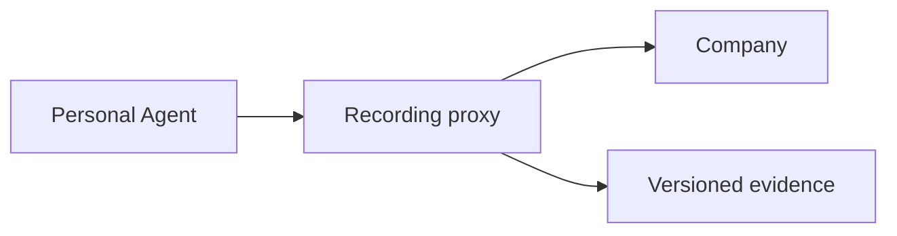

# The Poppy ecosystem

A map of known projects around [Poppy, the Personal Agent Protocol](https://personalagentprotocol.org/), updated **12 November 2026**. Each observation and test result keeps its own date. The historical full grid was run on **17 October** at **13 October** pins. Refresh on demand for a specific integration decision; [the last section](#how-to-update-this-map) describes the scope.

This page owns current ecosystem observations. The [frozen implementation catalogue](https://github.com/adewale/pda/blob/289c6592c6f6e629b1d525247f3c4e2243662bc2/docs/implementations.md) preserves the earlier licence and maturity survey. Historical [implementation findings](history/poppy-issues.md) and [interop design](history/interop-testing.md) retain their recorded revisions. For the protocol we implement, use the [0.4 issue list](poppy-0.4-issues.md), [our readings](readings.md), the [harness contract](interop-spec.md), and [current verification](poppy-0.4-conformance.md#current-verification). Other dated reports are in [history](history/README.md).

**Historical method (12–13 October).** Read-only: GitHub (repositories, code, issues and pull requests), npm, PyPI, crates.io, web search, and the community lists. We read other projects' code at a pinned commit and run it only in Docker. We fetch a live Company's `poppy.json` and its issuer's metadata only with our validator CLI, once per host per survey, one host at a time; the hosts come from our records, public directories and other projects' pull requests. Nothing is posted to other projects.

## Current ecosystem — 12 November 2026

PDA speaks **Poppy 0.4 alone** ([decision 49](decisions.md#49-03-dropped-the-agent-mock-validator-and-interop-speak-04-alone)), deployed on 12 November, and refuses a Company that declares anything else. 0.4 was published on 10 November as the 1.0 release candidate. Upstream opened **Draft 1.0** on 11 November (`272cab0`): 0.4 with fixes; at `ad20217` we found it differing only in its version strings. The official kit's validator at `ad20217` checks for `"1.0"` alone, so it fails a 0.4 Company's `discovery.protocol-version`; our validator keeps the [frozen 0.4 pin](../spec/draft-0.4-retrieved-2026-11-11/README.md). Both checks below are read only: no Session, sign-in or order was attempted, and nothing was posted to any project.

### Public discovery — 12 November 2026

58 hosts, checked one at a time with our validator's 0.4 profile at `c79324a` ([receipt](evidence/ecosystem-2026-11-12/discovery.json)): the 29 October list's 33, [PAP Checker's directory](https://papchecker.com/sites) (39) and Company hosts named on [poppy.md's implementations page](https://poppy.md/implementations). **9 valid, 41 refused for their version, 8 indeterminate.**

| Hosts | Declared | Result | Notes |
| --- | --- | --- | --- |
| printwithpoppy.com, sandbox.printwithpoppy.com | 0.4 | Valid | 0 errors, 0 warnings. Both declared 0.3 or 0.2 on 29 October |
| www.cliffside-retail.com, www.alpine-retail.com | 0.4 | Valid | Both serve Cliffside Retail. The official demos page labels it 0.4 |
| flowers.papsandbox.com, stays.papsandbox.com | 0.4 | Valid | Each links its 0.3 document in `supported_versions`. food.papsandbox.com still declares 0.3 |
| stacktr.ee | 0.4 | Valid | Links a 0.3 document in `supported_versions` |
| emorahealth.com | 0.4 | Valid | Declared 0.1 on 29 October |
| project-1xtwb.vercel.app | 0.4 | Valid | "My B2B Store"; new since 29 October |
| 18 hosts, among them planmyvisit.to, saferate.com, notjustabank.com, directv.com, orbitz.com, rocket.com and demo.poppykit.dev | 0.3 | Refused | A version PDA no longer speaks; not a failure against its own rules. Which 0.3 text each follows was not judged |
| archon.technology, crosswalk.to, ticketfairy.com, x402broker.com, coveragecat.com, vzlabnb.com | 0.2 | Refused | As above |
| 17 hosts, among them ample.computer, tilopay.shop, poppy.ilmer.org, you.com and getvibe.dev | 0.1 | Refused | As above |
| tilopay.tilopay.shop, intercom.io, poppylab.dev, papplayground.com, papsandbox.com, poppy-simulator.stacktr.ee | not read | Indeterminate | `poppy.json` answered 404 |
| globalresearch.ca; goodrx.com | not read | Indeterminate | 403; a redirect to a block page over 100 KB |

A valid document says only that discovery would succeed. Of the nine, Print with Poppy's sandbox is the only one known to simulate payment and fulfilment, which the live checks need ([deployment tasks](deployment-tasks.md#2-live-checks)).

### Who implements 0.4 — 12 November 2026

42 repositories read at their default-branch heads ([receipt](evidence/ecosystem-2026-11-12/repositories.json)): the 29 October survey's 23, awesome-poppy's list, and GitHub searches since 28 October. Code was read, never run.

| Project | Head | What it implements |
| --- | --- | --- |
| [print-with-poppy](https://github.com/spenciefy/print-with-poppy/tree/bd1dc43c993a3c9bf6a21626f16f5836f745cb39) | `bd1dc43`, 12 November | 0.4. Its PR #36, merged at 19:45 UTC, reads the delegation from `poppy_dlg` with `typ: poppy-delegation+jwt`. At `ae453ed`, our interop pin, it read `pap_dlg`, which is why its API refused our Session JWTs ([interop spec](interop-spec.md#print-with-poppy-delegation)). Whether the live store runs `bd1dc43` wasn't checked |
| [Datalayer SDKs](https://github.com/datalayer/personal-agent-protocol/tree/ee03a044c6c597573522076006b396d43f7412df) | `ee03a04`, 12 November | 0.4 as published (SDK 0.35.0): Operations 3 and Browser Control 1, with Draft 1.0 opt-in. The only open-source implementation of published 0.4 on both sides |
| [poppy-demo](https://github.com/irvinebroque/poppy-demo/tree/863ebf21a10a55e932c5028c956f13ee6b74a62a), [agent-runtimes](https://github.com/datalayer/agent-runtimes/tree/de2bc86d1310ec83d672d89ef8ec0fbaa326fa0a), diegopacheco's proof of concept | 6 to 12 November | 0.4 drafts from before publication (6 to 8 November): no Operations 3 or `Poppy-Extensions` where checked |
| [descope/poppy-js](https://github.com/descope/poppy-js/tree/167ae80bd56516d26570d1035f0b3df14cd3ec06) | `167ae80`, 11 November | 0.3 as published; 0.4 is in its open PR #15 |
| [authlete/poppy-company](https://github.com/authlete/poppy-company/tree/f26e7008a5c169491e43b215ba42d2cae4a22751) | `f26e700`, 10 November | 0.3 as published. It lists 0.4 in `supported_versions` but links the same 0.3 document |
| 0.3 as published on 4 November (`poppy_dlg`) | | authlete/poppy-agent-playground, AgentConnect's dsh-pap and service-agent, auto-agent-protocol, poppylab, TryGeoSuite/poppy-json |
| The 28 October 0.3 text (`pap_dlg`) | | PoppyKit client and server, adonis-agora agent and authkit, haat-gateway, two curtismu7 demos |
| Earlier drafts | | poppyseed (the earlier 0.3 draft); ohartwig's three, poppy-cli, allowfy-check (0.2); everruns, pi-poppy, Ilmer, tipping-co, poppy-agent-demo, openavt (0.1) |

`poppy_dlg` alone doesn't mark 0.4: 0.3 as published on 4 November already used it, and only the 28 October text used `pap_dlg`. `Poppy-Version`, `Poppy-Extensions` and Operations 3 do. The [receipt](evidence/ecosystem-2026-11-12/repositories.json) lists every repository, including lists, tooling and proposals.

**What it means for PDA.** Discovery now succeeds at nine public hosts (eight Companies; Cliffside Retail has two hosts), where none served 0.4 on 29 October. Print with Poppy is the only one with source we can pin and a sandbox that simulates payment. Its fix makes our known failure stale: moving the interop pin from `ae453ed` to `bd1dc43` and rerunning its cell, then the signed-in live check against its sandbox, are the next steps. Datalayer's SDKs are the one independent 0.4 implementation that could join the interop grid.

## Historical observations

The [29 October observations](https://github.com/adewale/pda/blob/c79324a007d5a658a339f2c1fb922aac60b73e47/docs/ecosystem.md#current-ecosystem--29-october-2026), at 0.3, are frozen at the last revision that held them ([receipt](evidence/ecosystem-2026-10-29/discovery.json)). The earlier surveys, scorecard and fault-line analysis are [frozen at their recorded revision](https://github.com/adewale/pda/blob/289c6592c6f6e629b1d525247f3c4e2243662bc2/docs/ecosystem.md#earlier-observations--28-october-2026). They are evidence of those dates, not an additional current inventory.

## Earlier observations — 28 October 2026

See the [frozen survey](https://github.com/adewale/pda/blob/289c6592c6f6e629b1d525247f3c4e2243662bc2/docs/ecosystem.md).

## Dated implementation catalogue — 12–18 October

See the [frozen survey](https://github.com/adewale/pda/blob/289c6592c6f6e629b1d525247f3c4e2243662bc2/docs/ecosystem.md).

## Personal Agents

See the [frozen survey](https://github.com/adewale/pda/blob/289c6592c6f6e629b1d525247f3c4e2243662bc2/docs/ecosystem.md).

## Companies and Company SDKs

See the [frozen survey](https://github.com/adewale/pda/blob/289c6592c6f6e629b1d525247f3c4e2243662bc2/docs/ecosystem.md).

## Both-sides SDKs

See the [frozen survey](https://github.com/adewale/pda/blob/289c6592c6f6e629b1d525247f3c4e2243662bc2/docs/ecosystem.md).

## Checkers, validators and linters

See the [frozen survey](https://github.com/adewale/pda/blob/289c6592c6f6e629b1d525247f3c4e2243662bc2/docs/ecosystem.md).

## Companies you can reach

See the [frozen survey](https://github.com/adewale/pda/blob/289c6592c6f6e629b1d525247f3c4e2243662bc2/docs/ecosystem.md).

## Adjacent and declined

See the [frozen survey](https://github.com/adewale/pda/blob/289c6592c6f6e629b1d525247f3c4e2243662bc2/docs/ecosystem.md).

## How they work together

See the [frozen survey](https://github.com/adewale/pda/blob/289c6592c6f6e629b1d525247f3c4e2243662bc2/docs/ecosystem.md).

### Scorecard

The [dated scorecard](https://github.com/adewale/pda/blob/289c6592c6f6e629b1d525247f3c4e2243662bc2/docs/ecosystem.md#scorecard) retains the original results and attribution. It is not a current compatibility ranking.

## Open fault lines

See the [frozen survey](https://github.com/adewale/pda/blob/289c6592c6f6e629b1d525247f3c4e2243662bc2/docs/ecosystem.md).

## How to update this map

Refresh only when a concrete integration or protocol decision needs it. Update the current observation above with its date, pin and evidence; do not propagate counts into proposals or historical surveys. Runtime peer pins belong in `interop/registry.json`; current verification belongs in [the verification report](poppy-0.4-conformance.md#current-verification).
