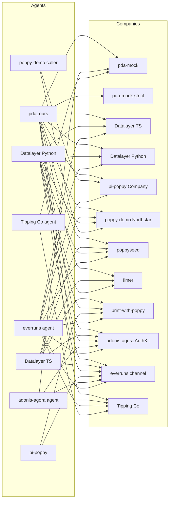

# The Poppy ecosystem

A map of the public ecosystem around [Poppy, the Personal Agent Protocol](https://personalagentprotocol.org/), refreshed on **17 October 2026**. Dates in each row distinguish current source checks from older observations. The grid still uses its 13 October upstream pins and the 9/12 October draft baseline; a source update is not a tested pin update.

The earlier detailed implementation survey is in [implementations.md](implementations.md); code findings are in [poppy-issues.md](poppy-issues.md). [Spec issues](spec-issues.md) and [our readings](readings.md) describe the older draft baseline, with the later revision marked for reconciliation. [Interop testing](interop-testing.md) explains the harness, and [results](interop-results/README.md) distinguish the committed snapshot from fresh runs. This page is the current catalogue.

**Method.** Read-only GitHub repositories, code, issues and pull requests; npm, PyPI and crates.io; web search and community lists. The 17 October refresh read source at fixed commits and checked registry metadata. No third-party code was executed and no live Company endpoint was probed. New hosted listings below are attributed reports, not our live verification. Earlier live checks retain their original dates. Nothing was posted to other projects. This is a search-based map, not an exhaustive census; forks, discovery-only sites and proposals are distinguished from independent protocol implementations.

## The spec

| Item | State on 17 October | Source | Checked |
| --- | --- | --- | --- |
| Draft 0.1, revised in place | Still called 0.1, but the 15–16 October commits change wire requirements: assertion `aud` must be the issuer (not an endpoint); DPoP algorithms must be published and include ES256; discovery binds to the final HTTPS host; Sessions retain their account binding after sign-out. Other changes specify rate-limit and Mediated Sign-In errors, conversation message roles, repeat close/handoff and SSE cursor precedence. A new security section covers untrusted Company content and credentials. Our old readings and grid must be reviewed against this revision before claiming current-draft conformance. | [official source at `95fcbf2`](https://github.com/personal-agent-protocol/personal-agent-protocol/blob/95fcbf22c5991a0090061aed3dbeb68c0ea575e0/content/spec.mdx), [commit history](https://github.com/personal-agent-protocol/personal-agent-protocol/commits/main/) | 17 Oct, source read |
| Authors | Led by Sierra and Meta, with 35 named design partners (Sierra's post). Path to 1.0 lists 43 partners that agreed to be named: three personal agents (Instinct, Meta, OpenAI), 21 Companies and 19 technology providers, and invites more by email. | [sierra.ai/blog/poppy](https://sierra.ai/blog/poppy), [Path to 1.0](https://personalagentprotocol.org/docs/path-to-1#partners) ([our copy](../spec/draft-0.1-2026-10-12/pages/path-to-1.md)) | 12 Oct; Path to 1.0 13 Oct |
| Licence | Apache 2.0 for the specification, documentation and examples; not the names, logo or site design. Feedback is licensed to all members and users. | [licence](https://personalagentprotocol.org/license), [contributions](https://personalagentprotocol.org/license/contributions) | 12 Oct |
| Where it lives | Public specification/site repository created 14 October; issues and pull requests now take feedback. It also generates `llms.txt`, downloadable docs and Company/review skills. This is specification and tooling source, not the promised server/client reference implementation. | [personal-agent-protocol/personal-agent-protocol](https://github.com/personal-agent-protocol/personal-agent-protocol), [issues](https://github.com/personal-agent-protocol/personal-agent-protocol/issues) | 17 Oct, `95fcbf2` |
| Our copy | The latest local snapshot is the 12 October text, retrieved 13 October. It remains the historical baseline for our readings, issue ledger and completed grid; it does not contain the later normative revisions. Current revision linked above. | [spec/draft-0.1-2026-10-12](../spec/draft-0.1-2026-10-12/README.md), [spec/grounding.md](../spec/grounding.md) | Baseline distinction checked 17 Oct |
| Change tracking | `node scripts/spec-snapshot.mjs` compares the live site with the newest snapshot (read-only); `--save` stores a new dated one | [`scripts/spec-snapshot.mjs`](../scripts/spec-snapshot.mjs) | Run 12 Oct, twice, and 13 Oct |

## Reference implementation and conformance tooling

| Item | State | Source | Checked |
| --- | --- | --- | --- |
| Sierra's reference implementation | The official repository now publishes the spec and Company implementation kit, whose validator has an in-memory test Company. It explicitly says it does not implement the protocol APIs. No general reference server/client release found; do not count the kit as that release. | [official README](https://github.com/personal-agent-protocol/personal-agent-protocol/blob/95fcbf22c5991a0090061aed3dbeb68c0ea575e0/README.md), [Sierra's promise](https://sierra.ai/blog/poppy) | 17 Oct |
| Partner launches | None of the launch or design partners we know of serves a `poppy.json`: we checked Sierra and seven partners on 11 October ([implementations.md](implementations.md#not-found)), and PAP Checker's author checked them on 11 October too. | [dev.to article](https://dev.to/benjifisher/what-is-poppyjson-a-personal-agent-protocol-example-and-how-to-validate-yours-3d5m) | 12 Oct (no new fetch) |
| Muse with Redfin and Rocket | A video demo; no code, no endpoints, no spec version | [video](https://x.com/SierraPlatform/status/2108245197440307584), via [poppy.md](https://poppy.md/implementations) | 11 Oct |
| Conformance tooling | The official Company kit now includes JSON Schemas and a zero-dependency TypeScript validator for discovery, Sessions, DPoP, OpenAPI, MCP and conversations. Automated sign-in checks are not yet implemented. It is not a complete cross-implementation matrix or a certification. Datalayer's 124 shared cases and our independently pinned grid remain complementary. | [official validator](https://github.com/personal-agent-protocol/personal-agent-protocol/blob/95fcbf22c5991a0090061aed3dbeb68c0ea575e0/kit/company/validate/README.md) | 17 Oct, source only; not run |

## Personal Agents

"Grid" is whether our harness runs it ([`interop/registry.json`](../interop/registry.json)).

| Project | What | Language, licence | Grid | Source | Checked |
| --- | --- | --- | --- | --- | --- |
| This project (pda) | A hosted Personal Agent per User, on Durable Objects. Beyond Poppy: general tools (reading a public page, rendering it in Browser Run when it needs JavaScript; notes about the User; dates and exact sums) and reminders and scheduled tasks, with Web Push | TypeScript, Apache-2.0 | Yes | [adewale/pda](https://github.com/adewale/pda) | 12 Oct |
| openavt (new) | A Python Personal Agent client, `PAPClient`, and a custom extension that binds a Poppy Session's authority to a voice call; a local reference Company for its demo | Python, Apache-2.0 | No: a candidate for an agent adapter (it covers discovery, Sessions, the three sign-ins, refresh and Operations) | [ketanbj/openavt `docs/pap.md`](https://github.com/ketanbj/openavt/blob/9e99b622515b20d1b8d5405be229c7199d73dd60/docs/pap.md) | 17 Oct: upstream head unchanged |
| Datalayer SDK | Client side of a both-sides SDK; upstream 0.24.0 adds MCP 429 reporting with Retry-After and richer sign-in/reply displays | Python, TypeScript; BSD-3-Clause | Yes, still pinned at `00216eb` (0.17.0). Upstream `b90be95` (0.24.0, 14 Oct); not rerun at that head | [datalayer/personal-agent-protocol](https://github.com/datalayer/personal-agent-protocol/tree/b90be95004e468041bc6d37d82fd8a9fbe74bf06) | 17 Oct, source diff and npm/PyPI |
| pi-poppy | An extension for the pi coding agent | TypeScript, MIT | Yes, at `11ea106` | [richardanaya/pi-poppy](https://github.com/richardanaya/pi-poppy) | 17 Oct: upstream head unchanged |
| adonis-agora agent | `poppy-client`, CLI and connections in an AdonisJS agent library. Upstream scopes connection-resume approval lookup to its run; now requires Node 24/26 | TypeScript, MIT | Yes, still `e139b95` (0.80.1); upstream `5777b4c`. Core `poppy-client` unchanged since pin | [DavideCarvalho/adonis-agora-agent](https://github.com/DavideCarvalho/adonis-agora-agent/tree/5777b4c8b4e5e9dccd9736748a58513fc5e307c8) | 17 Oct, diff read |
| nestjs-agent | `@dudousxd/nestjs-agent-poppy` (0.1.1, on npm since 12 Oct): a NestJS port of the adonis-agora agent. Its client is a verbatim copy of adonis-agora's `poppy-client`, plus connections and a `poppy-agent` CLI | TypeScript, MIT | No | [DavideCarvalho/nestjs-agent](https://github.com/DavideCarvalho/nestjs-agent) | 17 Oct: head `27d43eb` (13 Oct), non-Poppy restart recovery and release updates |
| poppy-demo caller | A demo caller Worker | TypeScript, none declared | Yes, at `02a9b30` | [irvinebroque/poppy-demo](https://github.com/irvinebroque/poppy-demo) | 17 Oct: upstream head unchanged |
| everruns `poppy_client` | A capability of a production agent platform; since [#4577](https://github.com/everruns/everruns/pull/4577) (11 Oct) also for apps built on its framework. Still no sign-in. | Rust, MIT | Yes, pinned at `aceb2e2` (13 Oct; was `f470ad7`, 60 commits earlier, none in its Poppy code) | [everruns/everruns](https://github.com/everruns/everruns) | 17 Oct: upstream `7bb1bc1`, 105 commits after the pin, no Poppy files changed |
| Atlas (introspection-js-sdk) | A scripted demo agent in an open pull request | TypeScript, Apache-2.0 | No | [PR #441](https://github.com/introspection-org/introspection-js-sdk/pull/441) | 17 Oct: PR #441 still open |
| Tipping Co's agent (timothyohare) | A CLI Personal Agent with a callback host, from a learning demo: Direct Sign-In with PKCE, DPoP, an OpenAPI API; no conversations. No `typ` on its assertions; metadata by insertion | TypeScript, none declared | Yes, as `tipping-co` at `fb7b4e6` since 13 Oct ([`interop/impls/tipping-co-agent`](../interop/impls/tipping-co-agent)) | [timothyohare/personal-agent-protocol](https://github.com/timothyohare/personal-agent-protocol) | 17 Oct: upstream head unchanged |
| Cloud Wallet pilot (Ekubo) | Only a public identity: client metadata, a JWKS and a sign-in callback page on GitHub Pages; the client itself isn't public | n/a | No | [EkuboProtocol/cloud-wallet-poppy-pilot-agent](https://github.com/EkuboProtocol/cloud-wallet-poppy-pilot-agent) | 12 Oct (new) |
| print-with-poppy's `scripts/agent.ts` | A reference client for that store, demo identity only | TypeScript, MIT (since 12 Oct) | No | [spenciefy/print-with-poppy](https://github.com/spenciefy/print-with-poppy) | 12 Oct |
| poppy-agent-demo (new) | Pi extension and web chat from Poppyseed's author: discovery, MCP tools, Device Sign-In, conversations, operation approvals and sign-out. Uses `poppyseed/agent`; distinct from richardanaya's pi-poppy despite its extension package name | TypeScript, MIT | No; adapter candidate, not run | [akshay5995/poppy-agent-demo at `a5c0bdc`](https://github.com/akshay5995/poppy-agent-demo/tree/a5c0bdc34f423ee924216f4268eb28d704dfa731) | 17 Oct, code and README |
| Cedar Line / Pip demo (new) | Local Python agent and Company: real HTTP discovery, signed-out Sessions, Direct Sign-In/PKCE, scoped order exchange, conversations, renewal and revocation. Teaching demo over localhost HTTP, no nonce requirement; not the pre-draft sample | Python, Apache-2.0 | No; model-free adapter candidate, not run | [cobusgreyling/personal-agent-protocol-demo at `a5d62bd`](https://github.com/cobusgreyling/personal-agent-protocol-demo/tree/a5d62bd7fd1f6bb7cd3aad0d2d16db7d6e70c40b) | 17 Oct, code and README |
| poppy-gateway client (new) | Personal Agent client inside the new Company gateway: all three sign-ins, account renewal, browser assertions and conversations | TypeScript, Apache-2.0 | No; not run | [sirwilliamiv/poppy-gateway at `cec43e3`](https://github.com/sirwilliamiv/poppy-gateway/tree/cec43e3fa3e27209c39a60e650e4b3c01a1e3b50) | 17 Oct, source |
| ap-federation (new) | Personal-agent client/service plus a Company door bound to its own mandate/authority model. Discovery, JWT/DPoP Sessions and Direct/Device Sign-In; Mediated refused by default. Custom authority extensions must be assessed separately | TypeScript; licence not established in this survey | No; not run | [agentictrustlabs/ap-federation at `f59fdf4`](https://github.com/agentictrustlabs/ap-federation/tree/f59fdf4b76cefe04f351154811f74476725acac7/packages/personal-agent-client) | 17 Oct, README and discovery source |
| Windom Test Agent identity (new) | Public client metadata, JWKS and callback only. No public client runtime established | Static documents; no licence declared | No | [scottbissinger-spec/windom-test-agent at `af578af`](https://github.com/scottbissinger-spec/windom-test-agent/tree/af578af0aa561eb887755aa357c61ccc0193b136) | 17 Oct |

## Companies and Company SDKs

| Project | What | Language, licence | Grid | Source | Checked |
| --- | --- | --- | --- | --- | --- |
| poppyseed | A Company library for Next.js, with a demo Company; 0.1.1 fixes Node 20+ safeFetch DNS lookup and adds real-socket and NAT64 tests | TypeScript, MIT | Yes, still at `f479fb6`; upstream `69f9233`, npm 0.1.1. New pin requires rebuild and smoke tests | [akshay5995/poppyseed](https://github.com/akshay5995/poppyseed/tree/69f9233242f46db943b79008a668d7e79aa8b733) | 17 Oct, source diff and npm |
| Datalayer "Manzanita" | Reference Company on the SDK side; since our pin: orderly Company shutdown cancels open work and ends sign-ins, domain aliases, per-agent/account rate-limit admission and human staff replies | Python, TypeScript; BSD-3-Clause | Yes, still pinned at `00216eb` (0.17.0); upstream `b90be95` (0.24.0) | [Datalayer changelog](https://github.com/datalayer/personal-agent-protocol/blob/b90be95004e468041bc6d37d82fd8a9fbe74bf06/CHANGELOG.md) | 17 Oct, diff read; not run |
| adonis-agora AuthKit | Company OAuth server and conversations; upstream changes OIDC client discovery/token sharing, configuration and Node support, with no changes to its Poppy server code | TypeScript, MIT | Yes, still `fe2a3ff` (0.80.0); upstream `8018b8b` | [DavideCarvalho/adonis-agora-authkit](https://github.com/DavideCarvalho/adonis-agora-authkit/tree/8018b8b3f3df20b4fa4fad476b0777d9e895b619) | 17 Oct, diff read |
| nestjs-agent Company | The same package's conversation endpoint (section 7, with SSE, handoff and Direct Conversations). No `poppy.json` and no authorization server: it checks tokens through a resolver that adonis-agora AuthKit provides | TypeScript, MIT | No | [DavideCarvalho/nestjs-agent](https://github.com/DavideCarvalho/nestjs-agent) | 12 Oct |
| pi-poppy test Company | A test peer in the pi-poppy repository | TypeScript, MIT | Yes, at `11ea106` | [richardanaya/pi-poppy](https://github.com/richardanaya/pi-poppy) | 17 Oct: upstream head unchanged |
| poppy-demo Northstar | A demo retailer Worker that accepts only its own agent | TypeScript, none declared | Yes, patched, at `02a9b30` | [irvinebroque/poppy-demo](https://github.com/irvinebroque/poppy-demo) | 17 Oct: upstream head unchanged |
| Ilmer.org | A local-history archive assistant, signed-out only. Latest changes are dependencies and a CI build fix | TypeScript, MIT | Yes, still `de0d1ec`; upstream `eda7179` (15 Oct), not rerun | [rbirkby/Ilmer.org](https://github.com/rbirkby/Ilmer.org/tree/eda7179f0ac90794c6efb5dc1a1fa570f85e5737) | 17 Oct, diff read |
| everruns `poppy` channel | Hosts a Company's Poppy endpoints, signed-out only | Rust, MIT | Yes, pinned at `aceb2e2` (13 Oct; was `f470ad7`, 60 commits earlier, none in its Poppy code) | [everruns/everruns](https://github.com/everruns/everruns) | 17 Oct: upstream `7bb1bc1`, 105 commits after the pin, no Poppy files changed |
| Spot | A cart-approval and payment service | JavaScript, none declared | No | [futurebasicsrepo/…-client-hub-api](https://github.com/futurebasicsrepo/futurebasicsrepo-client-hub-api) | 13 Oct (last commit 12 Oct) |
| print-with-poppy | Agent-first photo-printing store: OpenAPI and Operations, Direct/Mediated Sign-In, accounts and a separate Agent Sandbox. Since our pin: product/preview workflows, sample artwork, corrected read scopes and revocation error handling | TypeScript (Express, SQLite), MIT | Yes, still `246727d` (13 Oct), unpatched; upstream `6dca0ad` (15 Oct). Proposal schema still leaves `operation` optional; assertion audience policy still needs the revised draft | [spenciefy/print-with-poppy](https://github.com/spenciefy/print-with-poppy/tree/6dca0ad4f89b80015d0de26df887cb535ffe0594) | 17 Oct, source diff; no live flow |
| Tipping Co (timothyohare) | A learning-demo Company for an NRL tipping service: signed-out and Direct Sign-In Sessions, DPoP, refresh and revocation, OpenAPI; in-memory stores. Requires the token endpoint as `aud`, at revocation too | TypeScript (Hono), none declared | Yes, as `tipping-co` at `fb7b4e6` since 13 Oct ([`interop/impls/tipping-co-company`](../interop/impls/tipping-co-company)) | [timothyohare/personal-agent-protocol](https://github.com/timothyohare/personal-agent-protocol) | 17 Oct: upstream head unchanged |
| Flight Sector (introspection-js-sdk) | The demo Company in PR #441 | TypeScript, Apache-2.0 | No | [PR #441](https://github.com/introspection-org/introspection-js-sdk/pull/441) | 17 Oct: PR #441 still open |
| TYPO3 lab | A signed-out "knowledge profile" in a private extension | PHP, private | README only | [dirnbauer/webconsulting-typo3-lab](https://github.com/dirnbauer/webconsulting-typo3-lab) | 12 Oct |
| Fillthemat (planned) | A growth platform for martial-arts schools planning to make each School a Company: one issuer per School with a path (`https://auth.fillthemat.com/schools/<id>`), metadata by RFC 8414 insertion, signed-out Sessions first. Draft PR; nothing served from merged code | TypeScript, MIT | No | [fillthemat/fillthemat PR #200](https://github.com/fillthemat/fillthemat/pull/200) | 17 Oct: PR #200 still open, latest head `73cc3e4` |
| poppy-gateway (new) | Framework-independent Company library with OAuth/DPoP, all three sign-ins, MCP Bearer, browser sessions and conversations; includes a client and hosted negotiating agent. Operations planned. README says `npm install poppy-gateway`, but registry returns 404 | TypeScript, Apache-2.0 | No; source-only candidate | [sirwilliamiv/poppy-gateway at `cec43e3`](https://github.com/sirwilliamiv/poppy-gateway/tree/cec43e3fa3e27209c39a60e650e4b3c01a1e3b50) | 17 Oct, source and registry |
| Cedar Line (new) | Fictional shop in the Python Pip demo above; both sides run in one local process | Python, Apache-2.0 | No | [source](https://github.com/cobusgreyling/personal-agent-protocol-demo/blob/a5d62bd7fd1f6bb7cd3aad0d2d16db7d6e70c40b/pop/company.py) | 17 Oct, source |
| Stacktree (new to this map) | Maintainer reports production since 11 Oct: signed-out publishing, Direct Sign-In, scoped REST and MCP. No conversations, browser Sessions, Device/Mediated or Operations. Reports nonstandard `poppy_` metadata keys to avoid affecting existing MCP clients; this is a disclosed conformance gap | Hosted, implementation source not established | No | [maintainer's implementation report](https://github.com/personal-agent-protocol/personal-agent-protocol/issues/12) | 17 Oct, report only |

## Both-sides SDKs

Datalayer (Python and TypeScript, published as `personal-agent-protocol` on PyPI and `@datalayer/personal-agent-protocol` on npm, 0.24.0 on 14 October; grid still at 0.17.0), adonis-agora (agent and AuthKit), nestjs-agent (a port of adonis-agora's code), everruns, and the three demos (poppy-demo, introspection's travel demo, timothyohare's Tipping Co) each cover both sides. The new poppy-gateway is also a standalone library with a client, though its advertised npm package is not published. Cedar Line is a both-sides teaching demo; ap-federation embeds both roles in its authority system.

## Checkers, validators and linters

| Tool | What it checks | Open? | Source | Checked |
| --- | --- | --- | --- | --- |
| Our validator | `poppy.json`, the issuer's metadata, client metadata and JWKS; 76 messages, each with an explanation, a fix and a reference | Yes (in this repo); live at [/validator](https://poppydemoagent.dev/validator) | [`src/validator/`](../src/validator) | 12 Oct |
| poppy-validator | A linter for discovery and issuer metadata: 64 rules with their basis, JSON Schema, JSON/strict output | Yes: Python, MIT; no PyPI release found | [tusharck/poppy-validator](https://github.com/tusharck/poppy-validator) at `ef7544f`; only README changed since our `d2220bf` pin | 17 Oct |
| poppy-sidecar | A `poppy.json` generator, a 25-check validator, and a "testbed" that checks an agent's self-reported action trace against granted scopes | Yes: Python, MIT; its README's PyPI badge points at a package that doesn't exist | [habib-analyst/poppy-sidecar](https://github.com/habib-analyst/poppy-sidecar) at `858db66` (still its head on 13 Oct) | 17 Oct: head unchanged |
| PAP Checker | Read-only external discovery checker and domain directory. Directory currently displays 65 checked domains and 11 entries, including one with no protocol version; cached counts differ across sources | No (closed); counts are not a conformance census | [papchecker.com/sites](https://papchecker.com/sites) | 17 Oct, directory read; listed hosts not probed |
| Ora's poppy.ax and `ax` CLI | A guide and a domain checker; `ax generate-files` (0.9.0, 12 Oct; 0.9.1 the same day) writes a starter `poppy.json` (`organization` and `web: {}` only) that Ora's API decides | Front end and CLI open (MIT); checks in Ora's closed API | [ora/poppy-ax](https://github.com/ora/poppy-ax), [ora/ax](https://github.com/ora/ax) | 12 Oct |
| Flow's checker | Readiness levels 0–3, plus a compliance checklist | No | [flow.engineer/poppy](https://flow.engineer/poppy) | 11 Oct |
| poppyseed's check command; Datalayer's `pap company verify` | Each project's conformance runner for a Company | Yes | the projects above | 11 Oct |
| Datalayer's conformance cases | 124 language-neutral JSON cases, unchanged from 0.6.0 to 0.17.0; we run them against our client and validator (13 Oct, at 0.17.0: 24 pass, 2 fail on readings, 98 n/a) | Yes, BSD-3-Clause | [interop/vectors/datalayer](../interop/vectors/datalayer) | 13 Oct |
| Official Company kit (new) | JSON Schemas, requirement checklist and active Company validator: discovery, Sessions, DPoP, APIs and conversations; automated sign-in remains unimplemented. Its resource probes use conversations when available, otherwise an explicit GET API probe | Yes, Apache-2.0; Node TypeScript, zero dependencies. Active mode creates Sessions and messages; not used in this survey | [official kit at `95fcbf2`](https://github.com/personal-agent-protocol/personal-agent-protocol/tree/95fcbf22c5991a0090061aed3dbeb68c0ea575e0/kit/company) | 17 Oct, source |
| GeoSuite Poppy Check (new) | Discovery checker/generator, CLI and web UI; issuer metadata checks. Does not check every redirect hop or all sign-in fields | Yes, MIT, zero-dependency JavaScript. README advertises `@geosuite/poppy-json`; registry returns 404 | [TryGeoSuite/poppy-json at `2af8f3a`](https://github.com/TryGeoSuite/poppy-json/tree/2af8f3af1401cd86070469bf247b134b56e1a51e) | 17 Oct, source and registry |
| aigentify (new) | Document-only Poppy audit and discovery generator, merged in #63. Does not test OAuth metadata or signed flows | Yes, TypeScript, MIT | [pooriaarab/aigentify #63](https://github.com/pooriaarab/aigentify/pull/63), [checker source](https://github.com/pooriaarab/aigentify/blob/main/src/audit/poppy.ts) | 17 Oct |
| Lumar Agentic Readiness (new) | Commercial discovery/issuer scanner and generator. Reports 27 documents from 10 publishers on 14 Oct; those are the vendor's counts, not independently verified flows | Closed scanner; public methodology | [capability page](https://agentic-readiness.lumar.io/docs/capabilities/pap) | 17 Oct, documentation |

A committed script, [`interop/vectors/validators/`](../interop/vectors/validators/README.md), runs the two open validators and ours over the same 107 `poppy.json` documents (rerun on 13 October at both pins, with the same counts as on 12 October); the results are in [interop-testing.md](interop-testing.md#validator-cross-check).

## Companies you can reach

The original live sample consisted of small businesses, demos and sandboxes, plus the payment company Tilopay. Newly reported hosts below have not been probed in this refresh. On the evening of 12 October we ran our validator CLI once against each host below except the TYPO3 lab: every one is valid, with no errors or warnings ([verdicts and info notes](implementations.md#live-companies-checked-on-12-october)). None of the three new ones offers sign-in.

| Host | What it is | Sign-in | How we know | Checked |
| --- | --- | --- | --- | --- |
| [spotmeplease.com](https://spotmeplease.com/.well-known/poppy.json) | Spot, a small cart-approval product | Guest Sessions and Direct Sign-In | Its repository; fetched 11 Oct ([implementations.md](implementations.md)) | 12 Oct: valid, no messages |
| [withpoppyseed.dev](https://withpoppyseed.dev) | "Poppy Travel", poppyseed's demo | Direct, device and mediated (PAP Checker's directory) | Its repository | 12 Oct: valid, no messages |
| [poppy-receiver.roundtrip.workers.dev](https://poppy-receiver.roundtrip.workers.dev/.well-known/poppy.json) | Northstar Outfitters, poppy-demo's retailer | Direct Sign-In, its own caller only | Its repository | 12 Oct: valid, 1 info |
| [poppy.ilmer.org](https://poppy.ilmer.org/.well-known/poppy.json), and ilmer.org through www.ilmer.org | Ilmer's local-history archive; since 12 Oct the main site's `poppy.json` names the same issuer | Signed-out only | Its repository | 12 Oct: valid, info only |
| TYPO3 lab `/poppy/demo` | A protocol playground | Behind a login | Its repository | 11 Oct (not fetched) |
| flowers.papsandbox.com | "Northlight Flowers"; the name suggests a sandbox | Direct Sign-In (PAP Checker's directory) | [PAP Checker's directory](https://papchecker.com/sites), first seen 11 Oct | 12 Oct: valid, no messages |
| tilopay.shop, tilopay.tilopay.shop | Tilopay, a payment company: an MCP server for searching and buying from its merchants' stores, payment only on its own 3-D Secure page (extension `tilopay.com/hosted-checkout`). The issuer, `mcp.tilopay.com`, is shared by 14 domains, most of them stores ([N11](spec-issues.md#n11)) | Signed-out only | PAP Checker's directory, first seen 12 Oct | 12 Oct: valid, 1 info each (PAP Checker: 1 problem each) |
| [salespeak.ai](https://salespeak.ai/agent-endpoint/) (new) | Salespeak, a vendor of AI sales agents for business websites. Its `poppy.json` redirects to a host under `agents.salespeak.ai` with an issuer of its own; customers can ask for the same on their domains | Signed-out conversations only | A Salespeak employee's [pull request](https://github.com/ora/standards/pull/6) to Ora's standards page | 12 Oct: valid, 1 info |
| emorahealth.com (new) | Emora Health, a virtual mental-health service for children, teens and young adults. Its issuer has a path, `https://www.emorahealth.com/poppy`, with metadata only at the RFC 8414 inserted location ([S3](spec-issues.md#s3)) | Signed-out conversations only | PAP Checker's directory, first seen 12 Oct | 12 Oct: valid, 1 info |
| [printwithpoppy.com](https://printwithpoppy.com) | Print with Poppy, the store above, live: real payments (Stripe Checkout) and prints (Prodigi) whenever `/api/catalog` says `mode: live`. Its hosted example was print-with-poppy.vercel.app, in demo mode | Guest Sessions for agents on an allowlist (ours is on it); accounts since 12 Oct. A non-Poppy "compatibility" path, documented apart from the Poppy description since 12 Oct | The owner's deployed agent, 12 Oct: discovery, a Session, the catalogue, and an upload's approval card ([poppy-issues.md](poppy-issues.md#print-with-poppy-spenciefyprint-with-poppy)) | 12 Oct |
| [www.alpine-retail.com](https://www.alpine-retail.com/.well-known/poppy.json) (new) | Alpine Retail, a retail demo by a colleague of this project's owner: the first live Company we know of with a Company Agent (conversations). Its OpenAPI API is three DPoP-protected reads (inventory, rewards points, who the session belongs to); no Operations, no website section. Source not public. The apex redirects to `www.` | Direct (`poppy:read`, `poppy:write`, a custom `addresses` scope) and Mediated (a phone number, `poppy:read`) | Its developer, 13 Oct | 13 Oct: valid, no messages. In the live lane with its developer's approval: D, S0, N and C pass since 14 October, with the live lane's public identity (on 13 October S0, N and C stopped at its `invalid_client`, since the lane's agent had no public `client_id`; [interop-testing.md](interop-testing.md#the-live-lane-first-run-13-october)). Through the deployed agent, 13 and 14 Oct: conversations, API reads, Direct Sign-In, a refresh and sign-out all work; its revocation takes only the token endpoint as `aud` ([S1](spec-issues.md#s1)) |
| PlanMyVisit / Autoura (new) | Visit planner; Direct Sign-In via Autoura, MCP and custom visit-plan/location scopes | Direct, reported | [operator's standards statement](https://www.planmyvisit.to/trust), [directory evidence dated 14 Oct](https://poppy.md/implementations) | 17 Oct, sources only |
| Windom Sports (new) | Fantasy sports site, Direct Sign-In and MCP league tools | Direct, reported | [public test identity](https://github.com/scottbissinger-spec/windom-test-agent), [directory evidence dated 14 Oct](https://poppy.md/implementations) | 17 Oct, sources only |
| Stacktree (new) | Page publishing via REST and MCP; see its implementation report above | Direct, reported | [operator report](https://github.com/personal-agent-protocol/personal-agent-protocol/issues/12) | 17 Oct; no endpoint probe |
| Origin Platform Labs (new) | Negotiating Company agent using poppy-gateway; hosted service source is public | Signed-out, reported | [gateway README](https://github.com/sirwilliamiv/poppy-gateway/blob/cec43e3fa3e27209c39a60e650e4b3c01a1e3b50/README.md#talk-to-our-agent) | 17 Oct; no conversation sent |
| Rent Our Bins, Ax Air, Dub and OpenStatus benchmark hosts (new listings) | Third-party directory entries; benchmark deployments are not evidence that Dub/OpenStatus adopted Poppy in production | As listed, unverified | [PAP Checker directory](https://papchecker.com/sites) | 17 Oct; no endpoint probe |

Ora's poppy.ax had seen only poppy-receiver.roundtrip.workers.dev on 10 October (its `fixtures/sites.json`). On the evening of 12 October PAP Checker said it had checked 18 domains, and its directory listed 6. printwithpoppy.com, print-with-poppy's own domain, was valid with 3 info notes that evening.

## Adjacent and declined

| Item | Kind | Source | Checked |
| --- | --- | --- | --- |
| OpenAgents | Proposal to support both sides, closed as not planned (11 Oct) | [OpenAgentsInc/openagents#11239](https://github.com/OpenAgentsInc/openagents/issues/11239) | 11 Oct |
| orka | Tracking issue: "We should not build anything yet" | [orka-agents/orka#774](https://github.com/orka-agents/orka/issues/774) | 11 Oct |
| tiny-poppy-gate | A teaching toy "inspired by" the draft: an in-memory scope gate with its own document shape. No network, no OAuth; "not an implementation of the protocol". | [bobbyhalljr/tiny-poppy-gate](https://github.com/bobbyhalljr/tiny-poppy-gate) | 12 Oct |
| OpenLine POPPY-PROOF-001 | An extension prototype: the Company verifies the owner's authorisation for an operation itself (Envoy ext_authz), "do not merge" | [terryncew/openline-receipt-gate#105](https://github.com/terryncew/openline-receipt-gate/pull/105) | 12 Oct |
| mission-bound-authorization | Evaluates the draft and sketches a standing-permissions extension | [mcguinness/mission-bound-authorization#1189](https://github.com/mcguinness/mission-bound-authorization/pull/1189) | 11 Oct |
| poppy-operations-findings | A literal sandbox of the Operations extension with five findings | [SmokeSol/poppy-operations-findings](https://github.com/SmokeSol/poppy-operations-findings) | 12 Oct (no commits since 9 Oct) |
| IETF vCon | A charter pull request on linking a conversation to the order and payment an agent made | [draft-ietf-vcon-vcon-core#41](https://github.com/ietf-wg-vcon/draft-ietf-vcon-vcon-core/pull/41) | 12 Oct |
| Service Handshake extension | A proposed extension, `dualcx.com/service-handshake`: declarations of what an agent may agree to, and a Company's allow, deny, hold or escalate decision bound to Operations. Schema and examples only | [neos-wave/service-handshake-pap-extension](https://github.com/neos-wave/service-handshake-pap-extension) | 12 Oct (new) |
| EMILIA Gate | An Operations v1 reference with optional signed approval evidence, offline with synthetic tokens (open PR) | [emiliaprotocol/emilia-protocol#916](https://github.com/emiliaprotocol/emilia-protocol/pull/916) | 12 Oct (new) |
| slicc-cdp | Discovery probe now merged (#153): browser automation detects and summarizes Poppy documents. Discovery support, not a signed Poppy client | [ai-ecoverse/slicc-cdp#153](https://github.com/ai-ecoverse/slicc-cdp/pull/153) | 17 Oct |
| personal-budget | An app's open question whether Poppy applies to its MCP plans | [rmartz/personal-budget#540](https://github.com/rmartz/personal-budget/issues/540) | 12 Oct (new) |
| PACT | A separate protocol (Decagon and Instinct), on A2A and OAuth | [openpactprotocol](https://github.com/openpactprotocol/openpactprotocol) | 11 Oct |
| Pre-draft models | Cobus Greyling's sample, agent-ledger, trust_gateway: `/.well-known/personal-agent.json`, not Draft 0.1 | [implementations.md](implementations.md#related-but-not-implementations) | 11 Oct |
| Lists and trackers | [awesome-poppy](https://github.com/JaviChulvi/awesome-poppy) (added PAP Checker on 11 Oct and poppy-validator on 12 Oct), [poppy.md](https://poppy.md/implementations) (checked against its sources on 12 Oct; it now also lists poppyseed, PAP Checker and awesome-poppy, none of them new to us), [awesome-muse](https://github.com/cszach/awesome-muse) | as linked | 12 Oct, evening |
| Auto Agent Protocol 2.0 (new) | Automotive A2A/Poppy guest-API profile, schemas, OpenAPI and acceptance criteria; preparation PR merged, docs still mark 2.0 unreleased. Baseline predates the 16 Oct wire revisions. Not evidence of a live dealer implementation | [PR #40](https://github.com/auto-agent-protocol/auto-agent-protocol/pull/40), [profile](https://autoagentprotocol.org/docs/latest/personal-agent-protocol) | 17 Oct |
| HTTP Archive adoption metric (new) | Open PR to collect compact `poppy.json` metadata in web crawls; not yet a published adoption dataset | [HTTPArchive/custom-metrics #210](https://github.com/HTTPArchive/custom-metrics/pull/210) | 17 Oct |
| Discovery-only publishers (new) | Merged `web: {}` discovery in Samet Celikbicak's site, GetVibe, llms-txt-hub and bot-directory. No OAuth Sessions claimed. t3code's equivalent PR is still open | [Samet #90](https://github.com/sametcelikbicak/web-site/pull/90), [GetVibe #28](https://github.com/pooriaarab/getvibe/pull/28), [llms-txt-hub #1](https://github.com/pooriaarab/llms-txt-hub/pull/1), [bot-directory #1](https://github.com/pooriaarab/bot-directory/pull/1), [t3code #1](https://github.com/pooriaarab/t3code/pull/1) | 17 Oct, merged source; deployment not verified |
| Archon, cheqd, ANEX and ai-maestro (new leads) | Respectively an open support proposal, research note, separate person-to-person protocol and design mapping. None establishes a shipped Poppy implementation | [Archon #1395](https://github.com/archetech/archon/issues/1395), [cheqd research](https://github.com/cheqd/agent-toolkit/blob/main/docs/research/pap-2026-10.md), [ANEX](https://github.com/ammonhaggerty/ANEX), [ai-maestro mapping](https://github.com/23blocks-OS/ai-maestro/blob/main/docs/AID-POPPY-MAPPING.md) | 17 Oct |
| Specification forks | OneSignal, tan2line and sthamann fork the official spec; forks are not additional agents or Companies | [official repository network](https://github.com/personal-agent-protocol/personal-agent-protocol/forks) | 17 Oct |

False positives in searches are listed in [implementations.md](implementations.md#related-but-not-implementations).

## How they work together

[Two complete isolated runs on 17 October](https://github.com/adewale/pda/actions/runs/38988240129), each with fresh containers, keys and protocol state, exercised **8 agents × 12 Companies × 30 scenarios = 2,880 cells per run**. Each independently produced **1,000 pass, 273 known fail, 1,607 unsupported, zero setup errors, unexpected failures, stale exceptions or flakes**. The upstream pins remain those selected on 13 October. These are results against the earlier draft baseline, not validation of today's upstream heads or revised spec. “Known” means an exception signature matched; it does not establish that every failure is an upstream bug.

The 17 directly identified harness/reporting cells have two causes: PDA × Print-with-Poppy OU does not handle a locally held proposal request, and 16 R cells complete renewal but become unsupported solely because optional Account Token rotation did not occur. Separate renewal evidence from rotation evidence, and allow the proposal's local approval path while preserving approval before execution. N and RL also require an OpenAPI call unnecessarily: conversation variants should exercise native nonce/retry paths. After those changes, audit each omitted declaration against native code and available adapter controls; missing grid support does not prove a missing implementation feature.

### Scorecard

Each implementation's cells, as pass / fail / unsupported, summed over the grid's row (as a Personal Agent) or column (as a Company). The percentage is passes among cells classified pass/fail. Unsupported can mean an optional feature, a missing adapter hook, a scenario assumption or no observed rotation; it does not always mean the product lacks the feature. This scorecard describes the 17 October runs at the old pins and draft baseline. A failure counts against both ends of its cell, so read the last column before blaming a side: the [attribution rules](interop-spec.md) decide whose it is, and [the results](interop-results/README.md) list every failure by rule.

**As a Personal Agent** (against all twelve Companies):

| Agent | Pass / fail / unsupported | Passes where run | What its failures are |
| --- | --- | --- | --- |
| pda (ours) | 213 / 1 / 146 | 99.5% of 214 | OU at Print-with-Poppy: its proposal schema leaves `operation` optional, so our agent holds the write for approval; the scenario only handles a held upload. SO at Tipping Co passes in these runs. |
| Datalayer Python | 201 / 8 / 151 | 96% of 209 | Device Sign-In polling ignores `use_dpop_nonce` (SVN); it requires `conversation_id` in handoff and close answers, which our mocks don't send (7.9, 7.12); SO at Tipping Co (S1). |
| Datalayer TS | 197 / 12 / 151 | 94% of 209 | The same SVN failure; its event stream gives up after five quick reconnects (CS); the handoff and close answers; SO at Tipping Co (S1). |
| adonis-agora | 141 / 47 / 172 | 75% of 188 | Its assertions carry no `typ`, which three Companies refuse ([S2](spec-issues.md#s2), the spec's); its device and revocation `aud` ([S1](spec-issues.md#s1)); renewal without `session_id` at Datalayer. |
| everruns | 33 / 11 / 316 | 75% of 44 | Its Session assertion has no `typ` (S2); it fetches metadata only at the appended location, so DP fails at both our mocks ([S3](spec-issues.md#s3)). Signed-out only, conversations and no APIs. |
| pi-poppy | 147 / 55 / 158 | 73% of 202 | No `typ` (S2); it resends the Session assertion on a nonce retry, and at the token endpoint retries only when `WWW-Authenticate` names the nonce error; it throws when a Company ends the Session ([N39](spec-issues.md#n39)). |
| poppy-demo caller | 39 / 69 / 252 | 36% of 108 | It requires the issuer to be the Company's origin, though the draft's examples put it elsewhere, needs an `agent` member and an `authorization_endpoint`, and always asks for its hard-coded scopes. |
| Tipping Co's agent | 29 / 70 / 261 | 29% of 99 | It sends no `client_id` at the token endpoint (RFC 7521 4.2 allows that), which every third-party Company refuses; it requires `authorization_endpoint`, so it can't discover a signed-out Company. It passes everything it claims at its own Company and at pda-mock. |

**As a Company** (against all eight agents):

| Company | Pass / fail / unsupported | Passes where run | What its failures are |
| --- | --- | --- | --- |
| poppyseed | 126 / 12 / 102 | 91% of 138 | Mostly the agents': adonis-agora's `aud` (S1), poppy-demo's parse of an empty revocation answer, Tipping Co's agent's missing `client_id`. |
| pi-poppy Company | 123 / 13 / 104 | 90% of 136 | The agents': Datalayer's SVN polling, pi-poppy's own nonce retry, adonis-agora's `aud`, Tipping Co's agent's missing `client_id`. |
| Datalayer TS / Python | 112 / 17 / 111 each | 87% of 129 | Its renewal requires `session_id`; its cancel sends `result.data: null` ([N41](spec-issues.md#n41)); poppy-demo's hard-coded scopes; Tipping Co's agent's missing `client_id`. |
| pda-mock (lenient reference) | 143 / 23 / 74 | 86% of 166 | The agents': nonce retries, Datalayer's SVN polling, CS stream and handoff and close answers, poppy-demo's issuer rule, everruns' S3 reading (DP). |
| everruns channel | 24 / 5 / 211 | 83% of 29 | poppy-demo's issuer-origin rule (D, S0, C) and Tipping Co's agent's need for `authorization_endpoint`. |
| adonis-agora AuthKit | 112 / 24 / 104 | 82% of 136 | The agents': poppy-demo's issuer-origin rule, pi-poppy's nonce retry, Tipping Co's agent's missing `client_id`. |
| Tipping Co | 51 / 12 / 177 | 81% of 63 | Other agents' assertion/discovery compatibility. PDA SO passes; the old token-endpoint audience policy now also needs migration to the revised issuer rule. |
| print-with-poppy | 46 / 17 / 177 | 73% of 63 | Old-pin failures include poppy-demo discovery, adonis-agora revocation, Tipping Co assertion compatibility and PDA OU. Revocation error handling is fixed upstream; the proposal schema remains optional. |
| poppy-demo Northstar | 50 / 32 / 158 | 61% of 82 | It refuses assertions without `typ` (S2 `jwt-60s`); poppy-demo's own agent passes there. |
| Ilmer | 18 / 18 / 204 | 50% of 36 | It refuses assertions without `typ` (S2); poppy-demo's crash; Tipping Co's agent's need for `authorization_endpoint`. Signed-out only. |
| pda-mock-strict | 83 / 83 / 74 | 50% of 166 | It refuses assertions without `typ`, our strict reading of S2, so pi-poppy, adonis-agora, everruns and Tipping Co's agent fail almost every cell. |

The newly found implementations above are not in the grid. Older candidates also remain outside it: nestjs-agent (its Company needs adonis-agora's AuthKit, which the grid already runs), Spot, the private TYPO3 lab, Atlas and Flight Sector (an open pull request), and the hosted Companies with no public implementation source established. [Interop testing](interop-testing.md#candidates-from-the-12-october-survey) records the older candidates' adapter work.

The diagram is computed from the 17 October results. An edge means no cell between that pair failed; a missing edge means at least one did. Unsupported cells count for nothing either way, so an edge between two small implementations can rest on a few cells: each signed-out Company's edges rest on one to four, and every edge to everruns' channel or from everruns' agent on at most four.

At print-with-poppy and Tipping Co, everruns' agent runs only D (it starts a Session only for a conversation). pda's one missing edge is Print-with-Poppy, over the OU scenario's held-proposal path; Tipping Co's agent reaches pda-mock only since our mock stopped requiring `client_id` on 13 October.

pi-poppy's only clean pairs are print-with-poppy and everruns' channel. At every other Company one of four habits fails a cell: it resends the Session assertion on a nonce retry, retries a token request only when `WWW-Authenticate` names the nonce error, gives up when a Session ends, and sends no `typ`.

What the grid found in each project is in [poppy-issues.md](poppy-issues.md); the failures by rule are in [interop-results/](interop-results/README.md).

## Open fault lines

The analysis below describes the 9/12 October text. The 16 October revision resolves several of these questions, including issuer audiences (S1), final-host discovery binding and account binding after sign-out. It must be reconciled with our existing code, readings and exceptions; old failure counts are not current-spec defect counts.

Where the draft is ambiguous, implementations already disagree. The questions are in [spec-issues.md](spec-issues.md); our readings and why are in [readings.md](readings.md). How each implementation reads the four that most often break a pair (from each adapter's declared readings, or from its code where it has no adapter; for a Company, "omits" means it expects no `scope` there):

| Implementation | S1 client assertion `aud` | S2 assertion `typ` and lifetime | S3 metadata for an issuer with a path | S4 `scope` on a signed-out Session |
| --- | --- | --- | --- | --- |
| pda (agent) | endpoint called | `typ: JWT`, `kid`, 60 s | insertion | omits |
| pda-mock / pda-mock-strict | endpoint, token endpoint or issuer | any, 300 s / `typ: JWT`, `kid`, 60 s | insertion | ignores |
| Datalayer agents | endpoint called | `typ: JWT`, 60 s | insertion | omits |
| Datalayer Companies | endpoint called, token endpoint or issuer (0.10.0) | `typ` absent or `JWT`, 120 s, `jti` of 16+ characters (0.10.0) | insertion | omits or ignores |
| pi-poppy agent / Company | endpoint called / endpoint called | no `typ` on Session assertions / any, 120 s | append / either | omits / ignores |
| poppy-demo caller / Northstar | endpoint called / endpoint called | `typ: JWT`, 60 s / required | append / n/a | omits / `invalid_scope` |
| adonis-agora agent / AuthKit | token endpoint / either | no `typ`, 60 s / any | insertion / either (serves both) | omits / omits |
| poppyseed | endpoint called | any | either | ignores |
| Ilmer | token endpoint | `typ: JWT`, `kid`, 60 s | either | omits |
| everruns agent / Company | token endpoint / token endpoint or issuer | Session assertion without `typ` / any, 300 s | append / either | omits / `invalid_scope` |
| print-with-poppy | endpoint called (token and revocation) | any `typ` except the browser one, 120 s | n/a (issuer is the origin) | `invalid_scope` (since `260dbb4`; it ignored it before) |
| Fillthemat (planned) | this School's token endpoint, exactly | not stated | insertion (path issuers) | 17 Oct: PR #200 still open, latest head `73cc3e4` |
| nestjs-agent | token endpoint (as adonis-agora) | no `typ`, `kid`, 60 s | insertion | 17 Oct: head `27d43eb` (13 Oct), non-Poppy restart recovery and release updates |
| timothyohare agent / Company | token endpoint / token endpoint, at revocation too | no `typ`, `kid`, 60 s / any `typ`, ES256 only, up to 300 s after `iat` | insertion / n/a (issuer is the origin) | omits / ignores |
| Emora Health (live) | not known | not known | insertion only: the appended location is 404 | not known |

The others most often met: [S9](spec-issues.md#s9) (a retried first message), [S23](spec-issues.md#s23) (nonce scope), [N39](spec-issues.md#n39) (the error for an ended Session) and [N41](spec-issues.md#n41) (`null` for an optional member). Validators disagree too, mostly on how strict to be where the draft has no keyword: see the [cross-check](interop-testing.md#validator-cross-check).

## How to update this map

1. **The spec.** Run `node scripts/spec-snapshot.mjs`. If any text differs, store a snapshot with `--save` and re-check [spec/grounding.md](../spec/grounding.md).
2. **Sierra.** Read [Sierra's post](https://sierra.ai/blog/poppy) and list [sierra-inc](https://github.com/sierra-inc)'s public repositories (`curl -s https://api.github.com/orgs/sierra-inc/repos`; `gh api` needs SSO for that organisation).
3. **New projects.** `gh search repos "<term>" --created ">=<last check>"` for `poppy`, `"personal agent protocol"`, `poppy.json`; `gh search code` for `well-known/poppy`, `poppy_domains`, `browser_session_endpoint`, `poppy:write`, `"Personal Agent Protocol"`; `gh search issues --include-prs` for the same since the last check. Then npm (`registry.npmjs.org/-/v1/search?text=…`), PyPI (`pypi.org/pypi/<name>/json`) and crates.io. Read [awesome-poppy](https://github.com/JaviChulvi/awesome-poppy), [poppy.md](https://poppy.md/implementations) and [PAP Checker's directory](https://papchecker.com/sites). Expect noise: Poppy Playtime, the Poppy robot, PoppyDB.
4. **Existing rows and pins.** `gh api repos/<owner>/<repo>` for `pushed_at` and `archived`, and `…/commits?per_page=3` and `…/releases?per_page=2`. For each upstream [`interop/registry.json`](../interop/registry.json) pins, `git ls-remote <source> HEAD`, and for one that moved, `gh api repos/<owner>/<repo>/compare/<pin>...<head>` (or a blobless clone when the compare passes 300 files) to read what changed in its Poppy code.
5. **Reading code.** Download a tarball at a pinned commit into a new empty directory, and read it there. Run third-party code only in Docker, never on the host.
6. **Live Companies.** Find hosts in public directories, articles and pull requests, and record who listed each. Check each once with `npm run validate -- <domain>`, one host at a time: it fetches the `poppy.json`, following redirects, and the issuer's metadata, and nothing else. No other requests: no Sessions, no conversations.
7. **Moving a pin.** Change the commit in the adapter's `Dockerfile`, its adapter's `commit` constant, `interop/registry.json`, and any line-anchored links in its README and `interop/known-failures.json` (find the same lines at the new commit; don't just swap the hash). Rebuild it and smoke-test it with our agent or our mock (`--scenarios D,S0` at least), and add a "what changed upstream" note to its README.
8. **Record it.** Update the rows here and in [implementations.md](implementations.md), change the date at the top of both, and propose a pinned adapter where one fits; adopting one requires isolated validation, not just a directory entry ([interop-testing.md](interop-testing.md)).
