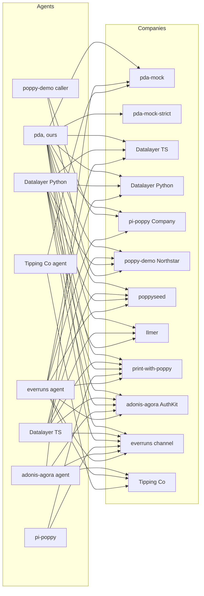

# The Poppy ecosystem

A map of everything around [Poppy, the Personal Agent Protocol](https://personalagentprotocol.org/), as of **18 October 2026**, nine days after Draft 0.1 was published. Everything was checked again that day: the spec site, Sierra, every row's upstream, new projects, the community lists and directories, and every live Company we know of. The interop grid wasn't rerun, so the [scorecard](#scorecard) is still the 13 October run. It is meant to be kept up to date: each row says where it comes from and when it was last checked, and [the last section](#how-to-update-this-map) says how to check again.

The detail lives elsewhere. Every implementation, with licences and maturity, is in [implementations.md](implementations.md); what we found in their code is in [poppy-issues.md](poppy-issues.md); the spec's problems are in [spec-issues.md](spec-issues.md), with our chosen readings in [readings.md](readings.md); how our harness pairs them is in [interop-testing.md](interop-testing.md), and its last run in [interop-results/](interop-results/README.md). This page is the index.

**18 October in short.** The site now serves **Draft 0.2, in progress**, with a [changelog](https://personalagentprotocol.org/docs/changelog); 0.1 is frozen at [/docs/0.1/spec](https://personalagentprotocol.org/docs/0.1/spec). The spec has a public repository, an issue tracker and an official Company kit with a validator. 0.2 settles three of our open questions, S1, S3 and N11, and its answer to S1 goes against every agent in our grid, ours included ([what 0.2 changes](#what-draft-02-changes-for-this-map)). New on the map: poppy-gateway, a Company SDK with a conformance suite; poppyseed's author's Personal Agent; Cobus Greyling's Draft 0.1 demo; a Poppy branch in Archon; and three more checkers. PAP Checker now lists 15 domains, and we ran our validator once against 12 hosts new to us. Spot's code and Ekubo's pilot identity are no longer public.

**Method.** Read-only: GitHub (repositories, code, issues and pull requests), npm, PyPI, crates.io, web search, and the community lists. We read other projects' code at a pinned commit and run it only in Docker. We fetch a live Company's `poppy.json` and its issuer's metadata only with our validator CLI, once per host per survey, one host at a time; the hosts come from our records, public directories and other projects' pull requests. Nothing is posted to other projects. On 18 October we read GitHub through git and its public pages, not its API.

## The spec

| Item | State on 18 October | Source | Checked |
| --- | --- | --- | --- |
| Draft 0.2, in progress | What the site serves: `/docs/spec` redirects to `/docs/0.2/spec`, which says "This is draft version 0.2" and whose example has `"protocol_version": "0.2"`. No page shows an "Updated" date any more. The changelog marks 12 changes "Breaking", among them: assertions' `aud` is the issuer (S1); one issuer per Company (N11) and RFC 8414 insertion for a path issuer (S3); `organization.domain` is the host that served `poppy.json` after redirects, and a leading `www.` is no longer ignored; `dpop_signing_alg_values_supported` is required and includes ES256; full RFC 9449 proof checks; a Session stays tied to its account after sign-out; Mediated Sign-In's statuses, errors and where its credentials may be kept; `role` as a message field; and a new section 8, Security considerations. Ten pages: the nine before, plus the changelog. | [personalagentprotocol.org](https://personalagentprotocol.org/), [changelog](https://personalagentprotocol.org/docs/changelog) ([our copy](../spec/draft-0.2-retrieved-2026-10-18/pages/changelog.md)) | 18 Oct, `node scripts/spec-snapshot.mjs`: 9 text changes, stored |
| Draft 0.1 | Published 9 October (the site updated it on 12 October without changing a wire rule), now "frozen" at [/docs/0.1/spec](https://personalagentprotocol.org/docs/0.1/spec). It is the version every implementation on this page declares, ours included, and the one our validator, mock and [grounding](../spec/grounding.md) cite. | [changelog](https://personalagentprotocol.org/docs/changelog#v0-1) | 18 Oct |
| Authors | Led by Sierra and Meta, with 35 named design partners (Sierra's post). Path to 1.0 lists 43 partners that agreed to be named: three personal agents (Instinct, Meta, OpenAI), 21 Companies and 19 technology providers, and invites more by email. Every commit in the spec's repository is by one author, Arya Asemanfar. | [sierra.ai/blog/poppy](https://sierra.ai/blog/poppy), [Path to 1.0](https://personalagentprotocol.org/docs/path-to-1#partners) ([our copy](../spec/draft-0.2-retrieved-2026-10-18/pages/path-to-1.md)) | 18 Oct |
| Licence | Apache 2.0 for the specification, documentation and examples; not the names, logo or site design. Feedback is licensed to all members and users. The repository is Apache-2.0 too. | [licence](https://personalagentprotocol.org/license), [contributions](https://personalagentprotocol.org/license/contributions) | 18 Oct |
| Where it lives | [personal-agent-protocol/personal-agent-protocol](https://github.com/personal-agent-protocol/personal-agent-protocol), the site's source (Next.js), public since about 14 October (`f766ef8`, "Link to GitHub and take feedback as issues"); head `95fcbf2`, 16 Oct. Feedback now goes in as GitHub issues: 16 by 18 Oct (#2 to #17), among them the issues that 0.2 cites for S1 (#2), N11 (#3), security considerations (#4) and Mediated Sign-In (#5), implementation reports from Stacktree (#12) and Ample Computer (#15), and three extension proposals. Its `main` has the 0.2 text (the issuer `aud`, for one) but still calls itself "draft version 0.1" and has no changelog or versioned paths, so the live site is built from something newer than the public branch. | [the repository](https://github.com/personal-agent-protocol/personal-agent-protocol), [spec-issues.md](spec-issues.md#how-we-found-them) | 18 Oct, read at `95fcbf2` |
| Official Company kit | [/kit/company](https://personalagentprotocol.org/kit/company) (`kit/company/` in the repository, from `95fcbf2`, 16 Oct): a skill for coding agents with milestones, JSON Schemas for every message, and a TypeScript validator that acts as a test Personal Agent against a live Company, or checks a `poppy.json` file offline. It quotes each MUST and SHOULD; sign-in checks are left to a person. It replaces the earlier review kit. | [the kit](https://personalagentprotocol.org/kit/company) | 18 Oct (read, not run) |
| Our copy | A dated snapshot of every page, for citing | [spec/draft-0.2-retrieved-2026-10-18](../spec/draft-0.2-retrieved-2026-10-18/README.md) (the newest; named by its retrieval date, since 0.2 shows none), [spec/draft-0.1-2026-10-12](../spec/draft-0.1-2026-10-12/README.md) (0.1 as frozen), [spec/draft-0.1-2026-10-09](../spec/draft-0.1-2026-10-09/README.md), [spec/grounding.md](../spec/grounding.md) (still 0.1) | Snapshots taken 12, 13 and 18 Oct |
| Change tracking | `node scripts/spec-snapshot.mjs` compares the live site with the newest snapshot (read-only); `--save` stores a new dated one. On 18 Oct it needed two fixes for the new site: a pattern that backtracked without end on the new home page, and the walkthroughs' version, which they now read from another chunk | [`scripts/spec-snapshot.mjs`](../scripts/spec-snapshot.mjs) | Run 12 Oct (twice), 13 Oct and 18 Oct |

## Promised, not released

| Item | State | Source | Checked |
| --- | --- | --- | --- |
| Sierra's reference implementation | Promised "over the next month", with design workshops. Not published; the official Company kit (above) is the nearest thing so far. Sierra's GitHub organisation is [sierra-inc](https://github.com/sierra-inc) (7 public repositories, all SDKs and forks; none for Poppy). No blog post since 9 October. | [Sierra's post](https://sierra.ai/blog/poppy) | 18 Oct |
| Partner launches | None of the launch or design partners we know of serves a `poppy.json`: we checked Sierra and seven partners on 11 October ([implementations.md](implementations.md#not-found)), and PAP Checker's author checked them on 11 October too. Not fetched again; no partner announced a launch by 18 October that we found. | [dev.to article](https://dev.to/benjifisher/what-is-poppyjson-a-personal-agent-protocol-example-and-how-to-validate-yours-3d5m) | 18 Oct (no new fetch) |
| Muse with Redfin and Rocket | A video demo; no code, no endpoints, no spec version | [video](https://x.com/SierraPlatform/status/2108245197440307584), via [poppy.md](https://poppy.md/implementations) | 11 Oct |
| A shared conformance suite | None yet. The official kit's validator checks a Company, with sign-in left to a person, and nothing official checks a Personal Agent. On 18 October [issue #17](https://github.com/personal-agent-protocol/personal-agent-protocol/issues/17) asked whether a conformance suite for Draft 0.1, modelled on MCP's, would be welcome (no answer yet), and poppy-gateway (below) ships one for its own SDK. Datalayer's 124 JSON cases are still the nearest language-neutral set. | [open topics](https://personalagentprotocol.org/docs/path-to-1#open-topics), [our copy](../spec/draft-0.2-retrieved-2026-10-18/pages/path-to-1.md) | 18 Oct |

## Personal Agents

"Grid" is whether our harness runs it ([`interop/registry.json`](../interop/registry.json)).

| Project | What | Language, licence | Grid | Source | Checked |
| --- | --- | --- | --- | --- | --- |
| This project (pda) | A hosted Personal Agent per User, on Durable Objects. Beyond Poppy: general tools (reading a public page, rendering it in Browser Run when it needs JavaScript; notes about the User; dates and exact sums) and reminders and scheduled tasks, with Web Push. Declares Draft 0.1; its assertions name the endpoint called, which 0.2 refuses | TypeScript, Apache-2.0 | Yes | [adewale/pda](https://github.com/adewale/pda) | 18 Oct |
| openavt | A Python Personal Agent client, `PAPClient`, and a custom extension that binds a Poppy Session's authority to a voice call; a local reference Company for its demo | Python, Apache-2.0 | No: a candidate for an agent adapter (it covers discovery, Sessions, the three sign-ins, refresh and Operations) | [ketanbj/openavt `docs/pap.md`](https://github.com/ketanbj/openavt/blob/9e99b622515b20d1b8d5405be229c7199d73dd60/docs/pap.md) | 18 Oct (no commits since `9e99b62`); code not run |
| Datalayer SDK | Client side of a both-sides SDK | Python, TypeScript; BSD-3-Clause | Yes, pinned at `00216eb` (0.17.0). Head `9476431` (0.24.0, 14 Oct): 0.18.0 to 0.24.0 are Company-side and UI, plus mapping an MCP 429 to `rate_limited` on the client; no change to Sessions, assertions, DPoP or discovery | [datalayer/personal-agent-protocol](https://github.com/datalayer/personal-agent-protocol) | 18 Oct |
| pi-poppy | An extension for the pi coding agent | TypeScript, MIT | Yes, at `11ea106` | [richardanaya/pi-poppy](https://github.com/richardanaya/pi-poppy) | 18 Oct (no commits since 10 Oct) |
| adonis-agora agent | `poppy-client`, `poppy-agent` bin and "connections" in an AdonisJS agent library | TypeScript, MIT | Yes, pinned at `e139b95` (0.80.1). Head `3645a8f` (0.81.1, 17 Oct): `poppy-client` unchanged; approvals on resumed connections are scoped by run (`7eabb1a`); 0.81 needs Node 24, and our adapter builds on Node 22 | [DavideCarvalho/adonis-agora-agent](https://github.com/DavideCarvalho/adonis-agora-agent) | 18 Oct |
| nestjs-agent | `@dudousxd/nestjs-agent-poppy` (0.1.1, on npm since 12 Oct): a NestJS port of the adonis-agora agent. Its client is a verbatim copy of adonis-agora's `poppy-client`, plus connections and a `poppy-agent` CLI | TypeScript, MIT | No | [DavideCarvalho/nestjs-agent](https://github.com/DavideCarvalho/nestjs-agent) | 18 Oct (head `27d43eb`; no Poppy change since 12 Oct) |
| poppy-demo caller | A demo caller Worker | TypeScript, none declared | Yes, at `02a9b30` | [irvinebroque/poppy-demo](https://github.com/irvinebroque/poppy-demo) | 18 Oct (no commits since 9 Oct) |
| poppy-agent-demo (new) | A Personal Agent by poppyseed's author, adapted from poppy-demo: a pi extension with five tools and a web chat. Device Sign-In only, MCP, operation approvals; its client metadata is served through a tunnel | TypeScript, MIT | No: a candidate (an adapter would replace the tunnelled identity) | [akshay5995/poppy-agent-demo](https://github.com/akshay5995/poppy-agent-demo) at `a5c0bdc` (15 Oct, one commit) | 18 Oct, read; not run |
| everruns `poppy_client` | A capability of a production agent platform; since [#4577](https://github.com/everruns/everruns/pull/4577) (11 Oct) also for apps built on its framework. Still no sign-in. | Rust, MIT | Yes, pinned at `aceb2e2`. Head `07f2e7a`, 119 commits on: no Poppy code change, only a feature page and a PACT and Poppy walkthrough video | [everruns/everruns](https://github.com/everruns/everruns) | 18 Oct |
| Cobus Greyling's demo (new) | Both sides of Draft 0.1 on one machine: discovery, guest Sessions, sign-in with PKCE and scopes, DPoP without nonces, conversations with idempotent message IDs, an API with read and write scopes, revocation. Plain HTTP on 127.0.0.1. Not the same as his pre-draft model | Python, Apache-2.0 | No: possible on both sides, but it serves only HTTP | [cobusgreyling/personal-agent-protocol-demo](https://github.com/cobusgreyling/personal-agent-protocol-demo) at `a5d62bd` (14 Oct) | 18 Oct, read; listed by poppy.md |
| Atlas (introspection-js-sdk) | A scripted demo agent in an open pull request | TypeScript, Apache-2.0 | No | [PR #441](https://github.com/introspection-org/introspection-js-sdk/pull/441) | 18 Oct (still an open draft; no commits since 11 Oct) |
| Tipping Co's agent (timothyohare) | A CLI Personal Agent with a callback host, from a learning demo: Direct Sign-In with PKCE, DPoP, an OpenAPI API; no conversations. No `typ` on its assertions; metadata by insertion | TypeScript, none declared | Yes, as `tipping-co` at `fb7b4e6` since 13 Oct ([`interop/impls/tipping-co-agent`](../interop/impls/tipping-co-agent)) | [timothyohare/personal-agent-protocol](https://github.com/timothyohare/personal-agent-protocol) | 18 Oct (no commits since 12 Oct) |
| Cloud Wallet pilot (Ekubo) | Was only a public identity (client metadata, a JWKS and a sign-in callback page on GitHub Pages). By 18 October the repository and its Pages site were gone or private | n/a | No | EkuboProtocol/cloud-wallet-poppy-pilot-agent (no longer public) | 18 Oct |
| Windom Sports' test agent (new) | Only a public identity, like Ekubo's: client metadata, a JWKS and a callback page, which Windom Sports uses to test its own sign-in | Static HTML, none declared | No | [scottbissinger-spec/windom-test-agent](https://github.com/scottbissinger-spec/windom-test-agent) at `af578af` (13 Oct) | 18 Oct |
| print-with-poppy's `scripts/agent.ts` | A reference client for that store, demo identity only | TypeScript, MIT (since 12 Oct) | No | [spenciefy/print-with-poppy](https://github.com/spenciefy/print-with-poppy) | 18 Oct |

## Companies and Company SDKs

| Project | What | Language, licence | Grid | Source | Checked |
| --- | --- | --- | --- | --- | --- |
| poppyseed | A Company library for Next.js, with a demo Company | TypeScript, MIT (plain MIT since `69f9233`, with the spec note moved to NOTICE) | Yes, at `f479fb6`. Head `69f9233` (15 Oct): its fetcher refuses a host if any resolved address is private, NAT64 counts as private, and a clearer refusal message; no assertion rule changed | [akshay5995/poppyseed](https://github.com/akshay5995/poppyseed) | 18 Oct |
| poppy-gateway (new) | A Company SDK on WHATWG `Request` and `Response` with `jose`, by Origin Platform Labs (which sells Poppy implementation work). Its README claims all of sections 3 to 7: the three sign-ins, Account Tokens, browser sessions, APIs, conversations with SSE, handoff and close; Operations "planned". Also a Personal Agent client, a conformance suite, and a hosted "front door" Company Agent on Cloud Run. Its client assertions may name the token, issuer, revocation or device endpoint; Session assertions only the token endpoint | TypeScript, Apache-2.0 | No: the strongest new Company candidate. Its README says `npm install poppy-gateway`, but it isn't on npm | [sirwilliamiv/poppy-gateway](https://github.com/sirwilliamiv/poppy-gateway) at `cec43e3` (16 Oct, three commits since 14 Oct) | 18 Oct, read; not run |
| Datalayer "Manzanita" | Reference Company on the SDK's Company side; since 0.13.0 a Session holding a scope no longer offered ends, since 0.15.0 a password reset ends earlier sign-ins, since 0.16.0 refusals are reported to telemetry. 0.18.0 to 0.24.0 (13–14 Oct) add take-downs, rate limits answered with `rate_limited` and `Retry-After`, alias domains that serve discovery and appear in `poppy_domains`, and staff replies | Python, TypeScript; BSD-3-Clause | Yes, pinned at `00216eb` (0.17.0); head `9476431` (0.24.0) | [datalayer/personal-agent-protocol](https://github.com/datalayer/personal-agent-protocol) | 18 Oct |
| adonis-agora AuthKit | Company OAuth server and conversation endpoint in an AdonisJS kit; 0.79.0 (12 Oct) adds an admin page that blocks an agent, 0.80.0 a ready-made Mediated Sign-In by emailed code. 0.81.0 (17 Oct) needs Node 24; its OIDC client gained discovery and `id_token` checks, which aren't Poppy | TypeScript, MIT | Yes, pinned at `fe2a3ff` (0.80.0); head `f9d3ee5`, no change under its Poppy code | [DavideCarvalho/adonis-agora-authkit](https://github.com/DavideCarvalho/adonis-agora-authkit) | 18 Oct |
| nestjs-agent Company | The same package's conversation endpoint (section 7, with SSE, handoff and Direct Conversations). No `poppy.json` and no authorization server: it checks tokens through a resolver that adonis-agora AuthKit provides | TypeScript, MIT | No | [DavideCarvalho/nestjs-agent](https://github.com/DavideCarvalho/nestjs-agent) | 18 Oct |
| pi-poppy test Company | A test peer in the pi-poppy repository | TypeScript, MIT | Yes, at `11ea106` | [richardanaya/pi-poppy](https://github.com/richardanaya/pi-poppy) | 18 Oct |
| poppy-demo Northstar | A demo retailer Worker that accepts only its own agent | TypeScript, none declared | Yes, patched, at `02a9b30` | [irvinebroque/poppy-demo](https://github.com/irvinebroque/poppy-demo) | 18 Oct |
| Ilmer.org | A local-history archive assistant, signed-out only. Since 12 Oct its main site, www.ilmer.org, also serves a `poppy.json` naming the same issuer, and its agent gained web search and fetch tools; since `eda7179` (15 Oct) it builds those tools only when a Workers AI binding is present | TypeScript, MIT | Yes, pinned at `de0d1ec`, with a stand-in Workers AI binding the new tools need; head `f0adb08`, history content and no Poppy change | [rbirkby/Ilmer.org](https://github.com/rbirkby/Ilmer.org) | 18 Oct |
| everruns `poppy` channel | Hosts a Company's Poppy endpoints, signed-out only | Rust, MIT | Yes, pinned at `aceb2e2`; head `07f2e7a`, no Poppy code change | [everruns/everruns](https://github.com/everruns/everruns) | 18 Oct |
| Spot | A cart-approval and payment service. On 14 Oct (`40f9c9b`) it moved out of the public hub into its own repository, `futurebasicsrepo/spotmeplease`, which isn't public, so its code is no longer open. The live host still answers ([below](#companies-you-can-reach)) | JavaScript, none declared | No | [the hub](https://github.com/futurebasicsrepo/futurebasicsrepo-client-hub-api) (Spot's code up to `40f9c9b`) | 18 Oct |
| print-with-poppy | An agent-first photo-printing store: signed-out Sessions, OpenAPI, Operations v1 required for orders; agents on an allowlist. Since 12 Oct (`260dbb4`) optional accounts: Direct and Mediated Sign-In by an emailed code, `poppy:read` for order history, `poppy:write` to order into the account. Since 13 Oct a hosted Agent Sandbox for testing agents without cards (sandbox.printwithpoppy.com), mixed products in one order and private coupons. In a commit not in our pin (`7f43d1a`), revocation answers a bad client assertion with 401 `invalid_client`, not 500; later a T-shirt with a store-specific preview approval before confirm, sample artwork, and `security` on the account endpoints in its OpenAPI | TypeScript (Express, SQLite), MIT | Yes, pinned at `246727d`, unpatched: D, S0, CM, SD, SX, SMC, SO, AO, AS, R, and OU with pda only ([`interop/impls/print-with-poppy-company`](../interop/impls/print-with-poppy-company)); head `6dca0ad` (15 Oct) | [spenciefy/print-with-poppy](https://github.com/spenciefy/print-with-poppy) | 18 Oct |
| Tipping Co (timothyohare) | A learning-demo Company for an NRL tipping service: signed-out and Direct Sign-In Sessions, DPoP, refresh and revocation, OpenAPI; in-memory stores. Requires the token endpoint as `aud`, at revocation too | TypeScript (Hono), none declared | Yes, as `tipping-co` at `fb7b4e6` since 13 Oct ([`interop/impls/tipping-co-company`](../interop/impls/tipping-co-company)) | [timothyohare/personal-agent-protocol](https://github.com/timothyohare/personal-agent-protocol) | 18 Oct (no commits since 12 Oct) |
| Cobus Greyling's demo Company (new) | "Cedar Line", the Company side of the demo in [Personal Agents](#personal-agents), on 127.0.0.1 over HTTP | Python, Apache-2.0 | No | [cobusgreyling/personal-agent-protocol-demo](https://github.com/cobusgreyling/personal-agent-protocol-demo) | 18 Oct |
| Archon Herald (new, unmerged) | Archon's DID name service as a Company, behind a flag: Direct and Device Sign-In through an Archon wallet challenge, Account Tokens, revocation, an OpenAPI 3.1 API, and an issuer with a path (`…/names/poppy`). No conversations or MCP | TypeScript, MIT | No: unmerged, needs Redis, and wallet sign-in is hard to automate | [archetech/archon#1395](https://github.com/archetech/archon/issues/1395), branch `feat/poppy-1395` at `3226139` (18 Oct) | 18 Oct |
| Flight Sector (introspection-js-sdk) | The demo Company in PR #441 | TypeScript, Apache-2.0 | No | [PR #441](https://github.com/introspection-org/introspection-js-sdk/pull/441) | 18 Oct |
| TYPO3 lab | A signed-out "knowledge profile" in a private extension | PHP, private | README only | [dirnbauer/webconsulting-typo3-lab](https://github.com/dirnbauer/webconsulting-typo3-lab) | 18 Oct (no commits since 12 Oct) |
| Fillthemat (planned) | A growth platform for martial-arts schools planning to make each School a Company: one issuer per School with a path (`https://auth.fillthemat.com/schools/<id>`), metadata by RFC 8414 insertion, signed-out Sessions first. The PR left draft on 16 Oct and is ready for review; Poppy stays off for a School until its domain is verified and an interop check passes. Nothing served from merged code | TypeScript, MIT | No | [fillthemat/fillthemat PR #200](https://github.com/fillthemat/fillthemat/pull/200) | 18 Oct |

## Both-sides SDKs

Datalayer (Python and TypeScript, published as `personal-agent-protocol` on PyPI and `@datalayer/personal-agent-protocol` on npm, 0.24.0 on 14 October), poppy-gateway (a Company SDK with a Personal Agent client, not yet published), adonis-agora (agent and AuthKit), nestjs-agent (a port of adonis-agora's code), everruns, and the four demos (poppy-demo, introspection's travel demo, timothyohare's Tipping Co, Cobus Greyling's) each cover both sides. Datalayer and poppy-gateway are standalone SDKs; the others are inside a framework.

## Checkers, validators and linters

| Tool | What it checks | Open? | Source | Checked |
| --- | --- | --- | --- | --- |
| Our validator | `poppy.json`, the issuer's metadata, client metadata and JWKS, against Draft 0.1; 76 messages, each with an explanation, a fix and a reference | Yes (in this repo); live at [/validator](https://poppydemoagent.dev/validator) | [`src/validator/`](../src/validator) | 18 Oct |
| The official Company kit's validator (new) | A test Personal Agent against a live Company, or a `poppy.json` file offline; JSON Schemas for every message; each finding quotes its MUST or SHOULD. Sign-in left to a person | Yes: TypeScript, Apache-2.0 (Node 22.18+) | [`kit/company/validate`](https://github.com/personal-agent-protocol/personal-agent-protocol/tree/95fcbf22c5991a0090061aed3dbeb68c0ea575e0/kit/company) at `95fcbf2` | 18 Oct (read, not run). A candidate for the cross-check, in its offline mode |
| poppy-validator | A linter for `poppy.json` and the issuer's metadata: 64 rules, each with a spec section and a basis (MUST, field table, advisory, context), a JSON Schema, `--json` and `--strict` | Yes: Python, MIT, not on PyPI | [tusharck/poppy-validator](https://github.com/tusharck/poppy-validator); the cross-check pins `d2220bf`, head `ef7544f` (13 Oct, README only: no longer "unofficial") | 18 Oct |
| poppy-sidecar | A `poppy.json` generator, a 25-check validator, and a "testbed" that checks an agent's self-reported action trace against granted scopes | Yes: Python, MIT; its README's PyPI badge points at a package that doesn't exist | [habib-analyst/poppy-sidecar](https://github.com/habib-analyst/poppy-sidecar) at `858db66` (still its head on 18 Oct) | 18 Oct |
| Poppy Check (new) | A zero-dependency `poppy.json` checker and generator, as a CLI, a library and a [web checker](https://poppy-check.geosuite.workers.dev) | Yes: JavaScript, MIT; its npm badge names `@geosuite/poppy-json`, which isn't published | [TryGeoSuite/poppy-json](https://github.com/TryGeoSuite/poppy-json) at `2af8f3a` (14 Oct) | 18 Oct. A candidate for the cross-check |
| aigentify (new) | An agent-readiness auditor that added a Poppy audit and a discovery-only generator (`68724ee`, 14 Oct). It generates a website-only document (getvibe.dev's, [below](#companies-you-can-reach), is one) | Yes: TypeScript, MIT; npm `aigentify` 0.5.1 | [pooriaarab/aigentify](https://github.com/pooriaarab/aigentify) at `822a4d9` (16 Oct) | 18 Oct |
| Lumar Agentic Readiness (new) | A commercial site crawler with 15 PAP checks and a generator | No (closed) | [its PAP page](https://agentic-readiness.lumar.io/docs/capabilities/pap), via poppy.md | 18 Oct |
| PAP Checker | Checks a domain from outside (discovery, OAuth metadata, OpenAPI, MCP resource metadata), with a public directory of domains seen | No (closed); by Benji Fisher, who also runs UCP Checker. On 18 Oct it said it had checked 74 domains (18 on 12 Oct); its directory listed 15 (6), all on 0.1 | [papchecker.com](https://papchecker.com), [its directory](https://papchecker.com/sites) | 18 Oct |
| Ora's poppy.ax and `ax` CLI | A guide and a domain checker; `ax generate-files` writes a starter `poppy.json` (`organization` and `web: {}` only) that Ora's API decides. 0.10.0 and 0.10.1 (13 Oct) also write `llms.txt`, a `robots.txt` edit, an RFC 9727 API catalog and MCP server cards; poppy.ax's home page was rewritten for businesses | Front end and CLI open (MIT); checks in Ora's closed API | [ora/poppy-ax](https://github.com/ora/poppy-ax) (`466ee69`), [ora/ax](https://github.com/ora/ax) (`3d3a691`) | 18 Oct |
| Flow's checker | Readiness levels 0–3, plus a compliance checklist | No | [flow.engineer/poppy](https://flow.engineer/poppy) | 11 Oct |
| poppyseed's check command; Datalayer's `pap company verify`; poppy-gateway's conformance suite | Each project's conformance runner for a Company | Yes | the projects above | 18 Oct |
| Datalayer's conformance cases | 124 language-neutral JSON cases, unchanged from 0.6.0 to 0.24.0; we run them against our client and validator (13 Oct, at 0.17.0: 24 pass, 2 fail on readings, 98 n/a) | Yes, BSD-3-Clause | [interop/vectors/datalayer](../interop/vectors/datalayer) | 18 Oct |

A committed script, [`interop/vectors/validators/`](../interop/vectors/validators/README.md), runs the two open validators and ours over the same 107 `poppy.json` documents (rerun on 13 October at both pins, with the same counts as on 12 October; not rerun on 18 October); the results are in [interop-testing.md](interop-testing.md#validator-cross-check).

## Companies you can reach

None is a large business. Tilopay is a payment company; the rest are small businesses, demos and sandboxes. On 18 October we ran our validator CLI once against each host below except the TYPO3 lab, one host at a time, a few seconds apart: it fetches the `poppy.json`, following redirects, and the issuer's metadata, and nothing else. Every host serves a `poppy.json` declaring `"protocol_version": "0.1"`. Against 0.1, every one is valid but Ample Computer, and intercom.io serves none. The verdicts are our validator's, which checks 0.1. The last column says what 0.2's text would change; that column is our reading of the 0.2 text, not a validator's verdict.

| Host | What it is | Sign-in | How we know | 18 Oct: 0.1 verdict | Under 0.2 |
| --- | --- | --- | --- | --- | --- |
| [spotmeplease.com](https://spotmeplease.com/.well-known/poppy.json) | Spot, a small cart-approval product; its code is no longer public | Guest Sessions and Direct Sign-In | Its old repository; fetched since 11 Oct | Valid, no messages | |
| [withpoppyseed.dev](https://withpoppyseed.dev) | "Poppy Travel", poppyseed's demo; the apex redirects to `www.`, which its `organization.domain` names | Direct, device and mediated | Its repository | Valid, no messages | Fine: the domain is the host that serves it |
| [poppy-receiver.roundtrip.workers.dev](https://poppy-receiver.roundtrip.workers.dev/.well-known/poppy.json) | Northstar Outfitters, poppy-demo's retailer | Direct Sign-In, its own caller only | Its repository | Valid, 1 info | |
| [poppy.ilmer.org](https://poppy.ilmer.org/.well-known/poppy.json), and ilmer.org through www.ilmer.org | Ilmer's local-history archive; the main site's `poppy.json` names the same issuer | Signed-out only | Its repository | Valid, 4 and 5 info | ilmer.org's document is served by www.ilmer.org but says `ilmer.org`, which 0.2 no longer accepts |
| TYPO3 lab `/poppy/demo` | A protocol playground | Behind a login | Its repository | Not fetched | |
| flowers.papsandbox.com | "Northlight Flowers"; the name suggests a sandbox | Direct Sign-In | [PAP Checker's directory](https://papchecker.com/sites), first seen 11 Oct | Valid, no messages | |
| tilopay.shop, tilopay.tilopay.shop | Tilopay, a payment company: an MCP server for searching and buying from its merchants' stores, payment only on its own 3-D Secure page (extension `tilopay.com/hosted-checkout`). The issuer, `mcp.tilopay.com`, is shared by 14 domains, most of them stores ([N11](spec-issues.md#n11)) | Signed-out only | PAP Checker's directory, first seen 12 Oct | Valid, 1 info each | Two problems: one issuer for many stores (0.2's "one issuer per Company"), and no `dpop_signing_alg_values_supported` |
| [salespeak.ai](https://salespeak.ai/agent-endpoint/) | Salespeak, a vendor of AI sales agents for business websites. Its `poppy.json` redirects to a host under `agents.salespeak.ai` with an issuer of its own | Signed-out conversations only | A Salespeak employee's [pull request](https://github.com/ora/standards/pull/6) to Ora's standards page | Valid, 1 info | Served by the provider's host but naming `salespeak.ai`; 0.2 wants the provider to serve it on the Company's own domain |
| emorahealth.com | Emora Health, a virtual mental-health service for children, teens and young adults. Its issuer has a path, `https://www.emorahealth.com/poppy`, with metadata only at the RFC 8414 inserted location ([S3](spec-issues.md#s3)) | Signed-out conversations only | PAP Checker's directory, first seen 12 Oct | Valid, 1 info | Served by `www.` but naming `emorahealth.com`; its metadata location is now the spec's |
| [printwithpoppy.com](https://printwithpoppy.com) | Print with Poppy, the store above, live: real payments (Stripe Checkout) and prints (Prodigi) whenever `/api/catalog` says `mode: live` | Guest Sessions for agents on an allowlist (ours is on it); accounts since 12 Oct | The owner's deployed agent, 12 Oct ([poppy-issues.md](poppy-issues.md#print-with-poppy-spenciefyprint-with-poppy)); PAP Checker's directory since 16 Oct | Valid, 3 info | Its assertions must name the endpoint called, which 0.2 forbids |
| [www.alpine-retail.com](https://www.alpine-retail.com/.well-known/poppy.json) | Alpine Retail, a retail demo by a colleague of this project's owner: a Company Agent and three DPoP-protected reads (inventory, rewards points, who the session belongs to); no Operations, no website section. Source not public | Direct (`poppy:read`, `poppy:write`, a custom `addresses` scope) and Mediated (a phone number, `poppy:read`) | Its developer, 13 Oct | Valid, no messages | Its revocation takes only the token endpoint as `aud` ([S1](spec-issues.md#s1)), which 0.2 forbids. In the live lane since 13 Oct: D, S0, N and C pass since 14 October with the lane's public identity ([interop-testing.md](interop-testing.md#the-live-lane-first-run-13-october)); through the deployed agent, conversations, API reads, Direct Sign-In, a refresh and sign-out work |
| stacktr.ee (new) | Stacktree, a host for HTML pages: guest publishing, MCP and an OpenAPI API on `api.stacktr.ee` | Direct Sign-In | [Spec issue #12](https://github.com/personal-agent-protocol/personal-agent-protocol/issues/12) (its own report); PAP Checker, 16 Oct; poppy.md | Valid, 2 warnings, 2 info: its metadata lists neither `private_key_jwt` nor the JWT bearer grant | No `dpop_signing_alg_values_supported` |
| ample.computer (new) | Ample Computer, a cloud for apps that agents deploy: MCP only, with custom scopes. The apex redirects to `api.ample.computer`, which its `organization.domain` names; its issuer has a path, `https://api.ample.computer/poppy`, with metadata at the RFC 8414 inserted location. Its report says it requires the issuer as `aud` | Signed-out, and Direct Sign-In | [Spec issue #15](https://github.com/personal-agent-protocol/personal-agent-protocol/issues/15); PAP Checker, 17 Oct; poppy.md | **Invalid**: `organization-domain-mismatch`, since 0.1 compares the domain with the host requested | Fine: 0.2 compares with the host that served it. The first live Company we've seen built to 0.2's rules while declaring 0.1 |
| www.planmyvisit.to (new) | PlanMyVisit by Autoura, a trip planner: a Company Agent and MCP. The issuer is on another domain with a path, `https://api.autoura.com/api/auth` | Direct Sign-In | poppy.md (checked 14 Oct) | Valid, 1 info | |
| windomsports.com (new) | Windom Sports, fantasy sports: MCP. It tests its sign-in with the identity in [Personal Agents](#personal-agents) | Direct Sign-In (`poppy:read`, `poppy:write`) | poppy.md (checked 14 Oct) | Valid, 3 warnings, 2 info: its metadata lists neither `private_key_jwt`, the JWT bearer grant nor `refresh_token` | |
| notjustabank.com (new) | "North & Pine Card, powered by Not Just a Bank": an OpenAPI API and a website; sounds like a demo | Direct Sign-In | PAP Checker, 17 Oct | Valid, 1 warning (`northpine:payment_tokens` is offered but not described), 2 info | |
| neutral-state-jev-dub-bench.vercel.app, neutral-state-jev-os-bench.vercel.app (new) | "Dub" and "OpenStatus": copies of two open-source products with Poppy added, by the name a benchmark | Direct Sign-In, MCP | PAP Checker, 13 Oct | Valid, no messages each | |
| rentourbins.com, ax-air.com, getvibe.dev, origin-platform-labs.netlify.app (new) | A bin-rental business, "Ax Air", The Vibe Suite and Origin Platform Labs (poppy-gateway's maker): website-only documents (`organization` and `web: {}`), the shape Ora's and aigentify's generators write | None | PAP Checker, 13 Oct (the first two); [getvibe#28](https://github.com/pooriaarab/getvibe/pull/28), by aigentify's author; poppy-gateway's repository | Valid, info only | |
| intercom.io (new) | Listed as "Intercom", website only, with 1 problem | n/a | PAP Checker, 16 Oct | **None served**: intercom.io redirects to www.intercom.com, whose `poppy.json` is 404 | |

PAP Checker said on 18 October that it had checked 74 domains, and its directory listed 15, every one on version 0.1. Not fetched: poppy-gateway's hosted front door (an issuer on Cloud Run, from its repository), whose public domain, origin-platform-labs.netlify.app, serves only a website-only document.

## Adjacent and declined

| Item | Kind | Source | Checked |
| --- | --- | --- | --- |
| OpenAgents | Proposal to support both sides, closed as not planned (11 Oct) | [OpenAgentsInc/openagents#11239](https://github.com/OpenAgentsInc/openagents/issues/11239) | 18 Oct |
| orka | Tracking issue: "We should not build anything yet" | [orka-agents/orka#774](https://github.com/orka-agents/orka/issues/774) | 18 Oct (no activity since 9 Oct) |
| tiny-poppy-gate | A teaching toy "inspired by" the draft: an in-memory scope gate with its own document shape. No network, no OAuth; "not an implementation of the protocol". | [bobbyhalljr/tiny-poppy-gate](https://github.com/bobbyhalljr/tiny-poppy-gate) | 18 Oct (no commits since 11 Oct) |
| OpenLine POPPY-PROOF-001 | An extension prototype: the Company verifies the owner's authorisation for an operation itself (Envoy ext_authz), "do not merge" | [terryncew/openline-receipt-gate#105](https://github.com/terryncew/openline-receipt-gate/pull/105) | 18 Oct (open, no push since 11 Oct) |
| mission-bound-authorization | Evaluates the draft and sketches a standing-permissions extension (merged 10 Oct) | [mcguinness/mission-bound-authorization#1189](https://github.com/mcguinness/mission-bound-authorization/pull/1189) | 18 Oct |
| poppy-operations-findings | A literal sandbox of the Operations extension with five findings | [SmokeSol/poppy-operations-findings](https://github.com/SmokeSol/poppy-operations-findings) | 18 Oct (no commits since 9 Oct) |
| IETF vCon | A charter pull request on linking a conversation to the order and payment an agent made | [draft-ietf-vcon-vcon-core#41](https://github.com/ietf-wg-vcon/draft-ietf-vcon-vcon-core/pull/41) | 18 Oct (open, nothing since 11 Oct) |
| Service Handshake extension | A proposed extension, `dualcx.com/service-handshake`: declarations of what an agent may agree to, and a Company's allow, deny, hold or escalate decision bound to Operations. Schema and examples only | [neos-wave/service-handshake-pap-extension](https://github.com/neos-wave/service-handshake-pap-extension) | 18 Oct (no commits since 12 Oct) |
| EMILIA Gate | An Operations v1 reference with optional signed approval evidence, offline with synthetic tokens. Still open: on 12 Oct it left the merge queue on failed checks | [emiliaprotocol/emilia-protocol#916](https://github.com/emiliaprotocol/emilia-protocol/pull/916) | 18 Oct |
| slicc-cdp | A browser-automation tool's `poppy.json` probe, shipped in slicc-cdp 1.23.0 (the issue closed on 14 Oct, by #153, which requires `organization.domain`) | [ai-ecoverse/slicc-cdp#95](https://github.com/ai-ecoverse/slicc-cdp/issues/95) | 18 Oct |
| personal-budget, trip-planner | One author's open questions whether Poppy applies to an app's MCP plans; trip-planner's is new (about 15 Oct) | [rmartz/personal-budget#540](https://github.com/rmartz/personal-budget/issues/540), [rmartz/trip-planner#601](https://github.com/rmartz/trip-planner/issues/601) | 18 Oct |
| Auto Agent Protocol (new) | An automotive A2A profile preparing "AAP 2.0.0 with PAP support": `poppy.json` discovery, a guest OpenAPI profile, DPoP. #39 closed on 15 Oct for PR #40, itself closed; #41 links the Poppy spec from its site | [auto-agent-protocol#39](https://github.com/auto-agent-protocol/auto-agent-protocol/issues/39) | 18 Oct |
| Extension proposals in the spec's tracker (new) | A "feedback" extension for reporting where agents get stuck (#9), voice extensions (#10, closed) and "Claim Records" for post-purchase claims (#16, `kojiru.com/claim-records`) | [the spec's issues](https://github.com/personal-agent-protocol/personal-agent-protocol/issues) | 18 Oct |
| PACT | A separate protocol (Decagon and Instinct), on A2A and OAuth. everruns supports both, and published a walkthrough of PACT and Poppy together | [openpactprotocol](https://github.com/openpactprotocol/openpactprotocol) | 18 Oct (no commits since 6 Oct) |
| Pre-draft models | Cobus Greyling's first sample, agent-ledger, trust_gateway: `/.well-known/personal-agent.json`, not Draft 0.1. trust_gateway (`5c05e67`, 17 Oct) still has no Draft 0.1 code. Cobus Greyling's new demo is Draft 0.1 ([above](#personal-agents)) | [implementations.md](implementations.md#related-but-not-implementations) | 18 Oct |
| Lists and trackers | [awesome-poppy](https://github.com/JaviChulvi/awesome-poppy) (`d737377`, 17 Oct: since 12 Oct it added the spec's repository, Print with Poppy, the partner roster and the official kit, and reorganised around readers' goals), [poppy.md](https://poppy.md/implementations) (16 entries on 18 Oct, new to us: the official kit, Lumar, PlanMyVisit, Windom Sports, Stacktree, Ample Computer and Cobus Greyling's Draft 0.1 demo), [awesome-muse](https://github.com/cszach/awesome-muse) (nothing new on Poppy) | as linked | 18 Oct |

False positives in searches are listed in [implementations.md](implementations.md#related-but-not-implementations).

## How they work together

**Not rerun since 13 October.** By 18 October seven of the grid's ten upstream pins were behind their heads: Datalayer, adonis-agora (agent and AuthKit), everruns, poppyseed, Ilmer and print-with-poppy. pi-poppy, poppy-demo and Tipping Co hadn't moved. Of the moves, only print-with-poppy's touches a known failure: its revocation now answers a bad client assertion with `invalid_client`, not 500. That changes how adonis-agora's SO cell there fails, since the `aud` is still wrong, not whether it fails. The others change no Poppy wire code the grid exercises. adonis-agora 0.81 needs Node 24, and its agent adapter builds on Node 22, so that pin can't move without changing the image. Every implementation in the grid declares Draft 0.1, and the grid tests 0.1.

Our [interop grid](interop-results/README.md) ran eight Personal Agents against twelve Companies (our two mocks included) on 13 October, over 30 scenarios, on a network with no internet access, with every pin at its upstream's head that morning ([interop-testing.md](interop-testing.md#pins-moved-on-13-october)): **2,880 cells, 1,000 pass, 273 fail, 1,607 unsupported, 0 errors**. Every failure is a known upstream or spec failure. The separate security grid, run against our own implementations, passed **32 of 32**; later that day, with the new attacks XR and XT, our agent passed all 78 cells it ran against both mocks and the malicious Company. Against the 12 October grid, no cell changed with the pin moves; the new cells are everruns' (in the main grid for the first time) and Tipping Co's, which joined on both sides.

### Scorecard

Each implementation's cells, as pass / fail / unsupported, summed over the grid's row (as a Personal Agent) or column (as a Company). The percentage is passes among the cells that ran, because an unsupported cell means one side doesn't offer that feature, which is no failure. A failure counts against both ends of its cell, so read the last column before blaming a side: the [attribution rules](interop-spec.md) decide whose it is, and [the results](interop-results/README.md) list every failure by rule.

**As a Personal Agent** (against all twelve Companies):

| Agent | Pass / fail / unsupported | Passes where run | What its failures are |
| --- | --- | --- | --- |
| pda (ours) | 213 / 1 / 146 | 99.5% of 214 | SO at Tipping Co: it signs the revocation request's client assertion for the revocation endpoint, and Tipping Co wants its token endpoint there too ([S1](spec-issues.md#s1), the spec's). |
| Datalayer Python | 201 / 8 / 151 | 96% of 209 | Device Sign-In polling ignores `use_dpop_nonce` (SVN); it requires `conversation_id` in handoff and close answers, which our mocks don't send (7.9, 7.12); SO at Tipping Co (S1). |
| Datalayer TS | 197 / 12 / 151 | 94% of 209 | The same SVN failure; its event stream gives up after five quick reconnects (CS); the handoff and close answers; SO at Tipping Co (S1). |
| adonis-agora | 141 / 47 / 172 | 75% of 188 | Its assertions carry no `typ`, which three Companies refuse ([S2](spec-issues.md#s2), the spec's); its device and revocation `aud` ([S1](spec-issues.md#s1)); renewal without `session_id` at Datalayer. |
| everruns | 33 / 11 / 316 | 75% of 44 | Its Session assertion has no `typ` (S2); it fetches metadata only at the appended location, so DP fails at both our mocks ([S3](spec-issues.md#s3)). Signed-out only, conversations and no APIs. |
| pi-poppy | 147 / 55 / 158 | 73% of 202 | No `typ` (S2); it resends the Session assertion on a nonce retry, and at the token endpoint retries only when `WWW-Authenticate` names the nonce error; it throws when a Company ends the Session ([N39](spec-issues.md#n39)). |
| poppy-demo caller | 39 / 69 / 252 | 36% of 108 | It requires the issuer to be the Company's origin, though the draft's examples put it elsewhere, needs an `agent` member and an `authorization_endpoint`, and always asks for its hard-coded scopes. |
| Tipping Co's agent | 29 / 70 / 261 | 29% of 99 | It sends no `client_id` at the token endpoint (RFC 7521 4.2 allows that), which every third-party Company refuses; it requires `authorization_endpoint`, so it can't discover a signed-out Company. It passes everything it claims at its own Company and at pda-mock. |

**As a Company** (against all eight agents):

| Company | Pass / fail / unsupported | Passes where run | What its failures are |
| --- | --- | --- | --- |
| poppyseed | 126 / 12 / 102 | 91% of 138 | Mostly the agents': adonis-agora's `aud` (S1), poppy-demo's parse of an empty revocation answer, Tipping Co's agent's missing `client_id`. |
| pi-poppy Company | 123 / 13 / 104 | 90% of 136 | The agents': Datalayer's SVN polling, pi-poppy's own nonce retry, adonis-agora's `aud`, Tipping Co's agent's missing `client_id`. |
| Datalayer TS / Python | 112 / 17 / 111 each | 87% of 129 | Its renewal requires `session_id`; its cancel sends `result.data: null` ([N41](spec-issues.md#n41)); poppy-demo's hard-coded scopes; Tipping Co's agent's missing `client_id`. |
| pda-mock (lenient reference) | 143 / 23 / 74 | 86% of 166 | The agents': nonce retries, Datalayer's SVN polling, CS stream and handoff and close answers, poppy-demo's issuer rule, everruns' S3 reading (DP). |
| everruns channel | 24 / 5 / 211 | 83% of 29 | poppy-demo's issuer-origin rule (D, S0, C) and Tipping Co's agent's need for `authorization_endpoint`. |
| adonis-agora AuthKit | 112 / 24 / 104 | 82% of 136 | The agents': poppy-demo's issuer-origin rule, pi-poppy's nonce retry, Tipping Co's agent's missing `client_id`. |
| Tipping Co | 50 / 13 / 177 | 79% of 63 | It wants the token endpoint as `aud` at revocation (S1), so four agents fail SO; pi-poppy's nonce retry; poppy-demo's missing `agent` member. |
| print-with-poppy | 47 / 16 / 177 | 75% of 63 | poppy-demo's crash on its missing `agent` member (7 cells), adonis-agora's revocation `aud` (S1), which the store answers with 500, not `invalid_client` (SO), and Tipping Co's agent's missing `client_id`. No conversations, so most scenarios don't apply. OU, which only pda claims, passes. |
| poppy-demo Northstar | 50 / 32 / 158 | 61% of 82 | It refuses assertions without `typ` (S2 `jwt-60s`); poppy-demo's own agent passes there. |
| Ilmer | 18 / 18 / 204 | 50% of 36 | It refuses assertions without `typ` (S2); poppy-demo's crash; Tipping Co's agent's need for `authorization_endpoint`. Signed-out only. |
| pda-mock-strict | 83 / 83 / 74 | 50% of 166 | It refuses assertions without `typ`, our strict reading of S2, so pi-poppy, adonis-agora, everruns and Tipping Co's agent fail almost every cell. |

Not in the grid: nestjs-agent (its Company needs adonis-agora's AuthKit, which the grid already runs), Spot (its code is no longer public), poppy-gateway, poppy-agent-demo and Cobus Greyling's demo (new on 18 October; poppy-gateway is the strongest candidate, and Cobus Greyling's serves only HTTP), Archon's Herald (unmerged), the TYPO3 lab (private), Atlas and Flight Sector (an open pull request), and the live Companies with no public code (Salespeak, Emora Health, Tilopay, Northlight Flowers, Stacktree, Ample Computer, PlanMyVisit, Windom Sports and the rest; Alpine Retail is in the separate live lane). [interop-testing.md](interop-testing.md#candidates-from-the-12-october-survey) says what the 12 October candidates would need.

An edge below means no cell between that pair failed; a missing edge means at least one did. Unsupported cells count for nothing either way, so an edge between two small implementations can rest on a few cells: each signed-out Company's edges rest on one to four, and every edge to everruns' channel or from everruns' agent on at most four.

At print-with-poppy and Tipping Co, everruns' agent runs only D (it starts a Session only for a conversation). pda's one missing edge is Tipping Co, over SO and the S1 reading; Tipping Co's agent reaches pda-mock only since our mock stopped requiring `client_id` on 13 October.

pi-poppy's only clean pairs are print-with-poppy and everruns' channel. At every other Company one of four habits fails a cell: it resends the Session assertion on a nonce retry, retries a token request only when `WWW-Authenticate` names the nonce error, gives up when a Session ends, and sends no `typ`.

What the grid found in each project is in [poppy-issues.md](poppy-issues.md); the failures by rule are in [interop-results/](interop-results/README.md).

## Open fault lines

Where Draft 0.1 is ambiguous, implementations already disagree. The questions are in [spec-issues.md](spec-issues.md); our readings and why are in [readings.md](readings.md). How each implementation reads the four that most often break a pair (from each adapter's declared readings, or from its code where it has no adapter; for a Company, "omits" means it expects no `scope` there). The first row is what Draft 0.2, in progress, now says; every other row is an implementation of 0.1:

| Implementation | S1 client assertion `aud` | S2 assertion `typ` and lifetime | S3 metadata for an issuer with a path | S4 `scope` on a signed-out Session |
| --- | --- | --- | --- | --- |
| **Draft 0.2 (in progress)** | **the issuer, as a single string, for client and Session assertions alike; any other `aud` MUST be refused** | still unstated: "short-lived", one minute in the example | **insertion (RFC 8414 3.1)** | still unstated; a signed-out token has no `scope` |
| pda (agent) | endpoint called | `typ: JWT`, `kid`, 60 s | insertion | omits |
| pda-mock / pda-mock-strict | endpoint, token endpoint or issuer | any, 300 s / `typ: JWT`, `kid`, 60 s | insertion | ignores |
| Datalayer agents | endpoint called | `typ: JWT`, 60 s | insertion | omits |
| Datalayer Companies | endpoint called, token endpoint or issuer (0.10.0) | `typ` absent or `JWT`, 120 s, `jti` of 16+ characters (0.10.0) | insertion | omits or ignores |
| pi-poppy agent / Company | endpoint called / endpoint called | no `typ` on Session assertions / any, 120 s | append / either | omits / ignores |
| poppy-demo caller / Northstar | endpoint called / endpoint called | `typ: JWT`, 60 s / required | append / n/a | omits / `invalid_scope` |
| adonis-agora agent / AuthKit | token endpoint / either | no `typ`, 60 s / any | insertion / either (serves both) | omits / omits |
| poppyseed | endpoint called | any | either | ignores |
| Ilmer | token endpoint | `typ: JWT`, `kid`, 60 s | either | omits |
| everruns agent / Company | token endpoint / token endpoint or issuer | Session assertion without `typ` / any, 300 s | append / either | omits / `invalid_scope` |
| print-with-poppy | endpoint called (token and revocation) | any `typ` except the browser one, 120 s | n/a (issuer is the origin) | `invalid_scope` (since `260dbb4`; it ignored it before) |
| Fillthemat (planned) | this School's token endpoint, exactly | not stated | insertion (path issuers) | not stated |
| nestjs-agent | token endpoint (as adonis-agora) | no `typ`, `kid`, 60 s | insertion | omits |
| timothyohare agent / Company | token endpoint / token endpoint, at revocation too | no `typ`, `kid`, 60 s / any `typ`, ES256 only, up to 300 s after `iat` | insertion / n/a (issuer is the origin) | omits / ignores |
| Emora Health (live) | not known | not known | insertion only: the appended location is 404 | not known |
| Ample Computer (live) | the issuer, as a single string (its report) | not known | insertion (path issuer) | not known |
| poppy-gateway agent / Company | token endpoint / client assertion: token, issuer, revocation or device endpoint; Session assertion: token endpoint only | `typ` only on browser assertions / not checked | neither: the agent drops the issuer's path / append (it publishes at `{issuer}/.well-known/…`) | not checked |

By 0.2's S1 every agent in the table is wrong, ours included: none sends the issuer. Among Companies, pda-mock, Datalayer's, everruns' and poppy-gateway's already accept it in a client assertion, but only Ample Computer requires it. By 0.2's S3, the appending agents (pi-poppy, poppy-demo's caller, everruns) and poppy-gateway's agent are wrong. S2 and S4 stay open.

The others most often met: [S9](spec-issues.md#s9) (a retried first message), [S23](spec-issues.md#s23) (nonce scope), [N39](spec-issues.md#n39) (the error for an ended Session) and [N41](spec-issues.md#n41) (`null` for an optional member). Validators disagree too, mostly on how strict to be where the draft has no keyword: see the [cross-check](interop-testing.md#validator-cross-check).

## What Draft 0.2 changes for this map

0.2 is in progress, not published, and nothing on this page declares it yet, so the grid, our validator, our mock and [grounding.md](../spec/grounding.md) still test and cite 0.1. What it would change, from [the changelog](https://personalagentprotocol.org/docs/changelog) and [our copy of the 0.2 spec](../spec/draft-0.2-retrieved-2026-10-18/pages/spec.md):

- **[S1](spec-issues.md#s1), settled against us.** Both assertions name the issuer, and Companies MUST refuse any other `aud`, the token endpoint included (4.1, 4.2, and the new 8.4 on why). Our agent sends the endpoint it calls, and so does every other agent in the grid but adonis-agora's, everruns' and Tipping Co's, which send the token endpoint. A strict 0.2 Company would refuse all of them. Tipping Co and Alpine Retail, which require the token endpoint at revocation, are wrong by 0.2 too.
- **[S3](spec-issues.md#s3), settled our way.** An issuer with a path has its metadata at the RFC 8414 inserted location, which is what our client and both mocks do and what Emora Health, Ample Computer and Fillthemat serve.
- **[N11](spec-issues.md#n11), settled.** One issuer per Company, even on shared servers. Tilopay's shared issuer is the live case; Salespeak's per-customer issuers, everruns' channel and Fillthemat's plan already follow it.
- **Which domain a `poppy.json` speaks for.** The host that served it after redirects, compared ignoring case only, so `www.` counts. Three live hosts would fail (ilmer.org, emorahealth.com, salespeak.ai), and Ample Computer, invalid by 0.1, would pass. Our validator compares with the requested host, as 0.1 says.
- **Smaller wire changes the grid exercises:** `dpop_signing_alg_values_supported` is required and includes ES256 (Tilopay and Stacktree publish none); DPoP errors at APIs and conversations are 401 with `WWW-Authenticate: DPoP`; a repeated handoff or close returns the current state; `cursor` and `wait` are query parameters; a Session stays tied to its first account.

What to do about it is not this page's business: [readings.md](readings.md) and [spec-issues.md](spec-issues.md) record our positions, and moving them to 0.2 is a decision for when 0.2 is published or an implementation declares it.

## How to update this map

1. **The spec.** Run `node scripts/spec-snapshot.mjs`. If any text differs, store a snapshot with `--save` and re-check [spec/grounding.md](../spec/grounding.md). Read [the changelog](https://personalagentprotocol.org/docs/changelog) and the spec's [issues](https://github.com/personal-agent-protocol/personal-agent-protocol/issues), and `git ls-remote https://github.com/personal-agent-protocol/personal-agent-protocol HEAD` for its repository.
2. **Sierra.** Read [Sierra's post](https://sierra.ai/blog/poppy) and list [sierra-inc](https://github.com/sierra-inc)'s public repositories (`curl -s https://api.github.com/orgs/sierra-inc/repos`; `gh api` needs SSO for that organisation).
3. **New projects.** `gh search repos "<term>" --created ">=<last check>"` for `poppy`, `"personal agent protocol"`, `poppy.json`; `gh search code` for `well-known/poppy`, `poppy_domains`, `browser_session_endpoint`, `poppy:write`, `"Personal Agent Protocol"`; `gh search issues --include-prs` for the same since the last check. Then npm (`registry.npmjs.org/-/v1/search?text=…`), PyPI (`pypi.org/pypi/<name>/json`) and crates.io. Read [awesome-poppy](https://github.com/JaviChulvi/awesome-poppy), [poppy.md](https://poppy.md/implementations), [PAP Checker's directory](https://papchecker.com/sites) and the implementation reports in the spec's issues. Expect noise: Poppy Playtime, the Poppy robot, PoppyDB.
4. **Existing rows and pins.** `gh api repos/<owner>/<repo>` for `pushed_at` and `archived`, and `…/commits?per_page=3` and `…/releases?per_page=2`. For each upstream [`interop/registry.json`](../interop/registry.json) pins, `git ls-remote <source> HEAD`, and for one that moved, `gh api repos/<owner>/<repo>/compare/<pin>...<head>` (or a blobless clone when the compare passes 300 files) to read what changed in its Poppy code.
5. **Reading code.** Download a tarball at a pinned commit into a new empty directory, and read it there. Run third-party code only in Docker, never on the host.
6. **Live Companies.** Find hosts in public directories, articles and pull requests, and record who listed each. Check each once with `npm run validate -- <domain>`, one host at a time: it fetches the `poppy.json`, following redirects, and the issuer's metadata, and nothing else. No other requests: no Sessions, no conversations.
7. **Moving a pin.** Change the commit in the adapter's `Dockerfile`, its adapter's `commit` constant, `interop/registry.json`, and any line-anchored links in its README and `interop/known-failures.json` (find the same lines at the new commit; don't just swap the hash). Rebuild it and smoke-test it with our agent or our mock (`--scenarios D,S0` at least), and add a "what changed upstream" note to its README.
8. **Record it.** Update the rows here and in [implementations.md](implementations.md), change the date at the top of both, and add a pinned adapter to the grid where one fits ([interop-testing.md](interop-testing.md)).
