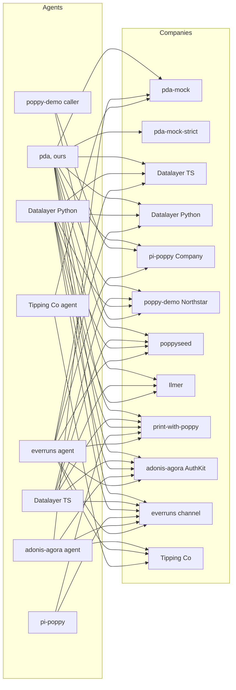

# The Poppy ecosystem

A map of everything around [Poppy, the Personal Agent Protocol](https://personalagentprotocol.org/), as of **13 October 2026** (pins, upstream heads and the spec site; the rest as of the evening of 12 October), four days after Draft 0.1 was published. It is meant to be kept up to date: each row says where it comes from and when it was last checked, and [the last section](#how-to-update-this-map) says how to check again.

The detail lives elsewhere. Every implementation, with licences and maturity, is in [implementations.md](implementations.md); what we found in their code is in [poppy-issues.md](poppy-issues.md); the spec's problems are in [spec-issues.md](spec-issues.md), with our chosen readings in [readings.md](readings.md); how our harness pairs them is in [interop-testing.md](interop-testing.md), and its last run in [interop-results/](interop-results/README.md). This page is the index.

**Method.** Read-only: GitHub (repositories, code, issues and pull requests), npm, PyPI, crates.io, web search, and the community lists. We read other projects' code at a pinned commit and run it only in Docker. We fetch a live Company's `poppy.json` and its issuer's metadata only with our validator CLI, once per host per survey, one host at a time; the hosts come from our records, public directories and other projects' pull requests. Nothing is posted to other projects.

## The spec

| Item | State on 13 October | Source | Checked |
| --- | --- | --- | --- |
| Draft 0.1, "Updated Oct 12, 2026" | The only version. The 12 October update changed no wire rule: the spec changed one link, and Extensions, Operations and the Guides only their date ([what changed](../spec/grounding.md#the-12-october-update)). Nine pages: home (with walkthroughs), introduction (was overview), spec, extensions, Operations extension v1, Guides, Path to 1.0 (new: the road to 1.0, the feedback process, the open topics and the design partners), licence, contributions. `/docs/overview` and `/docs/open-topics` redirect to their new places. | [personalagentprotocol.org](https://personalagentprotocol.org/) | 13 Oct, `node scripts/spec-snapshot.mjs`: the 12 October update found and stored (12 Oct, morning and evening: no changes) |
| Authors | Led by Sierra and Meta, with 35 named design partners (Sierra's post). Path to 1.0 lists 43 partners that agreed to be named: three personal agents (Instinct, Meta, OpenAI), 21 Companies and 19 technology providers, and invites more by email. | [sierra.ai/blog/poppy](https://sierra.ai/blog/poppy), [Path to 1.0](https://personalagentprotocol.org/docs/path-to-1#partners) ([our copy](../spec/draft-0.1-2026-10-12/pages/path-to-1.md)) | 12 Oct; Path to 1.0 13 Oct |
| Licence | Apache 2.0 for the specification, documentation and examples; not the names, logo or site design. Feedback is licensed to all members and users. | [licence](https://personalagentprotocol.org/license), [contributions](https://personalagentprotocol.org/license/contributions) | 12 Oct |
| Where it lives | Only on the website. No public source repository, issue tracker, changelog or `llms.txt`; the site links to none, and a GitHub search on the evening of 12 Oct found none. A copy of the source is in poppyseed's `spec/`. Feedback goes by email to feedback-personal-agent-protocol@sierra.ai, as inline comments exported from the site or written with the site's agent kit (Path to 1.0). | [spec-issues.md](spec-issues.md#how-we-found-them), [Path to 1.0](https://personalagentprotocol.org/docs/path-to-1#feedback) | 12 Oct, evening; the site 13 Oct |
| Our copy | A dated snapshot of every page, for citing | [spec/draft-0.1-2026-10-12](../spec/draft-0.1-2026-10-12/README.md) (the newest), [spec/draft-0.1-2026-10-09](../spec/draft-0.1-2026-10-09/README.md), [spec/grounding.md](../spec/grounding.md) | Snapshots taken 12 and 13 Oct |
| Change tracking | `node scripts/spec-snapshot.mjs` compares the live site with the newest snapshot (read-only); `--save` stores a new dated one | [`scripts/spec-snapshot.mjs`](../scripts/spec-snapshot.mjs) | Run 12 Oct, twice, and 13 Oct |

## Promised, not released

| Item | State | Source | Checked |
| --- | --- | --- | --- |
| Sierra's reference implementation | Promised "over the next month", with design workshops. Not published. Sierra's GitHub organisation is [sierra-inc](https://github.com/sierra-inc) (7 public repositories, all SDKs and forks; none for Poppy). | [Sierra's post](https://sierra.ai/blog/poppy) | 12 Oct, evening |
| Partner launches | None of the launch or design partners we know of serves a `poppy.json`: we checked Sierra and seven partners on 11 October ([implementations.md](implementations.md#not-found)), and PAP Checker's author checked them on 11 October too. | [dev.to article](https://dev.to/benjifisher/what-is-poppyjson-a-personal-agent-protocol-example-and-how-to-validate-yours-3d5m) | 12 Oct (no new fetch) |
| Muse with Redfin and Rocket | A video demo; no code, no endpoints, no spec version | [video](https://x.com/SierraPlatform/status/2108245197440307584), via [poppy.md](https://poppy.md/implementations) | 11 Oct |
| A shared conformance suite | None exists, and the draft doesn't mention one: its open topics are payments, push notifications and attachments, and Path to 1.0 plans implementation with design partners and feedback, not a test suite. Datalayer's 124 JSON cases are the nearest thing. | [open topics](https://personalagentprotocol.org/docs/path-to-1#open-topics), [our copy](../spec/draft-0.1-2026-10-12/pages/path-to-1.md) | 13 Oct |

## Personal Agents

"Grid" is whether our harness runs it ([`interop/registry.json`](../interop/registry.json)).

| Project | What | Language, licence | Grid | Source | Checked |
| --- | --- | --- | --- | --- | --- |
| This project (pda) | A hosted Personal Agent per User, on Durable Objects. Beyond Poppy: general tools (reading a public page, rendering it in Browser Run when it needs JavaScript; notes about the User; dates and exact sums) and reminders and scheduled tasks, with Web Push | TypeScript, Apache-2.0 | Yes | [adewale/dpa](https://github.com/adewale/dpa) | 12 Oct |
| openavt (new) | A Python Personal Agent client, `PAPClient`, and a custom extension that binds a Poppy Session's authority to a voice call; a local reference Company for its demo | Python, Apache-2.0 | No: a candidate for an agent adapter (it covers discovery, Sessions, the three sign-ins, refresh and Operations) | [ketanbj/openavt `docs/pap.md`](https://github.com/ketanbj/openavt/blob/9e99b622515b20d1b8d5405be229c7199d73dd60/docs/pap.md) | 14 Oct, docs read; code not run |
| Datalayer SDK | Client side of a both-sides SDK | Python, TypeScript; BSD-3-Clause | Yes, pinned at `00216eb` (0.17.0, 13 Oct; was `0c048aa`, 0.10.0). 0.11.0 to 0.17.0 add Reactor displays and an opt-in client that refuses private addresses, and change no wire behaviour the grid exercises | [datalayer/personal-agent-protocol](https://github.com/datalayer/personal-agent-protocol) | 13 Oct |
| pi-poppy | An extension for the pi coding agent | TypeScript, MIT | Yes, at `11ea106` | [richardanaya/pi-poppy](https://github.com/richardanaya/pi-poppy) | 13 Oct (no commits since 10 Oct) |
| adonis-agora agent | `poppy-client`, `poppy-agent` bin and "connections" in an AdonisJS agent library | TypeScript, MIT | Yes, pinned at `e139b95` (0.80.1, 13 Oct; was `e66a232`, 0.79.0); `poppy-client` unchanged | [DavideCarvalho/adonis-agora-agent](https://github.com/DavideCarvalho/adonis-agora-agent) | 13 Oct |
| nestjs-agent | `@dudousxd/nestjs-agent-poppy` (0.1.1, on npm since 12 Oct): a NestJS port of the adonis-agora agent. Its client is a verbatim copy of adonis-agora's `poppy-client`, plus connections and a `poppy-agent` CLI | TypeScript, MIT | No | [DavideCarvalho/nestjs-agent](https://github.com/DavideCarvalho/nestjs-agent) | 13 Oct (one docs commit since, `c0128df`) |
| poppy-demo caller | A demo caller Worker | TypeScript, none declared | Yes, at `02a9b30` | [irvinebroque/poppy-demo](https://github.com/irvinebroque/poppy-demo) | 13 Oct (no commits since 9 Oct) |
| everruns `poppy_client` | A capability of a production agent platform; since [#4577](https://github.com/everruns/everruns/pull/4577) (11 Oct) also for apps built on its framework. Still no sign-in. | Rust, MIT | Yes, pinned at `aceb2e2` (13 Oct; was `f470ad7`, 60 commits earlier, none in its Poppy code) | [everruns/everruns](https://github.com/everruns/everruns) | 13 Oct |
| Atlas (introspection-js-sdk) | A scripted demo agent in an open pull request | TypeScript, Apache-2.0 | No | [PR #441](https://github.com/introspection-org/introspection-js-sdk/pull/441) | 12 Oct (still open) |
| Tipping Co's agent (timothyohare) | A CLI Personal Agent with a callback host, from a learning demo: Direct Sign-In with PKCE, DPoP, an OpenAPI API; no conversations. No `typ` on its assertions; metadata by insertion | TypeScript, none declared | Yes, as `tipping-co` at `fb7b4e6` since 13 Oct ([`interop/impls/tipping-co-agent`](../interop/impls/tipping-co-agent)) | [timothyohare/personal-agent-protocol](https://github.com/timothyohare/personal-agent-protocol) | 13 Oct (no commits since 12 Oct; its README still says "planning") |
| Cloud Wallet pilot (Ekubo) | Only a public identity: client metadata, a JWKS and a sign-in callback page on GitHub Pages; the client itself isn't public | n/a | No | [EkuboProtocol/cloud-wallet-poppy-pilot-agent](https://github.com/EkuboProtocol/cloud-wallet-poppy-pilot-agent) | 12 Oct (new) |
| print-with-poppy's `scripts/agent.ts` | A reference client for that store, demo identity only | TypeScript, MIT (since 12 Oct) | No | [spenciefy/print-with-poppy](https://github.com/spenciefy/print-with-poppy) | 12 Oct |

## Companies and Company SDKs

| Project | What | Language, licence | Grid | Source | Checked |
| --- | --- | --- | --- | --- | --- |
| poppyseed | A Company library for Next.js, with a demo Company | TypeScript, MIT | Yes, at `f479fb6` | [akshay5995/poppyseed](https://github.com/akshay5995/poppyseed) | 13 Oct (no commits since 11 Oct) |
| Datalayer "Manzanita" | Reference Company on the SDK's Company side; since 0.13.0 a Session holding a scope no longer offered ends, since 0.15.0 a password reset ends earlier sign-ins, since 0.16.0 refusals are reported to telemetry | Python, TypeScript; BSD-3-Clause | Yes, pinned at `00216eb` (0.17.0) | [datalayer/personal-agent-protocol](https://github.com/datalayer/personal-agent-protocol) | 13 Oct |
| adonis-agora AuthKit | Company OAuth server and conversation endpoint in an AdonisJS kit; 0.79.0 (12 Oct) adds an admin page that blocks an agent, 0.80.0 a ready-made Mediated Sign-In by emailed code | TypeScript, MIT | Yes, pinned at `fe2a3ff` (0.80.0, 13 Oct; was 0.78.0) | [DavideCarvalho/adonis-agora-authkit](https://github.com/DavideCarvalho/adonis-agora-authkit) | 13 Oct |
| nestjs-agent Company | The same package's conversation endpoint (section 7, with SSE, handoff and Direct Conversations). No `poppy.json` and no authorization server: it checks tokens through a resolver that adonis-agora AuthKit provides | TypeScript, MIT | No | [DavideCarvalho/nestjs-agent](https://github.com/DavideCarvalho/nestjs-agent) | 12 Oct |
| pi-poppy test Company | A test peer in the pi-poppy repository | TypeScript, MIT | Yes, at `11ea106` | [richardanaya/pi-poppy](https://github.com/richardanaya/pi-poppy) | 13 Oct |
| poppy-demo Northstar | A demo retailer Worker that accepts only its own agent | TypeScript, none declared | Yes, patched, at `02a9b30` | [irvinebroque/poppy-demo](https://github.com/irvinebroque/poppy-demo) | 13 Oct |
| Ilmer.org | A local-history archive assistant, signed-out only. Since 12 Oct its main site, www.ilmer.org, also serves a `poppy.json` naming the same issuer, and its agent gained web search and fetch tools | TypeScript, MIT | Yes, pinned at `de0d1ec` (13 Oct; was `4ca76e0`), with a stand-in Workers AI binding the new tools need | [rbirkby/Ilmer.org](https://github.com/rbirkby/Ilmer.org) | 13 Oct |
| everruns `poppy` channel | Hosts a Company's Poppy endpoints, signed-out only | Rust, MIT | Yes, pinned at `aceb2e2` (13 Oct; was `f470ad7`, 60 commits earlier, none in its Poppy code) | [everruns/everruns](https://github.com/everruns/everruns) | 13 Oct |
| Spot | A cart-approval and payment service | JavaScript, none declared | No | [futurebasicsrepo/…-client-hub-api](https://github.com/futurebasicsrepo/futurebasicsrepo-client-hub-api) | 13 Oct (last commit 12 Oct) |
| print-with-poppy | An agent-first photo-printing store: signed-out Sessions, OpenAPI, Operations v1 required for orders; agents on an allowlist. Since 12 Oct (`260dbb4`) optional accounts: Direct and Mediated Sign-In by an emailed code, `poppy:read` for order history, `poppy:write` to order into the account. Since 13 Oct a hosted Agent Sandbox for testing agents without cards (sandbox.printwithpoppy.com), mixed products in one order and private coupons | TypeScript (Express, SQLite), MIT (since 12 Oct) | Yes, pinned at `246727d` (13 Oct; was `260dbb4`), unpatched: D, S0, CM, SD, SX, SMC, SO, AO, AS, R, and OU with pda only ([`interop/impls/print-with-poppy-company`](../interop/impls/print-with-poppy-company)) | [spenciefy/print-with-poppy](https://github.com/spenciefy/print-with-poppy) | 13 Oct |
| Tipping Co (timothyohare) | A learning-demo Company for an NRL tipping service: signed-out and Direct Sign-In Sessions, DPoP, refresh and revocation, OpenAPI; in-memory stores. Requires the token endpoint as `aud`, at revocation too | TypeScript (Hono), none declared | Yes, as `tipping-co` at `fb7b4e6` since 13 Oct ([`interop/impls/tipping-co-company`](../interop/impls/tipping-co-company)) | [timothyohare/personal-agent-protocol](https://github.com/timothyohare/personal-agent-protocol) | 13 Oct (no commits since 12 Oct) |
| Flight Sector (introspection-js-sdk) | The demo Company in PR #441 | TypeScript, Apache-2.0 | No | [PR #441](https://github.com/introspection-org/introspection-js-sdk/pull/441) | 12 Oct |
| TYPO3 lab | A signed-out "knowledge profile" in a private extension | PHP, private | README only | [dirnbauer/webconsulting-typo3-lab](https://github.com/dirnbauer/webconsulting-typo3-lab) | 12 Oct |
| Fillthemat (planned) | A growth platform for martial-arts schools planning to make each School a Company: one issuer per School with a path (`https://auth.fillthemat.com/schools/<id>`), metadata by RFC 8414 insertion, signed-out Sessions first. Draft PR; nothing served from merged code | TypeScript, MIT | No | [fillthemat/fillthemat PR #200](https://github.com/fillthemat/fillthemat/pull/200) | 12 Oct |

## Both-sides SDKs

Datalayer (Python and TypeScript, published as `personal-agent-protocol` on PyPI and `@datalayer/personal-agent-protocol` on npm, 0.17.0 on 13 October), adonis-agora (agent and AuthKit), nestjs-agent (a port of adonis-agora's code), everruns, and the three demos (poppy-demo, introspection's travel demo, timothyohare's Tipping Co) each cover both sides. Only Datalayer is a standalone SDK; the others are inside a framework.

## Checkers, validators and linters

| Tool | What it checks | Open? | Source | Checked |
| --- | --- | --- | --- | --- |
| Our validator | `poppy.json`, the issuer's metadata, client metadata and JWKS; 76 messages, each with an explanation, a fix and a reference | Yes (in this repo); live at [/validator](https://personal-agent.adewale-883.workers.dev/validator) | [`src/validator/`](../src/validator) | 12 Oct |
| poppy-validator | A linter for `poppy.json` and the issuer's metadata: 64 rules, each with a spec section and a basis (MUST, field table, advisory, context), a JSON Schema, `--json` and `--strict` | Yes: Python, MIT, not on PyPI | [tusharck/poppy-validator](https://github.com/tusharck/poppy-validator) at `d2220bf` (still its head on 13 Oct) | 13 Oct |
| poppy-sidecar | A `poppy.json` generator, a 25-check validator, and a "testbed" that checks an agent's self-reported action trace against granted scopes | Yes: Python, MIT; its README's PyPI badge points at a package that doesn't exist | [habib-analyst/poppy-sidecar](https://github.com/habib-analyst/poppy-sidecar) at `858db66` (still its head on 13 Oct) | 13 Oct |
| PAP Checker | Checks a domain from outside (discovery, OAuth metadata, OpenAPI, MCP resource metadata), with a public directory of domains seen | No (closed); by Benji Fisher, who also runs UCP Checker. On the evening of 12 Oct it said it had checked 18 domains; its directory listed 6 | [papchecker.com](https://papchecker.com), [its directory](https://papchecker.com/sites) | 12 Oct, evening |
| Ora's poppy.ax and `ax` CLI | A guide and a domain checker; `ax generate-files` (0.9.0, 12 Oct; 0.9.1 the same day) writes a starter `poppy.json` (`organization` and `web: {}` only) that Ora's API decides | Front end and CLI open (MIT); checks in Ora's closed API | [ora/poppy-ax](https://github.com/ora/poppy-ax), [ora/ax](https://github.com/ora/ax) | 12 Oct |
| Flow's checker | Readiness levels 0–3, plus a compliance checklist | No | [flow.engineer/poppy](https://flow.engineer/poppy) | 11 Oct |
| poppyseed's check command; Datalayer's `pap company verify` | Each project's conformance runner for a Company | Yes | the projects above | 11 Oct |
| Datalayer's conformance cases | 124 language-neutral JSON cases, unchanged from 0.6.0 to 0.17.0; we run them against our client and validator (13 Oct, at 0.17.0: 24 pass, 2 fail on readings, 98 n/a) | Yes, BSD-3-Clause | [interop/vectors/datalayer](../interop/vectors/datalayer) | 13 Oct |

A committed script, [`interop/vectors/validators/`](../interop/vectors/validators/README.md), runs the two open validators and ours over the same 107 `poppy.json` documents (rerun on 13 October at both pins, with the same counts as on 12 October); the results are in [interop-testing.md](interop-testing.md#validator-cross-check).

## Companies you can reach

None is a large business. Tilopay is a payment company; the rest are small businesses, demos and sandboxes. On the evening of 12 October we ran our validator CLI once against each host below except the TYPO3 lab: every one is valid, with no errors or warnings ([verdicts and info notes](implementations.md#live-companies-checked-on-12-october)). None of the three new ones offers sign-in.

| Host | What it is | Sign-in | How we know | Checked |
| --- | --- | --- | --- | --- |
| [spotmeplease.com](https://spotmeplease.com/.well-known/poppy.json) | Spot, a small cart-approval product | Guest Sessions and Direct Sign-In | Its repository; fetched 11 Oct ([implementations.md](implementations.md)) | 12 Oct: valid, no messages |
| [withpoppyseed.dev](https://withpoppyseed.dev) | "Poppy Travel", poppyseed's demo | Direct, device and mediated (PAP Checker's directory) | Its repository | 12 Oct: valid, no messages |
| [poppy-receiver.roundtrip.workers.dev](https://poppy-receiver.roundtrip.workers.dev/.well-known/poppy.json) | Northstar Outfitters, poppy-demo's retailer | Direct Sign-In, its own caller only | Its repository | 12 Oct: valid, 1 info |
| [poppy.ilmer.org](https://poppy.ilmer.org/.well-known/poppy.json), and ilmer.org through www.ilmer.org | Ilmer's local-history archive; since 12 Oct the main site's `poppy.json` names the same issuer | Signed-out only | Its repository | 12 Oct: valid, info only |
| TYPO3 lab `/poppy/demo` | A protocol playground | Behind a login | Its repository | 11 Oct (not fetched) |
| flowers.papsandbox.com | "Northlight Flowers"; the name suggests a sandbox | Direct Sign-In (PAP Checker's directory) | [PAP Checker's directory](https://papchecker.com/sites), first seen 11 Oct | 12 Oct: valid, no messages |
| tilopay.shop, tilopay.tilopay.shop | Tilopay, a payment company: an MCP server for searching and buying from its merchants' stores, payment only on its own 3-D Secure page (extension `tilopay.com/hosted-checkout`). The issuer, `mcp.tilopay.com`, is shared by 14 domains, most of them stores ([N11](spec-issues.md#n11)) | Signed-out only | PAP Checker's directory, first seen 12 Oct | 12 Oct: valid, 1 info each (PAP Checker: 1 problem each) |
| [salespeak.ai](https://salespeak.ai/agent-endpoint/) (new) | Salespeak, a vendor of AI sales agents for business websites. Its `poppy.json` redirects to a host under `agents.salespeak.ai` with an issuer of its own; customers can ask for the same on their domains | Signed-out conversations only | A Salespeak employee's [pull request](https://github.com/ora/standards/pull/6) to Ora's standards page | 12 Oct: valid, 1 info |
| emorahealth.com (new) | Emora Health, a virtual mental-health service for children, teens and young adults. Its issuer has a path, `https://www.emorahealth.com/poppy`, with metadata only at the RFC 8414 inserted location ([S3](spec-issues.md#s3)) | Signed-out conversations only | PAP Checker's directory, first seen 12 Oct | 12 Oct: valid, 1 info |
| [printwithpoppy.com](https://printwithpoppy.com) | Print with Poppy, the store above, live: real payments (Stripe Checkout) and prints (Prodigi) whenever `/api/catalog` says `mode: live`. Its hosted example was print-with-poppy.vercel.app, in demo mode | Guest Sessions for agents on an allowlist (ours is on it); accounts since 12 Oct. A non-Poppy "compatibility" path, documented apart from the Poppy description since 12 Oct | The owner's deployed agent, 12 Oct: discovery, a Session, the catalogue, and an upload's approval card ([poppy-issues.md](poppy-issues.md#print-with-poppy-spenciefyprint-with-poppy)) | 12 Oct |
| [www.alpine-retail.com](https://www.alpine-retail.com/.well-known/poppy.json) (new) | Alpine Retail, a retail demo by a colleague of this project's owner: the first live Company we know of with a Company Agent (conversations). Its OpenAPI API is three DPoP-protected reads (inventory, rewards points, who the session belongs to); no Operations, no website section. Source not public. The apex redirects to `www.` | Direct (`poppy:read`, `poppy:write`, a custom `addresses` scope) and Mediated (a phone number, `poppy:read`) | Its developer, 13 Oct | 13 Oct: valid, no messages. In the live lane with its developer's approval: D, S0, N and C pass since 14 October, with the live lane's public identity (on 13 October S0, N and C stopped at its `invalid_client`, since the lane's agent had no public `client_id`; [interop-testing.md](interop-testing.md#the-live-lane-first-run-13-october)). Through the deployed agent, 13 and 14 Oct: conversations, API reads, Direct Sign-In, a refresh and sign-out all work; its revocation takes only the token endpoint as `aud` ([S1](spec-issues.md#s1)) |

Ora's poppy.ax had seen only poppy-receiver.roundtrip.workers.dev on 10 October (its `fixtures/sites.json`). On the evening of 12 October PAP Checker said it had checked 18 domains, and its directory listed 6. printwithpoppy.com, print-with-poppy's own domain, was valid with 3 info notes that evening.

## Adjacent and declined

| Item | Kind | Source | Checked |
| --- | --- | --- | --- |
| OpenAgents | Proposal to support both sides, closed as not planned (11 Oct) | [OpenAgentsInc/openagents#11239](https://github.com/OpenAgentsInc/openagents/issues/11239) | 11 Oct |
| orka | Tracking issue: "We should not build anything yet" | [orka-agents/orka#774](https://github.com/orka-agents/orka/issues/774) | 11 Oct |
| tiny-poppy-gate | A teaching toy "inspired by" the draft: an in-memory scope gate with its own document shape. No network, no OAuth; "not an implementation of the protocol". | [bobbyhalljr/tiny-poppy-gate](https://github.com/bobbyhalljr/tiny-poppy-gate) | 12 Oct |
| OpenLine POPPY-PROOF-001 | An extension prototype: the Company verifies the owner's authorisation for an operation itself (Envoy ext_authz), "do not merge" | [terryncew/openline-receipt-gate#105](https://github.com/terryncew/openline-receipt-gate/pull/105) | 12 Oct |
| mission-bound-authorization | Evaluates the draft and sketches a standing-permissions extension | [mcguinness/mission-bound-authorization#1189](https://github.com/mcguinness/mission-bound-authorization/pull/1189) | 11 Oct |
| poppy-operations-findings | A literal sandbox of the Operations extension with five findings | [SmokeSol/poppy-operations-findings](https://github.com/SmokeSol/poppy-operations-findings) | 12 Oct (no commits since 9 Oct) |
| IETF vCon | A charter pull request on linking a conversation to the order and payment an agent made | [draft-ietf-vcon-vcon-core#41](https://github.com/ietf-wg-vcon/draft-ietf-vcon-vcon-core/pull/41) | 12 Oct |
| Service Handshake extension | A proposed extension, `dualcx.com/service-handshake`: declarations of what an agent may agree to, and a Company's allow, deny, hold or escalate decision bound to Operations. Schema and examples only | [neos-wave/service-handshake-pap-extension](https://github.com/neos-wave/service-handshake-pap-extension) | 12 Oct (new) |
| EMILIA Gate | An Operations v1 reference with optional signed approval evidence, offline with synthetic tokens (open PR) | [emiliaprotocol/emilia-protocol#916](https://github.com/emiliaprotocol/emilia-protocol/pull/916) | 12 Oct (new) |
| slicc-cdp | A browser-automation tool's planned `poppy.json` probe (open issue) | [ai-ecoverse/slicc-cdp#95](https://github.com/ai-ecoverse/slicc-cdp/issues/95) | 12 Oct (new) |
| personal-budget | An app's open question whether Poppy applies to its MCP plans | [rmartz/personal-budget#540](https://github.com/rmartz/personal-budget/issues/540) | 12 Oct (new) |
| PACT | A separate protocol (Decagon and Instinct), on A2A and OAuth | [openpactprotocol](https://github.com/openpactprotocol/openpactprotocol) | 11 Oct |
| Pre-draft models | Cobus Greyling's sample, agent-ledger, trust_gateway: `/.well-known/personal-agent.json`, not Draft 0.1 | [implementations.md](implementations.md#related-but-not-implementations) | 11 Oct |
| Lists and trackers | [awesome-poppy](https://github.com/JaviChulvi/awesome-poppy) (added PAP Checker on 11 Oct and poppy-validator on 12 Oct), [poppy.md](https://poppy.md/implementations) (checked against its sources on 12 Oct; it now also lists poppyseed, PAP Checker and awesome-poppy, none of them new to us), [awesome-muse](https://github.com/cszach/awesome-muse) | as linked | 12 Oct, evening |

False positives in searches are listed in [implementations.md](implementations.md#related-but-not-implementations).

## How they work together

Our [interop grid](interop-results/README.md) ran eight Personal Agents against twelve Companies (our two mocks included) on 13 October, over 30 scenarios, on a network with no internet access, with every pin at its upstream's head that morning ([interop-testing.md](interop-testing.md#pins-moved-on-13-october)): **2,880 cells, 1,000 pass, 273 fail, 1,607 unsupported, 0 errors**. Every failure is a known upstream or spec failure. The separate security grid, run against our own implementations, passed **32 of 32**; later that day, with the new attacks XR and XT, our agent passed all 78 cells it ran against both mocks and the malicious Company. Against the 12 October grid, no cell changed with the pin moves; the new cells are everruns' (in the main grid for the first time) and Tipping Co's, which joined on both sides.

### Scorecard

Each implementation's cells, as pass / fail / unsupported, summed over the grid's row (as a Personal Agent) or column (as a Company). The percentage is passes among the cells that ran, because an unsupported cell means one side doesn't offer that feature, which is no failure. A failure counts against both ends of its cell, so read the last column before blaming a side: the [attribution rules](interop-spec.md) decide whose it is, and [the results](interop-results/README.md) list every failure by rule.

**As a Personal Agent** (against all twelve Companies):

| Agent | Pass / fail / unsupported | Passes where run | What its failures are |
| --- | --- | --- | --- |
| pda (ours) | 213 / 1 / 146 | 99.5% of 214 | SO at Tipping Co: it signs the revocation request's client assertion for the revocation endpoint, and Tipping Co wants its token endpoint there too ([S1](spec-issues.md#s1), the spec's). |
| Datalayer Python | 201 / 8 / 151 | 96% of 209 | Device Sign-In polling ignores `use_dpop_nonce` (SVN); it requires `conversation_id` in handoff and close answers, which our mocks don't send (7.9, 7.12); SO at Tipping Co (S1). |
| Datalayer TS | 197 / 12 / 151 | 94% of 209 | The same SVN failure; its event stream gives up after five quick reconnects (CS); the handoff and close answers; SO at Tipping Co (S1). |
| adonis-agora | 141 / 47 / 172 | 75% of 188 | Its assertions carry no `typ`, which three Companies refuse ([S2](spec-issues.md#s2), the spec's); its device and revocation `aud` ([S1](spec-issues.md#s1)); renewal without `session_id` at Datalayer. |
| everruns | 33 / 11 / 316 | 75% of 44 | Its Session assertion has no `typ` (S2); it fetches metadata only at the appended location, so DP fails at both our mocks ([S3](spec-issues.md#s3)). Signed-out only, conversations and no APIs. |
| pi-poppy | 147 / 55 / 158 | 73% of 202 | No `typ` (S2); it resends the Session assertion on a nonce retry, and at the token endpoint retries only when `WWW-Authenticate` names the nonce error; it throws when a Company ends the Session ([N39](spec-issues.md#n39)). |
| poppy-demo caller | 39 / 69 / 252 | 36% of 108 | It requires the issuer to be the Company's origin, though the draft's examples put it elsewhere, needs an `agent` member and an `authorization_endpoint`, and always asks for its hard-coded scopes. |
| Tipping Co's agent | 29 / 70 / 261 | 29% of 99 | It sends no `client_id` at the token endpoint (RFC 7521 4.2 allows that), which every third-party Company refuses; it requires `authorization_endpoint`, so it can't discover a signed-out Company. It passes everything it claims at its own Company and at pda-mock. |

**As a Company** (against all eight agents):

| Company | Pass / fail / unsupported | Passes where run | What its failures are |
| --- | --- | --- | --- |
| poppyseed | 126 / 12 / 102 | 91% of 138 | Mostly the agents': adonis-agora's `aud` (S1), poppy-demo's parse of an empty revocation answer, Tipping Co's agent's missing `client_id`. |
| pi-poppy Company | 123 / 13 / 104 | 90% of 136 | The agents': Datalayer's SVN polling, pi-poppy's own nonce retry, adonis-agora's `aud`, Tipping Co's agent's missing `client_id`. |
| Datalayer TS / Python | 112 / 17 / 111 each | 87% of 129 | Its renewal requires `session_id`; its cancel sends `result.data: null` ([N41](spec-issues.md#n41)); poppy-demo's hard-coded scopes; Tipping Co's agent's missing `client_id`. |
| pda-mock (lenient reference) | 143 / 23 / 74 | 86% of 166 | The agents': nonce retries, Datalayer's SVN polling, CS stream and handoff and close answers, poppy-demo's issuer rule, everruns' S3 reading (DP). |
| everruns channel | 24 / 5 / 211 | 83% of 29 | poppy-demo's issuer-origin rule (D, S0, C) and Tipping Co's agent's need for `authorization_endpoint`. |
| adonis-agora AuthKit | 112 / 24 / 104 | 82% of 136 | The agents': poppy-demo's issuer-origin rule, pi-poppy's nonce retry, Tipping Co's agent's missing `client_id`. |
| Tipping Co | 50 / 13 / 177 | 79% of 63 | It wants the token endpoint as `aud` at revocation (S1), so four agents fail SO; pi-poppy's nonce retry; poppy-demo's missing `agent` member. |
| print-with-poppy | 47 / 16 / 177 | 75% of 63 | poppy-demo's crash on its missing `agent` member (7 cells), adonis-agora's revocation `aud` (S1), which the store answers with 500, not `invalid_client` (SO), and Tipping Co's agent's missing `client_id`. No conversations, so most scenarios don't apply. OU, which only pda claims, passes. |
| poppy-demo Northstar | 50 / 32 / 158 | 61% of 82 | It refuses assertions without `typ` (S2 `jwt-60s`); poppy-demo's own agent passes there. |
| Ilmer | 18 / 18 / 204 | 50% of 36 | It refuses assertions without `typ` (S2); poppy-demo's crash; Tipping Co's agent's need for `authorization_endpoint`. Signed-out only. |
| pda-mock-strict | 83 / 83 / 74 | 50% of 166 | It refuses assertions without `typ`, our strict reading of S2, so pi-poppy, adonis-agora, everruns and Tipping Co's agent fail almost every cell. |

Not in the grid: nestjs-agent (its Company needs adonis-agora's AuthKit, which the grid already runs), Spot (it publishes valid discovery, but has no adapter), the TYPO3 lab (private), Atlas and Flight Sector (an open pull request), and the live Companies with no public code (Salespeak, Emora Health, Tilopay, Northlight Flowers). [interop-testing.md](interop-testing.md#candidates-from-the-12-october-survey) says what the 12 October candidates would need.

An edge below means no cell between that pair failed; a missing edge means at least one did. Unsupported cells count for nothing either way, so an edge between two small implementations can rest on a few cells: each signed-out Company's edges rest on one to four, and every edge to everruns' channel or from everruns' agent on at most four.

At print-with-poppy and Tipping Co, everruns' agent runs only D (it starts a Session only for a conversation). pda's one missing edge is Tipping Co, over SO and the S1 reading; Tipping Co's agent reaches pda-mock only since our mock stopped requiring `client_id` on 13 October.

pi-poppy's only clean pairs are print-with-poppy and everruns' channel. At every other Company one of four habits fails a cell: it resends the Session assertion on a nonce retry, retries a token request only when `WWW-Authenticate` names the nonce error, gives up when a Session ends, and sends no `typ`.

What the grid found in each project is in [poppy-issues.md](poppy-issues.md); the failures by rule are in [interop-results/](interop-results/README.md).

## Open fault lines

Where the draft is ambiguous, implementations already disagree. The questions are in [spec-issues.md](spec-issues.md); our readings and why are in [readings.md](readings.md). How each implementation reads the four that most often break a pair (from each adapter's declared readings, or from its code where it has no adapter; for a Company, "omits" means it expects no `scope` there):

| Implementation | S1 client assertion `aud` | S2 assertion `typ` and lifetime | S3 metadata for an issuer with a path | S4 `scope` on a signed-out Session |
| --- | --- | --- | --- | --- |
| pda (agent) | endpoint called | `typ: JWT`, `kid`, 60 s | insertion | omits |
| pda-mock / pda-mock-strict | endpoint, token endpoint or issuer | any, 300 s / `typ: JWT`, `kid`, 60 s | insertion | ignores |
| Datalayer agents | endpoint called | `typ: JWT`, 60 s | insertion | omits |
| Datalayer Companies | endpoint called, token endpoint or issuer (0.10.0) | `typ` absent or `JWT`, 120 s, `jti` of 16+ characters (0.10.0) | insertion | omits or ignores |
| pi-poppy agent / Company | endpoint called / endpoint called | no `typ` on Session assertions / any, 120 s | append / either | omits / ignores |
| poppy-demo caller / Northstar | endpoint called / endpoint called | `typ: JWT`, 60 s / required | append / n/a | omits / `invalid_scope` |
| adonis-agora agent / AuthKit | token endpoint / either | no `typ`, 60 s / any | insertion / either (serves both) | omits / omits |
| poppyseed | endpoint called | any | either | ignores |
| Ilmer | token endpoint | `typ: JWT`, `kid`, 60 s | either | omits |
| everruns agent / Company | token endpoint / token endpoint or issuer | Session assertion without `typ` / any, 300 s | append / either | omits / `invalid_scope` |
| print-with-poppy | endpoint called (token and revocation) | any `typ` except the browser one, 120 s | n/a (issuer is the origin) | `invalid_scope` (since `260dbb4`; it ignored it before) |
| Fillthemat (planned) | this School's token endpoint, exactly | not stated | insertion (path issuers) | not stated |
| nestjs-agent | token endpoint (as adonis-agora) | no `typ`, `kid`, 60 s | insertion | omits |
| timothyohare agent / Company | token endpoint / token endpoint, at revocation too | no `typ`, `kid`, 60 s / any `typ`, ES256 only, up to 300 s after `iat` | insertion / n/a (issuer is the origin) | omits / ignores |
| Emora Health (live) | not known | not known | insertion only: the appended location is 404 | not known |

The others most often met: [S9](spec-issues.md#s9) (a retried first message), [S23](spec-issues.md#s23) (nonce scope), [N39](spec-issues.md#n39) (the error for an ended Session) and [N41](spec-issues.md#n41) (`null` for an optional member). Validators disagree too, mostly on how strict to be where the draft has no keyword: see the [cross-check](interop-testing.md#validator-cross-check).

## How to update this map

1. **The spec.** Run `node scripts/spec-snapshot.mjs`. If any text differs, store a snapshot with `--save` and re-check [spec/grounding.md](../spec/grounding.md).
2. **Sierra.** Read [Sierra's post](https://sierra.ai/blog/poppy) and list [sierra-inc](https://github.com/sierra-inc)'s public repositories (`curl -s https://api.github.com/orgs/sierra-inc/repos`; `gh api` needs SSO for that organisation).
3. **New projects.** `gh search repos "<term>" --created ">=<last check>"` for `poppy`, `"personal agent protocol"`, `poppy.json`; `gh search code` for `well-known/poppy`, `poppy_domains`, `browser_session_endpoint`, `poppy:write`, `"Personal Agent Protocol"`; `gh search issues --include-prs` for the same since the last check. Then npm (`registry.npmjs.org/-/v1/search?text=…`), PyPI (`pypi.org/pypi/<name>/json`) and crates.io. Read [awesome-poppy](https://github.com/JaviChulvi/awesome-poppy), [poppy.md](https://poppy.md/implementations) and [PAP Checker's directory](https://papchecker.com/sites). Expect noise: Poppy Playtime, the Poppy robot, PoppyDB.
4. **Existing rows and pins.** `gh api repos/<owner>/<repo>` for `pushed_at` and `archived`, and `…/commits?per_page=3` and `…/releases?per_page=2`. For each upstream [`interop/registry.json`](../interop/registry.json) pins, `git ls-remote <source> HEAD`, and for one that moved, `gh api repos/<owner>/<repo>/compare/<pin>...<head>` (or a blobless clone when the compare passes 300 files) to read what changed in its Poppy code.
5. **Reading code.** Download a tarball at a pinned commit into a new empty directory, and read it there. Run third-party code only in Docker, never on the host.
6. **Live Companies.** Find hosts in public directories, articles and pull requests, and record who listed each. Check each once with `npm run validate -- <domain>`, one host at a time: it fetches the `poppy.json`, following redirects, and the issuer's metadata, and nothing else. No other requests: no Sessions, no conversations.
7. **Moving a pin.** Change the commit in the adapter's `Dockerfile`, its adapter's `commit` constant, `interop/registry.json`, and any line-anchored links in its README and `interop/known-failures.json` (find the same lines at the new commit; don't just swap the hash). Rebuild it and smoke-test it with our agent or our mock (`--scenarios D,S0` at least), and add a "what changed upstream" note to its README.
8. **Record it.** Update the rows here and in [implementations.md](implementations.md), change the date at the top of both, and add a pinned adapter to the grid where one fits ([interop-testing.md](interop-testing.md)).
