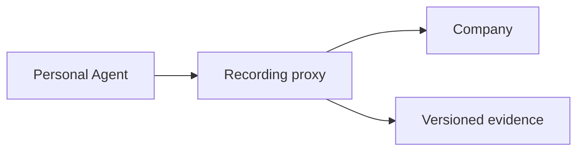

# The Poppy ecosystem

A map of known projects around [Poppy, the Personal Agent Protocol](https://personalagentprotocol.org/), refreshed manually on **19 November 2026**. This review rechecked 80 public Company hosts and 57 repository heads, and ran the current Print with Poppy source through the isolated interop grid. Directory totals, source claims, discovery results and executed journeys are identified separately. Earlier evidence keeps its original date.

This page owns ecosystem observations. [Current protocol verification](poppy-0.4-conformance.md#current-verification) owns PDA's verification status; [the 1.0 upgrade](poppy-1.0-upgrade.md) records the published-version alignment. The [harness contract](interop-spec.md) describes the tests. The [frozen implementation catalogue](https://github.com/adewale/pda/blob/289c6592c6f6e629b1d525247f3c4e2243662bc2/docs/implementations.md) preserves the earlier licence and maturity survey.

## Current ecosystem — 19 November 2026

Poppy **1.0 was published and frozen on 14 November**. Upstream now has a separate 1.1 draft and tells implementers to build against 1.0. PDA's repository supports published 1.0 beside frozen 0.4. Its live [build-info](https://poppydemoagent.dev/api/build-info), observed on 19 November, reports clean commit `d9323da`, versions 0.4 and 1.0, and the **13 November draft pin for 1.0**. The final-1.0 alignment is merged in the repository but has not reached that served build ([receipt](evidence/ecosystem-2026-11-19/deployment.json), [deployment tasks](deployment-tasks.md)). No deployment was made for this survey.

### The independent Company: Print with Poppy

[Current source `f4b839e`](https://github.com/spenciefy/print-with-poppy/tree/f4b839e8d4a08dc33d7e17fd2721fae4ac8ad802), dated 16 November, still implements **0.4**, Operations 3 and Mediated Sign-In 1. Both `printwithpoppy.com` and `sandbox.printwithpoppy.com` passed current discovery validation at 0.4, with no errors or warnings. Their deployed commits were not established from those documents.

The current source passed **30 of 30 isolated interop cases**, ten each with PDA, the lenient agent and the strict agent; there were no failed, unsupported or errored cells and no warnings ([receipt](evidence/ecosystem-2026-11-19/interop.json)). The tests include Direct and Mediated Sign-In, API access, sign-out, refusal and consent cases, and a photo upload followed by exact-terms approval. The Company ran unpatched in its demo mode on a Docker network with no external route. Payments, printing and email were simulated. No live authenticated journey or real order was attempted.

Only `src/main.tsx` and `src/style.css` changed between our maintained `20a3d56` pin and current HEAD. The executable backend and dependencies are unchanged. The current HEAD was selected in a temporary worktree for this run; the maintained peer pin stays at `20a3d56` because a homepage change adds no protocol coverage. [The interop report](interop-spec.md#print-with-poppy-at-20a3d56) retains both runs.

### Implementations and tooling

The [repository receipt](evidence/ecosystem-2026-11-19/repositories.json) records all 57 default-branch heads: the previous survey's 42 and 15 additional projects. Eighteen heads were unchanged. Its review labels distinguish source inspection, README claims and unchanged source; a new head alone is not a protocol upgrade. Except for Print with Poppy, these implementations were not executed against PDA.

| Project | Current observation | Evidence and limit |
| --- | --- | --- |
| [Datalayer Python and TypeScript SDKs](https://github.com/datalayer/personal-agent-protocol/tree/3d1463e28b4a648b18b6c44d045693277fc693e6) | **0.37.5**, released on npm and PyPI; **published 1.0 is the default**, with 0.4 available when selected. Implements both roles, including reference Companies | Reviewed `protocol/UPSTREAM.md` and both profile modules. They identify the frozen 14 November text, not draft 1.1. Strong candidate for an independent 1.0 grid peer; not yet in our grid |
| [Descope `poppy-agent`](https://github.com/descope/poppy-agent/tree/3c33139a767fe36cebd259f9ad5355d58718c0f0) | Renamed from `poppy-js`; source supports **1.0, 0.4 and 0.3** | `src/discovery.ts` lists those versions. Package source says 1.0.0, but the public npm lookup returned 404 and the README says to install from source. Not an executed interop result |
| [Authlete Company](https://github.com/authlete/poppy-company/tree/3d5b8d327300cc12cc05856a5f2dc77e84246434) | Declares **1.0**; `stays.poppysandbox.dev` passed discovery at 1.0 | Reviewed the Company configuration and metadata. Authenticated behavior was not exercised |
| [Authlete agent playground](https://github.com/authlete/poppy-agent-playground/tree/6c47e92e2b719202cf346d99a3048b6a7e2ad39e) | Locally patched, vendored 0.3 client also accepts **1.0** | Reviewed its documented PAR, discovery and version-header patches. This does not establish that every final-1.0 difference is implemented |
| [AgentConnect `dsh-pap`](https://github.com/AgentConnect/dsh-pap/tree/d705fbf08fe2e6088afbb2b2a0c6b444978f6c97) | DSH client now uses **1.0** | Read the client and discovery code. Its separate `service-agent` README still describes a signed-out **0.3** Company |
| [Auto Agent Protocol](https://github.com/auto-agent-protocol/auto-agent-protocol/tree/90865ef83496b059ab3570a5914c1bfaae435b46) | AAP 4.0 documents a **PAP 1.0** automotive binding | Binding documentation reviewed; its conformance claim was not tested here |
| [poppy-go](https://github.com/ofershap/poppy-go/tree/ceef9ea383e2f1fcc18b1bbaa3cf15574d9367b7) | Go Company-side primitives targeting **1.0**; README still calls it a draft | Source includes 1.0 documents and five-minute assertion acceptance. No full final-version review or grid run here |
| [Bash agent](https://github.com/abbaspour/poppy-bash) and [Cloudflare/Auth0 Company](https://github.com/abbaspour/poppy-sample-company-cloudflare-auth0) | Separate **1.0** examples | Current README claims, not executed results |
| [Magento module](https://github.com/brosenberger/module-poppy) | **1.0 discovery** | Publishing discovery is its stated scope; it is not evidence of a complete Company implementation |
| [vishkaty's agent checker](https://github.com/vishkaty/poppy-agent-conformance/tree/aac0ec69f608f9843681d466b617dbc67f218e17) and [verification LAB](https://github.com/curtismu7/poppy-verification-LAB) | New **1.0** verification tools | The request-log checker documents 27 checks with a narrower scope than full cryptographic or Company verification. Neither was run against PDA |
| [Pollen](https://github.com/NHTanvir/pollen), [Poppy Probe](https://github.com/gangjig/poppy-probe) and [Ora's guide/checker](https://github.com/ora/poppy-ax) | **1.0 metadata checking** | These check documents or present a checker's results; that does not prove sign-in, Sessions or actions |
| Older-version projects | `pi-poppy` remains 0.1; the ohartwig integrations still describe 0.2; PoppyKit's older 0.3 heads are unchanged; SecSimply's separate Next.js Poppyseed describes 0.3 | The receipt retains exact revisions and marks projects whose current wire support was not established. Old support is not silently carried forward after an unrelated repository update |

### Public discovery

**80 exact hosts** were checked: the previous 58 and 22 additional hosts from public listings and primary-source examples. The current validator selected the version each document declares. Reads were sequential, metadata-only and at least one second apart. The temporary transport pinned HTTPS to verified public IPs through the managed proxy; no runtime policy was changed ([method and reports](evidence/ecosystem-2026-11-19/discovery.json)).

| Result | Hosts | Meaning |
| --- | ---: | --- |
| Valid 1.0 discovery | **14** | Includes Cliffside/Alpine, Stacktree, Emora, the flowers/stays demos, Authlete's stays example, Chargezen and the Wix site `www.bkoc.no` |
| Valid 0.4 discovery | **11** | Includes Print with Poppy's two hosts, You.com, the B2B demo and four Shopify storefronts |
| Unsupported version | **40** | Fourteen declared 0.1, seven 0.2 and nineteen 0.3. Their own-version conformance was not judged |
| Current-version discovery rejected | **3** | One 0.4 and two 1.0 discovery chains failed validation; declaring a supported version is not enough |
| Indeterminate | **12** | HTTP refusal, missing documents or a failed fetch prevented a check |

Warning-only reports can still be valid; the receipt keeps every warning. Counts are hosts, not unique Companies. Exact hostnames matter: `byltbasics.com` declared 0.3, while `www.byltbasics.com` declared 0.4 and passed. Both GEICO hostnames were inconclusive from this environment, despite directory reports of a 1.0 document. None of these discovery checks starts a Session, signs in, or verifies an action.

### Platform rollout and public claims

[PAP Checker's directory](https://papchecker.com/sites) reports **10,097 publishing sites** on 19 November: 7,397 declaring 1.0 and 2,637 declaring 0.4. It attributes **7,386 to Wix** and **2,631 to Shopify**—99.2% of its total—and 68 company-authored sites to 64 organizations. These are that directory's coverage figures, not a census or our own successful-journey count ([source record](evidence/ecosystem-2026-11-19/directory.json)).

Our Wix example, `www.bkoc.no`, passed discovery at 1.0 and advertises MCP without OAuth sign-in. Allbirds, Gymshark, Brooklinen and `www.byltbasics.com` passed at 0.4 and advertise UCP. [Shopify's developer response](https://community.shopify.dev/t/how-will-personal-agent-protocol-sessions-surface-to-apps/38467/3) describes this automatic discovery-to-UCP path and explains that a UCP order alone does not prove Poppy was involved. **PDA does not implement UCP**, so accepting those files does not by itself enable their shopping flows.

[Sierra's 13 November announcement](https://sierra.ai/blog/releasing-poppy) says Muse uses Poppy, Shopify publishes files automatically, and more than 100 companies are design partners. It names Mercury, Synchrony and Turkish Airlines as going live. Those are first-party rollout claims; this review did not verify their authenticated journeys or infer a production implementation from a partner logo.

**What this changes for PDA.** Keep 0.4: Print with Poppy and the sampled Shopify templates still need it. Datalayer is now the strongest source-reviewed candidate for adding an independent frozen-1.0 Company to the grid. That needs an adapter and an actual run before claiming independent 1.0 interoperability. If Shopify commerce is a target, UCP support needs a separate implementation decision. Discovery growth alone settles neither question.

## Historical observations

The [12 November survey](https://github.com/adewale/pda/blob/848df6b2ce82d497794964f251885644aa45f4ef/docs/ecosystem.md#current-ecosystem--12-november-2026) is frozen at the last revision that held it, with its [discovery](evidence/ecosystem-2026-11-12/discovery.json) and [repository](evidence/ecosystem-2026-11-12/repositories.json) receipts.

The [29 October observations](https://github.com/adewale/pda/blob/c79324a007d5a658a339f2c1fb922aac60b73e47/docs/ecosystem.md#current-ecosystem--29-october-2026), at 0.3, are frozen at the last revision that held them ([receipt](evidence/ecosystem-2026-10-29/discovery.json)). The earlier surveys, scorecard and fault-line analysis are [frozen at their recorded revision](https://github.com/adewale/pda/blob/289c6592c6f6e629b1d525247f3c4e2243662bc2/docs/ecosystem.md#earlier-observations--28-october-2026). They are evidence of those dates, not an additional current inventory.

## Earlier observations — 28 October 2026

See the [frozen survey](https://github.com/adewale/pda/blob/289c6592c6f6e629b1d525247f3c4e2243662bc2/docs/ecosystem.md).

## Dated implementation catalogue — 12–18 October

See the [frozen survey](https://github.com/adewale/pda/blob/289c6592c6f6e629b1d525247f3c4e2243662bc2/docs/ecosystem.md).

## Personal Agents

See the [frozen survey](https://github.com/adewale/pda/blob/289c6592c6f6e629b1d525247f3c4e2243662bc2/docs/ecosystem.md).

## Companies and Company SDKs

See the [frozen survey](https://github.com/adewale/pda/blob/289c6592c6f6e629b1d525247f3c4e2243662bc2/docs/ecosystem.md).

## Both-sides SDKs

See the [frozen survey](https://github.com/adewale/pda/blob/289c6592c6f6e629b1d525247f3c4e2243662bc2/docs/ecosystem.md).

## Checkers, validators and linters

See the [frozen survey](https://github.com/adewale/pda/blob/289c6592c6f6e629b1d525247f3c4e2243662bc2/docs/ecosystem.md).

## Companies you can reach

See the [frozen survey](https://github.com/adewale/pda/blob/289c6592c6f6e629b1d525247f3c4e2243662bc2/docs/ecosystem.md).

## Adjacent and declined

See the [frozen survey](https://github.com/adewale/pda/blob/289c6592c6f6e629b1d525247f3c4e2243662bc2/docs/ecosystem.md).

## How they work together

See the [frozen survey](https://github.com/adewale/pda/blob/289c6592c6f6e629b1d525247f3c4e2243662bc2/docs/ecosystem.md).

### Scorecard

The [dated scorecard](https://github.com/adewale/pda/blob/289c6592c6f6e629b1d525247f3c4e2243662bc2/docs/ecosystem.md#scorecard) retains the original results and attribution. It is not a current compatibility ranking.

## Open fault lines

See the [frozen survey](https://github.com/adewale/pda/blob/289c6592c6f6e629b1d525247f3c4e2243662bc2/docs/ecosystem.md).

## How to update this map

Refresh only when a concrete integration or protocol decision needs it. Update the current observation above with its date, pin and evidence; do not propagate counts into proposals or historical surveys. Runtime peer pins belong in `interop/registry.json`; current verification belongs in [the verification report](poppy-0.4-conformance.md#current-verification).
