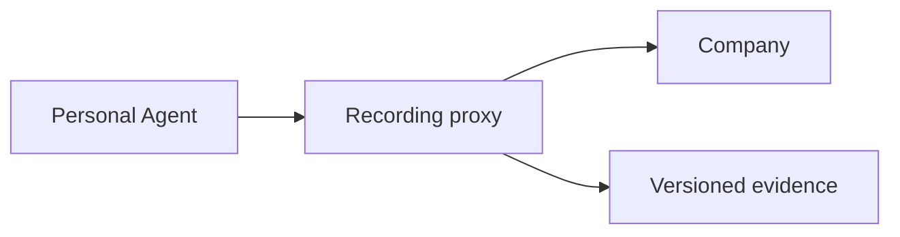

# The Poppy ecosystem

A map of known projects around [Poppy, the Personal Agent Protocol](https://personalagentprotocol.org/), updated **29 October 2026**. Each observation and test result keeps its own date. The historical full grid was run on **17 October** at **13 October** pins. Refresh on demand for a specific integration decision; [the last section](#how-to-update-this-map) describes the scope.

The detail lives elsewhere. Every implementation, with licences and maturity, is in [implementations.md](implementations.md); what we found in their code is in [poppy-issues.md](poppy-issues.md); the spec's problems are in [spec-issues.md](spec-issues.md), with our chosen readings in [readings.md](readings.md); how our harness pairs them is in [interop-testing.md](interop-testing.md), and its last run in [interop-results/](interop-results/README.md). This page is the index.

**Historical method (12–13 October).** Read-only: GitHub (repositories, code, issues and pull requests), npm, PyPI, crates.io, web search, and the community lists. We read other projects' code at a pinned commit and run it only in Docker. We fetch a live Company's `poppy.json` and its issuer's metadata only with our validator CLI, once per host per survey, one host at a time; the hosts come from our records, public directories and other projects' pull requests. Nothing is posted to other projects.

## Current ecosystem — 29 October 2026

PDA speaks **Poppy 0.3 alone**, the reviewed 29 October text ([local 0.3 copy](../spec/draft-0.3-retrieved-2026-10-29/README.md)), and refuses a Company that declares 0.1 or 0.2 ([decision 37](decisions.md#37-03-alone-what-dropping-01-and-02-overturns-and-settles)). "0.3" names more than one text: Datalayer's SDKs, poppyseed and several public Companies follow an earlier 0.3 draft, with Session Keys and Session Tokens, that the 28 October rewrite replaced with the Session header and delegated keys. An agent built for one can't use a Company built for the other.

### Who implements the 28 October text — 29 October 2026

We read the head of each project the grid used to pin (read only; nothing of theirs ran outside Docker).

| Project | Head | What its 0.3 is |
| --- | --- | --- |
| [print-with-poppy](https://github.com/spenciefy/print-with-poppy/tree/b340741d696d867ff3190c10c1f1d1e0c368e846) | `b340741`, 28 October | The 28 October text: the Session header on every API request, plain OAuth tokens, Operations 2 and Mediated Sign-In 1. It refuses agents built for 0.2 or the earlier draft. Its rebuilt isolated demo passes all ten supported scenarios ([fresh evidence](evidence/pr-36-interop-completion/README.md)); no live paid action was run |
| [Datalayer](https://github.com/datalayer/personal-agent-protocol/tree/a3713e3) | `a3713e3`, 27 October | The earlier 0.3 draft: Session Keys and Session Tokens |
| [poppyseed](https://github.com/akshay5995/poppyseed/tree/6393dfb) | `6393dfb`, 27 October | The earlier 0.3 draft; no protected resource metadata |
| [everruns](https://github.com/everruns/everruns/tree/a22760a) | `a22760a`, 28 October | 0.1; refuses 0.3 |
| [PoppyKit server](https://github.com/LMol-4/poppykit-server/tree/945d0cfa18a74a2e439abe9de06ddc98d179b338) / [client](https://github.com/LMol-4/poppykit-client/tree/053fe1c8c93a9519660122715583b75497ea0183) | `945d0cf` / `053fe1c`, read 29 October | Earlier 0.3 wire: their authentication/integration docs require Session Tokens and Session Keys. The README's version label alone does not establish compatibility |
| [Specification source](https://github.com/personal-agent-protocol/personal-agent-protocol/tree/3e9bada9ec8f66777b43e429d49574131dc2f67e) | `3e9bada`, 29 October | Contains the 28 October rewrite. The site adds the restored browser-ownership MUST; that sentence is not in this commit, so our exact pin remains the site snapshot |
| pi-poppy, poppy-demo, Ilmer, adonis-agora, tipping-co | read on 29 October | No code for either 0.3 text found |

### Public discovery — 29 October 2026

The same 33 hosts as on 28 October, checked one at a time with our validator's 0.3 profile ([receipt](evidence/ecosystem-2026-10-29/discovery.json)): **1 valid, 23 refused for their version, 9 indeterminate.**

| Hosts | Declared | Result | Why |
| --- | --- | --- | --- |
| printwithpoppy.com | 0.3 | Valid | 0 errors, 0 warnings; three notes that its documents send no caching headers |
| sandbox.printwithpoppy.com, archon.technology, crosswalk.to, stacktr.ee, www.planmyvisit.to, planmyvisit.to, saferate.com, www.alpine-retail.com | 0.2 | Refused | A version we no longer speak; not a failure against its own rules |
| 15 hosts, among them poppy.ilmer.org, tilopay.shop and getvibe.dev | 0.1 | Refused | As above |
| flowers, food and stays.papsandbox.com; withpoppyseed.dev; poppy.lukemolony.com; bank.notjustabank.com; notjustabank.com | 0.3 | Indeterminate | No protected resource metadata at `/.well-known/oauth-protected-resource`, which the 28 October text requires for discovery: these follow the earlier draft. notjustabank.com also names its subdomain as `organization.domain` |
| ax-air.com; intercom.io | not read | Indeterminate | `poppy.json` answered 403 and 404 |

Seven hosts that declare 0.3 can't be used by an agent that implements the 28 October text, though nothing here says they are wrong by the draft they follow. On 28 October we counted six declaring 0.3; printwithpoppy.com is the one that moved since.

## Historical observations

The earlier surveys, scorecard and fault-line analysis are [frozen at their recorded revision](https://github.com/adewale/pda/blob/289c6592c6f6e629b1d525247f3c4e2243662bc2/docs/ecosystem.md#earlier-observations--28-october-2026). They are evidence of those dates, not an additional current inventory.

## Earlier observations — 28 October 2026

See the [frozen survey](https://github.com/adewale/pda/blob/289c6592c6f6e629b1d525247f3c4e2243662bc2/docs/ecosystem.md).

## Dated implementation catalogue — 12–18 October

See the [frozen survey](https://github.com/adewale/pda/blob/289c6592c6f6e629b1d525247f3c4e2243662bc2/docs/ecosystem.md).

## Personal Agents

See the [frozen survey](https://github.com/adewale/pda/blob/289c6592c6f6e629b1d525247f3c4e2243662bc2/docs/ecosystem.md).

## Companies and Company SDKs

See the [frozen survey](https://github.com/adewale/pda/blob/289c6592c6f6e629b1d525247f3c4e2243662bc2/docs/ecosystem.md).

## Both-sides SDKs

See the [frozen survey](https://github.com/adewale/pda/blob/289c6592c6f6e629b1d525247f3c4e2243662bc2/docs/ecosystem.md).

## Checkers, validators and linters

See the [frozen survey](https://github.com/adewale/pda/blob/289c6592c6f6e629b1d525247f3c4e2243662bc2/docs/ecosystem.md).

## Companies you can reach

See the [frozen survey](https://github.com/adewale/pda/blob/289c6592c6f6e629b1d525247f3c4e2243662bc2/docs/ecosystem.md).

## Adjacent and declined

See the [frozen survey](https://github.com/adewale/pda/blob/289c6592c6f6e629b1d525247f3c4e2243662bc2/docs/ecosystem.md).

## How they work together

See the [frozen survey](https://github.com/adewale/pda/blob/289c6592c6f6e629b1d525247f3c4e2243662bc2/docs/ecosystem.md).

### Scorecard

The [dated scorecard](https://github.com/adewale/pda/blob/289c6592c6f6e629b1d525247f3c4e2243662bc2/docs/ecosystem.md#scorecard) retains the original results and attribution. It is not a current compatibility ranking.

## Open fault lines

See the [frozen survey](https://github.com/adewale/pda/blob/289c6592c6f6e629b1d525247f3c4e2243662bc2/docs/ecosystem.md).

## How to update this map

Refresh only when a concrete integration or protocol decision needs it. Update the current observation above with its date, pin and evidence; do not propagate counts into proposals or historical surveys. Runtime peer pins belong in `interop/registry.json`; current verification belongs in [the verification report](poppy-0.3-conformance.md#current-verification).
