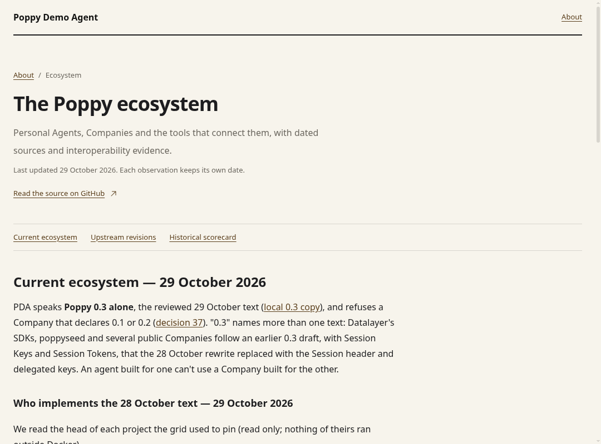
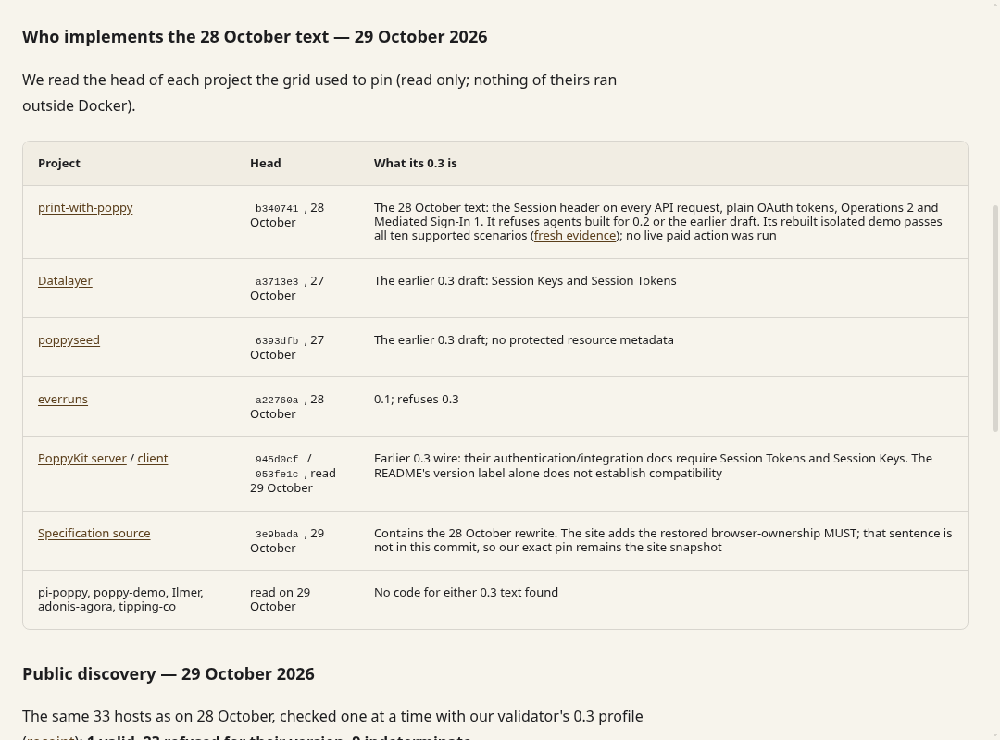

# Ecosystem navigation comparison

Following **Upstream revisions** now scrolls to the implementation table. Before the fix, the fragment named no element and the page stayed at the top.

The two captures use the production client build at 1080 × 800 in Chromium with a light color scheme. [The receipt](receipt.json) records the baseline commit, rendered source hashes, image hashes, link targets and scroll positions. The baseline is `1b2e76e585a9e4cbfca12233e9836b1d82238aed`.

| Before the fix, after following the link | After the fix, after following the link |
| --- | --- |
|  |  |

To reproduce, run `npm run build` at each revision, serve `dist/client` with an HTML fallback, open `/about/ecosystem`, and click **Upstream revisions** at the stated viewport. [The page regression](../../../test/ui/client.test.tsx) checks that every navigation target exists and that a historical target opens its disclosure.

These captures cover one public page and desktop viewport. They do not exercise authentication, live Companies, or the model-key and validator fixes in this PR.
