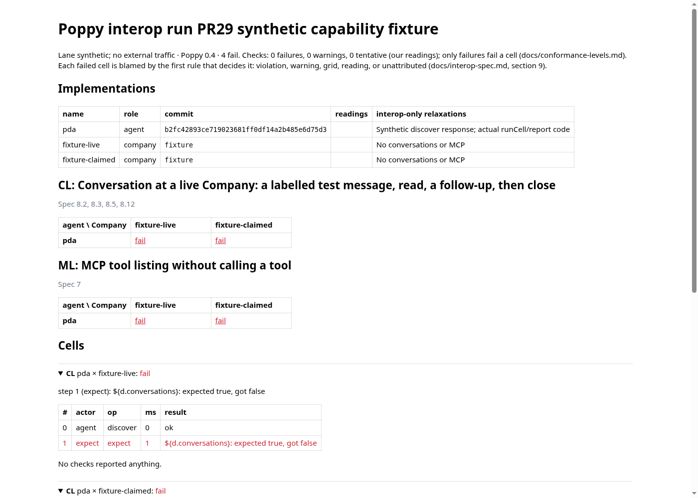
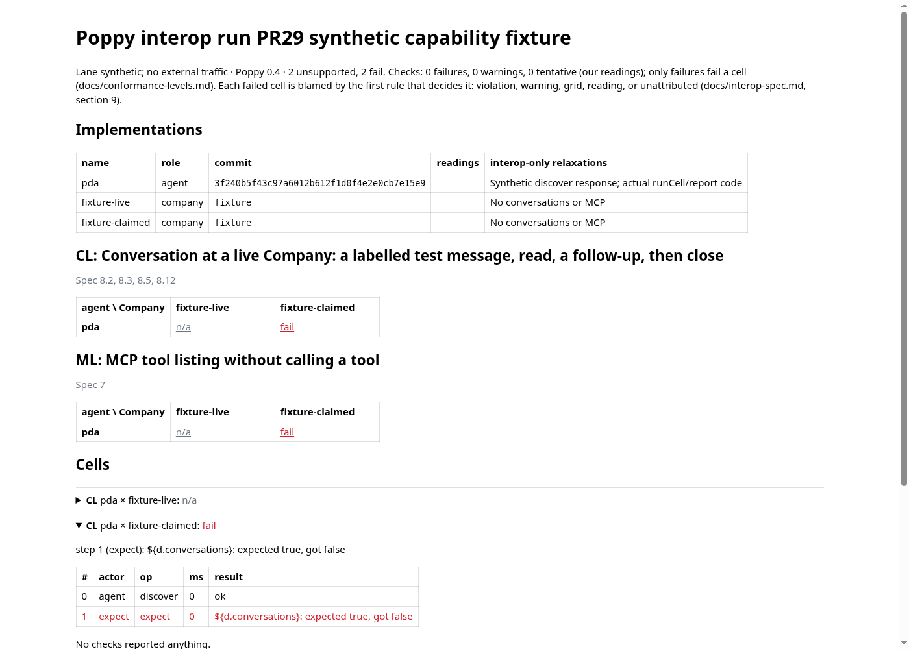

# PR 29: live classification on Poppy 0.4

This refresh targets main at `b2fc42893ce719023681ff0df14a2b485e6d75d3`. The tested implementation and capture source is `3f240b5f43c97a6012b612f1d0f4e2e0cb7e15e9`.

The runner changes classify missing live capabilities and statically required fixture values as unsupported. Local adapters that claim a scenario still fail. Fixture preflight shares execution's two interpolation passes, checks optional parameters and fixture-known conditions, and defers unknown runtime expressions. The current currency and feedback concurrency tests from main are retained without changes.

The [previous PR snapshot](https://github.com/adewale/pda/tree/d02855ec490ee0076ecc9a1549dba30004b012a3) preserves the October reports, 0.3 screenshots and their verification records. Those records are historical and are not carried into this focused change.

## Verification

- [Harness](interop.txt): 474 tests passed in 34 files.
- [Negative control](preflight-disabled.txt): all four CLI regressions fail when fixture preflight is disabled. The source was restored before the full suite and capture.
- [Full suite](tests-summary.txt): **2,705 passed, one existing skip**, across 134 files.
- Type checking, pinned-spec integrity, documentation links and all 17 tooling tests passed.
- [Validation receipt](validation.json) records source and artifact hashes.

## Visual evidence

Reviewer cue: `fixture-live` changes from red **fail** to grey **n/a** for both `CL` and `ML`. `fixture-claimed` stays red **fail** in both scenarios.

| Before: absent live capabilities fail | After: absent live capabilities are unsupported |
| --- | --- |
|  |  |

The same synthetic discovery response runs through actual immutable `runCell` and scenario sources. The production renderer and its complete runtime dependency closure are loaded from each revision, checked for equality and hashed. Chromium renders both at 1400 × 1000; external page requests are blocked. Assertions check all four outcomes, that only discovery runs, and the rendered grid counts. [Receipt](visual-receipt.json), [base HTML](before.html), [updated HTML](after.html).

Reproduce with the pinned dependencies, Node 24 and Chromium:

```sh
node docs/evidence/pr-29-04/capture.mjs \
  b2fc42893ce719023681ff0df14a2b485e6d75d3 \
  3f240b5f43c97a6012b612f1d0f4e2e0cb7e15e9
```

These are synthetic classification checks. They do not establish live Company interoperability or an authenticated hosted journey. No public Company was contacted for this refresh, and the registry's permitted live scenarios are unchanged.
