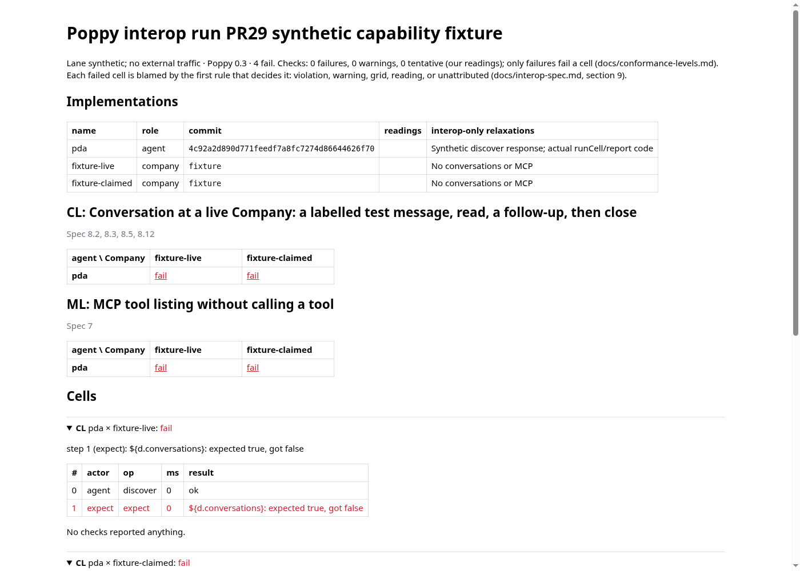
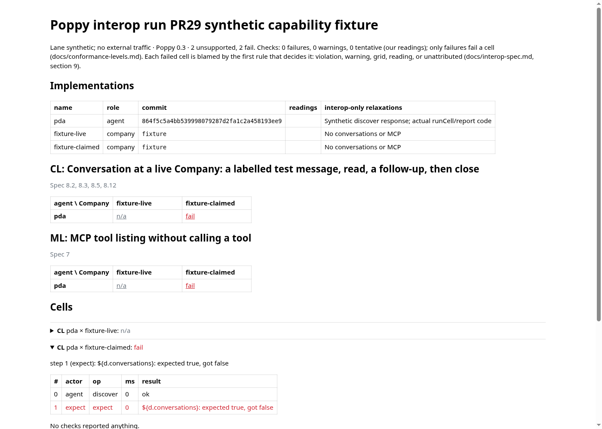

# PR 29: rebase onto the merged 0.3 implementation

PR 29 originally targeted `claude/live-preflight` at `73030c4`, with head `de613e0`. Its parent PR 26 and the 0.3 conversion in PR 36 are now merged. The tested rebase targets main at `4c92a2d890d771feedf7a8fc7274d86644626f70`; final implementation source is `864f5c5a4bb539998079287d2fa1c2a458193ee9`.

The rebase retains live feature/fixture classification, the locale-independent approval test, and dated 24–26 October records. It omits `ee86997` because that commit modifies retired peer adapters, the old S4 reading and 0.1/0.2 known failures. Those remain available at the [original immutable source](https://github.com/adewale/pda/tree/de613e0b49a9783315d27f75262b3e1647809575). The 0.3 Session model, scope defaults, Operations 2 frame, labelled greeting, and live conversation closure policy remain current.

Review found two defects beyond mechanical conflicts. The live conversation scenario is now `CL`; marking only the old `C` capability check would still fail the actual live conversation cell. Fixture inspection also scanned JSON object keys even though runtime interpolation changes only values. Both have [failing-before controls](review-before.txt) and pass after the fixes.

## Verification

- [Full suite](tests-summary.txt): **2,091 passed, one existing skip**, in 114 files. All 381 Appendix references and documented scenarios resolve.
- Type checking and spec integrity passed: 43 changelog dispositions, 13 pinned pages.
- [All 422 interop unit tests pass](interop-after.txt), including the live/local negative controls and literal-key regression.
- [en-GB](locale-gb.txt) and [en-US](locale-us.txt): all 14 chat-step tests pass in each locale. The expected message remains the current `poppy.approval` frame.
- [Validation receipt](validation.json) records source/artifact hashes and the rebase disposition.

These local tests use synthetic peers. The historical 0.1/0.2 runs were not repeated, no live Company was contacted, and this does not add authenticated live 0.3 evidence. Final-head CI results are linked from the PR.

## Visual evidence

Reviewer cue: inspect **fixture-live** in both `CL` and `ML`. Its result changes from **fail** to **n/a (unsupported)**. **fixture-claimed** stays **fail**, so a missing advertised feature is not hidden in the local grid.

| Base: missing live features fail | Head: missing live features are unsupported |
| --- | --- |
|  |  |

The same named synthetic capability fixture uses actual `runCell` and scenario files at full base/head SHAs. The production `renderReport` source is unchanged; Chromium renders its exact HTML at the same viewport, with external page requests blocked. Capture assertions check every cell outcome and both rendered grid counts. [Machine receipt](visual-receipt.json), [base HTML](before.html), [head HTML](after.html).

Reproduce after installing the pinned dependencies, with Node 24 and Chromium:

```sh
node docs/evidence/pr-29-rebase/capture.mjs \
  4c92a2d890d771feedf7a8fc7274d86644626f70 \
  864f5c5a4bb539998079287d2fa1c2a458193ee9
```

This is a focused renderer comparison, not a live interop grid or authentication journey. Application UI pixels are unchanged; the currency change corrects a test expectation only.
