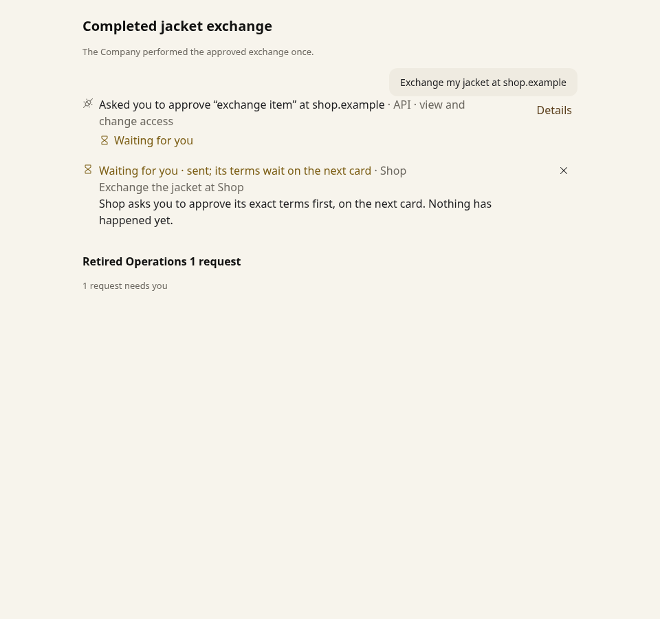
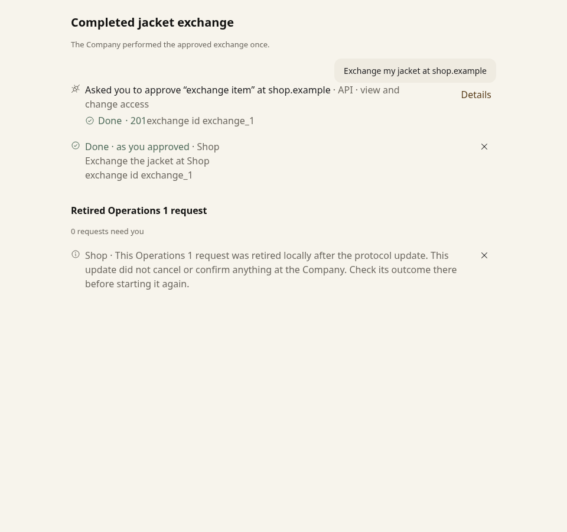

# PR 36 audit fixes

The nine findings from the adversarial review of `faedf153237017e1407e8d3a90bba7e39102de69` are fixed. The tests exercise real Worker requests or the Node client with SQLite and controlled network responses.

| Finding | Change | Regression coverage |
| --- | --- | --- |
| 1. Conversation terms could execute after local sign-out when revocation failed. | Persist the approval's account, Session and local authority counter; check them before sending and on every retry. | `test/poppy-conversation-approval.test.ts`: sign-out, refused revocation, paused signing, nonce retry and same-account reauthentication. |
| 2. A browser join could relabel account A's cookie as account B's after an await. | Serialize joins, bind each context to its original authority and discard it if that authority changes. Recheck before authorization, browser navigation and form submission. | `interop/test/browser-context-audit.test.ts`: account switches during join, stale forms, same-account reauthentication and legitimate `invalid_session` recovery. |
| 3. Interrupted legacy sign-ins could block later work indefinitely. | Retire incompatible or unreadable pending sign-ins with a closed notice. Keep sealed answers for reconciliation without replaying them. Preserve compatible 0.3 sign-ins. | `interop/test/legacy-state-migration.test.ts`: actual SQLite migration and recovery, missing context, valid 0.3 context, expiry and repeated migration. |
| 4. Service metadata decisions could cross Company boundaries. | Cache the document and reevaluate its issuer, domain and allowed hosts for each Company. | `interop/test/service-resource.test.ts`: positive and negative cache reuse across Companies. |
| 5. Removed Operations 1 tables left invisible open cards. | Convert old operation cards to closed, dismissible notices under the same card IDs; retain historical timestamps. | `interop/test/legacy-state-migration.test.ts`: open and historical cards, repeat migration and no remote effects. |
| 6. The interop leak checks ignored `Poppy-Session`. | Inspect Session JWTs in headers, URLs and bodies; reject unlisted destinations and authenticated redirects, including newly signed proofs. Include them in scenario secret checks. | `interop/test/session-leaks.test.ts`: 12 cases, including direct listed-host traffic and deliberately injected probe controls. |
| 7. Service metadata lookup lost a trailing slash. | Insert the well-known segment before the exact non-root service path. | `interop/test/service-resource.test.ts`: exact root and non-root request URLs. |
| 8. Excluded-task filtering leaked between Companies. | Cache the unfiltered task document and apply the current Company's interface list on each read. | `interop/test/coverage-cache-audit.test.ts`: shared task URL, repeated reads and an interface change. |
| 9. The original tool step stayed waiting after its terms card completed. | Persist the child approval ID and propagate its terminal outcome through the original request and any revised terms. Recovery also settles interrupted chains. | `test/poppy-terms-lifecycle.test.ts`: API and MCP approve/decline, revised terms, reentrant decisions, interrupted execution, Activity and transcript status, and replay without another write. |

## Withdrawal remains effective after signing back in

The follow-up review reproduced a same-account sign-out/sign-in sequence that restored an old Session/account pair. A persisted `authority_generation` now changes on sign-out independently of the protocol's Session ID. Approvals and browser contexts carry that counter. A missing counter on a valid older approval means zero, so existing approvals remain usable until their authority is withdrawn.

`PoppyClient.resource` also snapshots authority before metadata and token preparation and checks it after asynchronous JWT/DPoP signing. A stale prepared request cannot reach the transport. The service-resource tests cover signing and refresh races with real cryptography; the Worker tests cover actual action counts after reauthentication.

The property model's `bindingGone` oracle now includes account and authority generation alongside Session ID and remote expiry. Its generators, command domains and safety assertions are unchanged: withdrawn approvals must fail with `approval_changed` and leave the Company's performed-action count unchanged. This corrects the model's earlier assumption that reusing a Session ID restored local authority.

## Visual evidence

The same completed exchange is shown in both states. Before the fix, its original tool step still asks the User to act, and a retired operation contributes an invisible needs-you item. After the fix, the step says **Done** and the retired request has a visible notice with no pending action.

| Before | After |
| --- | --- |
|  |  |

[Narrow screen, 375 px](after-mobile.png).

These are Chromium captures of the production `Transcript`, `stepDecisions`, `PoppyCard` and `needsYou` components with the production stylesheet. The controlled fixture represents the card states established by the Worker and SQLite regression tests. The images establish rendering; they do not show a live Company, OAuth flow or button interaction. Both states use the same renderer because these fixes change persisted state rather than component markup.

These supplied-state captures are historical. The [frozen source and instructions](https://github.com/adewale/pda/tree/4a5d2143c2d46a88e37c90e48247b5a7162f2b5e/docs/evidence/pr-36-audit) preserve their fixture, driver and hashes. Those files are archived rather than maintained beside another capture harness.

For current interaction evidence, use [the application browser journey](../pr-36-conformance/README.md#reproduce), which builds production assets and exercises the real WebSocket and strict mock.

## Validation

Validation on 29 October 2026, Node 24.19.0:

- `npm test`: 1,826 passed, one skipped, across 90 files. Workers: 1,128 passed and one skipped; durability: 3; UI: 234; interop: 275; properties: 186. The documented test/scenario reference check passed too.
- `npm run typecheck`: passed.
- `npm run check:spec`: verified 42 changelog dispositions and 13 pinned pages.
- `node scripts/app-smoke.mjs --output /tmp/pda-pr36-fix-browser-final.json`: built production assets and passed the existing Chromium/workerd acceptance checks, with zero uncaught browser errors. It uses a synthetic signed identity and model, so it does not verify live OAuth or a live model. The report is saved as `browser-smoke.json` here.

The isolated Docker grid was rebuilt with image tag `pr36-audit-fix`: PDA against `lenient-company` and `strict-company` passed 70 cells, with 18 unsupported, zero failures, zero errors and zero check warnings. Results are local under the gitignored `interop/results/pr36-audit-fix/`. No live payment or external account was used.

Before/after checks independently reproduced the original failures: the five initial terms-lifecycle cases fail with the old operations implementation; ten Session leak cases fail with the old harness checks while two controls pass; and the browser, conversation and service-resource regressions fail with their respective old guards. These checks supplement the normal passing suite; screenshots alone do not establish authority or leak protection.
