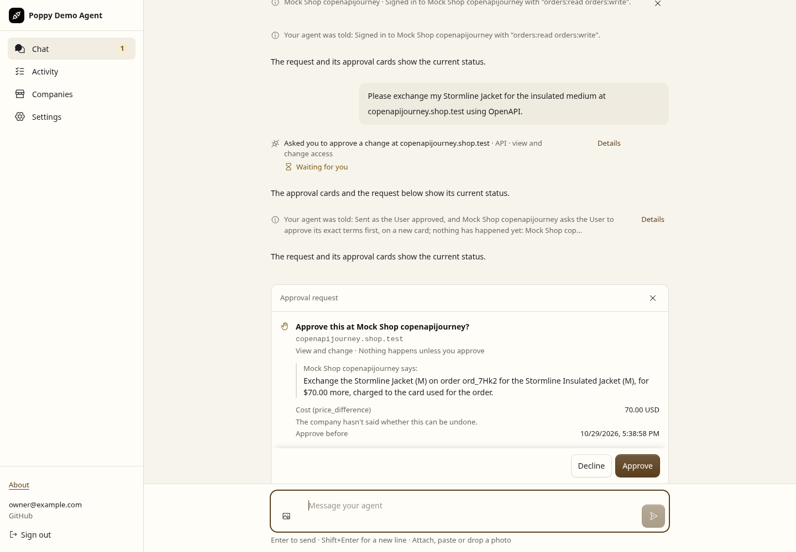

# PR 36: final adversarial audit

Six independent reviewers audited the PR at `3f46ac5047e4a0f0a892787846c3ab41acdb2519` against base `977e3bf146b958e8301fc1963379532d0fdad761`. Their areas were approval dispatch/recovery, OAuth/session authority, discovery/browser/hosting, migrations/UI, protocol conformance, and independent test oracles/evidence. Reviewers then challenged fixes outside their own areas. Root integrated the changes and owns final verification.

The audit covers code and local verification. The hosted pair is still undeployed; authenticated live OAuth/model verification and broader independent MCP/conversation/browser-join coverage remain open. Passing this audit supports a merge recommendation, not a production deployment claim.

## Findings and fixes

| ID | Finding | Fix and regression scope |
| --- | --- | --- |
| F01 | An older refresh response could overwrite a newer sign-in token or delete its account on `invalid_grant`. Sign-out could also lose to asynchronous token sealing. | Compare the exact sealed credential on refresh writes/errors and guard account-family generations around signing, sealing and dispatch. Ordinary refresh rotation remains valid. |
| F02 | A late `invalid_session` response could restart a different, newer Session and resend under it. | Response-triggered retries recheck the binding actually sent before mutating current state. |
| F03 | Scope narrowing or replacement consent could retain an older joined browser cookie and saved form, especially when old-grant revocation failed. | Contexts bind canonical scopes and account-family generation. New browsing rejoins; saved old forms fail without sending. Scope reordering is harmless. |
| F04 | A committed User reconciliation could permanently lose its model notice after card/callback failure; retry returned early. | A separately armed durable reconciliation notice preserves its exact ID/text and drains on linked-card retry/startup. Historical resolved rows default to no replay. |
| F05 | Failed receipt publication could change an already successful action from `done` to retryable `failed`; crashes could leave stale sending cards. | Card publication is outside business-outcome classification. Recovery repairs terminal receipts from durable outcomes without resending or reviving dismissed/aged receipts. |
| F06 | Batch recovery reused one notification ID with changed text, including after a User reconciliation. | Freeze the versioned batch notification before first delivery and replay the same ID/text. |
| F07 | A batch could describe a committed upload as undecided after card failure and clear its repair flag. | Use the durable terminal outcome, repair receipts before acknowledgement, and preserve pending recovery on publication failure. |
| F08 | A batch could clear a concurrent single handler's pending notice for an ID it had skipped. | Decision claims record explicit batch ownership; acknowledgement and recovery follow actual ownership, including claim/snapshot crash recovery. |
| F09 | CRLF split across network chunks invented SSE event boundaries, losing message data or cursors. | One incremental line-ending normalizer is shared by conversation streaming and the interop adapter. Every byte split is checked for CRLF, LF and CR, with replay/cursor assertions. |
| F10 | Individual stream events and unfinished text had no memory bound. | Bound each to 2,000,000 UTF-16 code units; cancel oversized streams while preserving earlier committed messages/cursors. Larger streams of bounded events remain valid. |
| F11 | Each streamed read left a timeout pending until the deadline. | A shared deadline-read helper clears the timer on data, EOF, error and timeout; 1,000 immediate reads leave none pending. |
| F12 | Concurrent normalized-task feedback calls could both POST before the sent intent existed. | Serialize per-client/Company/task attempts. Failed reports stay retryable; different tasks and Users remain independent. |
| F13 | The mock's repeated-feedback oracle incorrectly combined different Users. | Include verified client and User identity in its private repetition key. Keep the existing same-User negative control and public evidence schema. |
| F14 | The separately patched kit retained an old DPoP nonce after ordinary token responses and could reuse retry proofs. | Observe each token response's nonce, regenerate retry proofs, and retain independent positive/denial controls. Original archive and 79 source files remain unchanged. |
| F15 | Old conversations became uncloseable background retry loops after the protocol upgrade, and presence updates could stop before reaching valid work. | Add nullable retirement metadata, stop incompatible conversations locally, preserve history/cursor/pending evidence, terminate old reads and show an explicitly unknown local outcome. Supported contexts remain active. |
| F16 | Upgrade instructions named the old snapshot and implied a Git archive could be activated by the site-only checker. | Point to the actual 29 October pin and describe manual site capture. Clearly distinguish archival import from supported pin activation. |

The receipt, batch, stream and refresh patterns include pre-existing defects that remained relevant to the PR's new durability/interoperability claims. Findings are not all newly introduced regressions. Some before controls use the original committed production module in an isolated source copy; others demonstrate a follow-on failure after the first partial fix. The logs retain those scopes.

## Verification

The final source is `8ce3503bb10f18a9ff4ec3595aced9006e23b825`; the evidence follow-up changes documentation/artifacts only. [Validation receipt](validation.json) hashes the changed source and every retained artifact. Each before/after log below is an actual local run with its original fixture and limits retained.

| Check | Final local result |
| --- | --- |
| Full repository suites | [2,084 passed, one existing skip, 114 files](tests-summary.txt); all 381 Appendix references and documented scenarios resolve |
| TypeScript and spec integrity | Passed; 43 changelog dispositions and 13 pinned pages |
| Actual execution process crashes | [All eight pass](process-crashes.json), no business resend/effect; CI mode enabled |
| Independent print-with-poppy | [All ten supported scenarios pass](print-with-poppy.json), no warnings/errors/unsupported cells; actual source pin `8ce3503` |
| Production build and Chromium | [Both approval journeys pass](browser.json), zero browser errors or strict-mock findings |
| Company kit | [Fresh original/patched summary](company-kit-summary.json), every check ID/status and non-passing verdict retained; all 18 independent proof controls pass |
| Independent Python | [21 pass](python.txt), existing generators/default limits retained; Company/Python fixture unchanged after its source-pinned run |
| Final-head workflows | See [PR checks](https://github.com/adewale/pda/pull/36/checks); no deployment runs here |

The summary trims repeated HTTP/spec quotations from local kit receipts while retaining each check's verdict and every non-passing result. Complete raw local receipts remain at the recorded `/tmp` paths with hashes; CI separately uploads full raw receipts for its final-head run. The original DPoP findings remain failures/warnings, and absent features remain skips. The eight real process-crash cases cover the documented execution boundaries. Reconciliation, batch ownership, receipt publication and new async races have separate deterministic Worker/Node controls; this does not claim arbitrary process-crash coverage.

## Counterexamples and focused controls

- Authorization: [old refresh](account-refresh-before.txt), [late Session retry](account-retry-before.txt), [post-storage sign-out](account-store-before.txt), [62 focused client checks](account-after.txt).
- Browser authority: [four failing controls before](browser-before.txt), [narrowed/replacement grants after](browser-after.txt).
- Approval state: [lost reconciliation](reconciliation-before.txt), [receipt failures](receipts-before.txt), [batch/single ownership race](batch-ownership-before.txt), [final focused ownership/notice/migration checks](approval-after.txt).
- Streams: [CRLF framing](sse-framing-before.txt), [unbounded events/text](sse-bounds-before.txt), [pending timers](sse-timers-before.txt), [timer controls after](sse-timers-after.txt).
- Feedback: [concurrent-report failure](feedback-before.txt), [232 Worker checks after, including the original mock negative controls](conformance-after.txt).
- Upgrade: [legacy conversation failures](legacy-before.txt), [migration checks after](legacy-after.txt).

The patched-kit tests also use an intentionally permissive invalid-signature control to prove their denial oracle rejects a malformed proof accepted by a broken peer. Historical kit files and earlier evidence packages are unchanged.

Legacy compatibility: old batches whose claim owner was never recorded may report an outcome individually as well as in the batch. The migration preserves pending information instead of adopting another handler's notice from an old intent snapshot. No Company request is repeated.

## Visual evidence

The maintained production renderer captured these interaction states from the tested source. Reviewer cue: the original OpenAPI request moves from **Waiting for you** at Company terms to **Done** after approval and reload. The independent Company effect counters are 0 before either approval, 0 after our first approval, and 1 after Company terms approval/reload.

| Company terms await approval | Original request after approval and reload |
| --- | --- |
|  |  |


These are states from one current build, not a base/head pixel comparison. Identity, model and Company are synthetic; the production signed-cookie verifier, WebSocket, client and UI are in use. The browser recovery scene uses the maintained memory-recovery seam. The separate process receipt proves actual SIGKILL; screenshots do not. The new receipt/race defects are established by their failing/passing Worker/Node controls, rather than by pretending these screenshots capture each injected failure.

## Reproduce

```sh
npm run check:spec
npm run typecheck
npm test
CI=true npm run check:approval-crashes -- --output /tmp/approval-crashes.json
node scripts/check-company-kit.mjs --reviewed-findings --output /tmp/company-kit-original.json
node scripts/check-company-kit.mjs --with-dpop --reviewed-findings --output /tmp/company-kit-dpop.json
node scripts/app-smoke.mjs --approval-journey --output /tmp/browser.json
npm run test:hypothesis
npm run interop -- --agents pda --companies print-with-poppy --require-supported --scenarios D,S0,OU,CM,SD,SX,SMC,SO,AO,AS
```

The native kit nonce regression also failed all three current controls with only the old patch substituted in an isolated copy: [before](kit-nonce-before.txt), [after](kit-nonce-after.txt), [source/command record](kit-nonce-reproduction.json). Shared source was never replaced.
