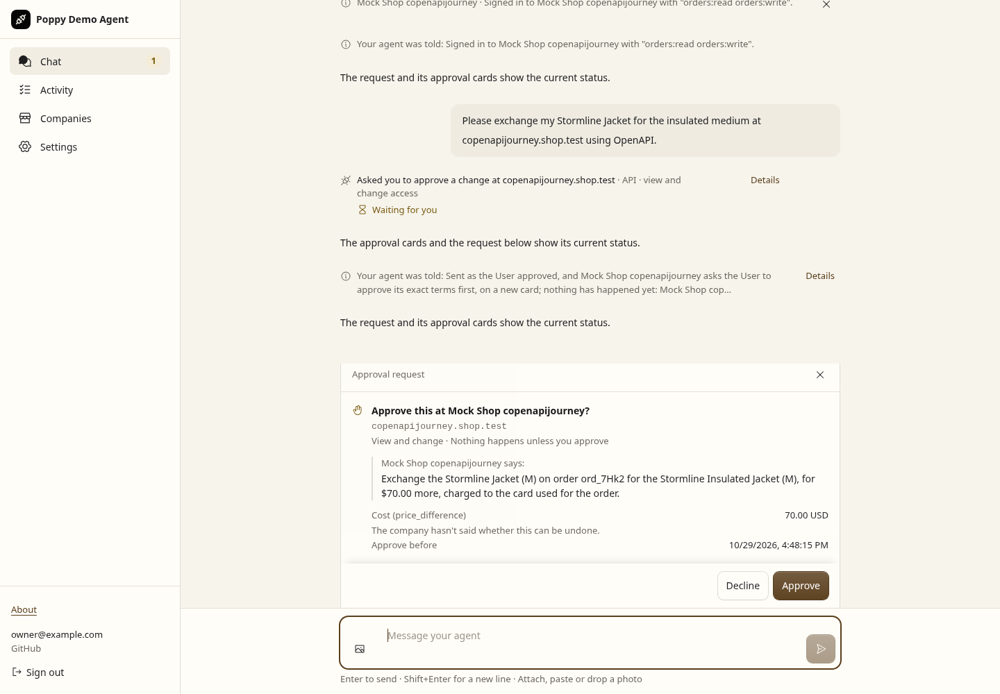
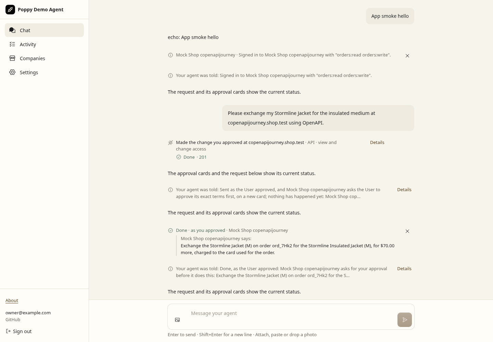
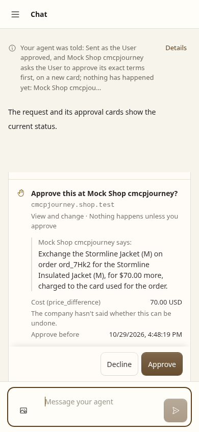
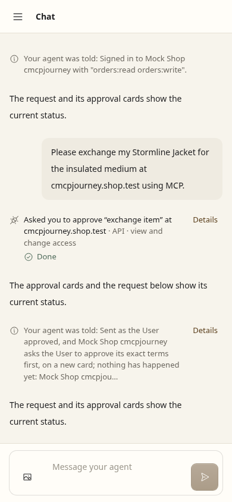

# PR 36: approval process crashes and refreshed interoperability evidence

Recorded manually on 29 October 2026. [Validation receipt](validation.json) contains exact tested source and artifact SHA-256 hashes. The grid truthfully labels the tested working tree `4c08609-dirty`; the hashes identify its final production source, committed at `44f61dc`. The crash runner subsequently received an explicit test Worker name and all eight cases passed again with `CI=true`; its current source and refreshed process receipt are hashed too. Identity, models, consent and business effects are synthetic unless explicitly stated otherwise. No live authentication or payments were performed.

## Results

| Check | Result | Scope |
| --- | --- | --- |
| Full repository suites | 2,022 passed, one existing skip, 103 files | [Summary](tests-summary.txt); 381 Appendix references, nine documented scenarios and four adversarial test references resolve |
| TypeScript | Passed | Full `npm run typecheck` |
| Actual process crashes | Eight passed | [Receipt](process-crashes.json); OpenAPI and MCP at four boundaries, separate surviving Company ledger |
| Concurrent authorization attacks | Eight passed | [Worker results](authorization-mixup.txt); two Companies × two Users, four subsequent valid sign-ins |
| Notification recovery | Three passed | [Results](notifications.txt); stable retry ID/text and new ID per later decision |
| Original upstream Company kit | Original findings retained | [Raw receipt](company-kit-original.json), all 79 files and archive unchanged |
| Separately patched DPoP kit | No failures or warnings | [Receipt](company-kit-dpop.json); mocks/Bearer 119 pass/one skip each, hosted handlers 62 pass/58 skips, 18 proof controls |
| Independent print-with-poppy | Ten passed, zero failed/unsupported/errors | [Grid receipt](print-with-poppy.json), pinned `b340741d696d867ff3190c10c1f1d1e0c368e846`, isolated Docker demo |
| Independent Python | 21 passed | [Local run](python.txt), existing 100 examples/30 steps and generators retained; Company-fixture evidence |
| Production build and Chromium | Passed, zero browser errors | [Receipt](browser.json), actual authenticated WebSocket approval clicks, synthetic identity/model/Company |
| Hosted authenticated journey | **Blocked; undeployed** | No Cloudflare identity or private hosted/OAuth/test-User settings configured; [setup](../../../test/hosted/README.md) |

The one repository skip is the existing deployer-local identity scan without private configuration. The kit's absent-feature skips remain skips. Passing local checks does not establish complete or universal 0.3 interoperability.

## Process-crash defect and fix

The initial real-process run failed after the Company action and local completion had committed, but before its notification. On restart, the completed approval produced **zero** recovered notifications where one was required. [Before-fix failure](crash-before-fix.txt), using production source at `4c08609` and the new crash driver. It passed the first two boundaries and failed the third; this is not a claim that every new test was independently ablated.

A claimed decision now arms a durable pending notification. Before delivery it saves a versioned ID and exact text; startup drains it through the existing idempotent model callback without repeating the Company request. A later decision on a reused terms card gets a fresh ID. Old terminal approvals migrate with pending clear; executing rows recover as unknown. Two additive SQLite columns and a partial index implement this without a new dependency or authentication route.

The driver supplies an explicit test Worker name, so Wrangler does not require interactive configuration. It sends SIGKILL to the entire detached PDA process group, including Node and workerd, then starts a different process using the same actual SQLite. The separate Company process and Node business-request ledger remain alive throughout.

| Crash boundary, tested on OpenAPI and MCP | Effects before/after recovery | Recovered status |
| --- | --- | --- |
| Before Company dispatch | 0 / 0 | Unknown; new approval-gated writes held |
| After Company effect, before local completion | 1 / 1 | Unknown; new approval-gated writes held |
| After local completion, before notification | 1 / 1 | Done; notification recovered once |
| After notification delivery, before its acknowledgement | 1 / 1 | Done; callback retries the same ID and exact text |

Every case retains User attribution, the durable User ID and an unchanged Company business-request ledger after restart and a repeated approval. Two callback completions in the acknowledgement-loss case do not claim two logical model deliveries. The production callback owns deduplication. These tests establish local crash behavior; they do not simulate a Cloudflare regional outage or real GitHub OAuth.

## Browser evidence

Fresh production-rendered interaction states from the maintained `scripts/app-smoke.mjs`. Reviewer cue: the original request moves from **Waiting for you** at Company terms to **Done** after approval and reload. The independent Company counters in `browser.json` show **0 effects before either approval, 0 after our first approval, 1 after terms approval and reload**.

| Company terms await approval, OpenAPI desktop | Original request after approval and reload |
| --- | --- |
|  |  |

| MCP terms, mobile | MCP request after approval and reload |
| --- | --- |
|  |  |

The following capture retains the User's checked outcome after receipt expiry, 205 newer synthetic Activity rows and reload. The original uncertain receipt is preserved; the User assertion remains attributed and no request is resent.


These captures are states of one current production build, not base/head pixel comparisons. The browser recovery scene uses the maintained memory-recovery seam. **The separate process receipt proves SIGKILL; these screenshots do not.**

## Remaining interoperability limits

The [peer review](peer-review.json) pins the independent sources checked. print-with-poppy implements the current Session-JWT wire and offers ten supported demo scenarios, but no MCP, conversations, streaming, handoff or browser join. Datalayer, poppyseed and PoppyKit still use earlier Session-Key/Session-Token 0.3 designs in the checked commits. A bounded GitHub code search found no additional matching peer among its results. This is not proof that none exists elsewhere.

The eight combined callback attacks run through the real Worker/client boundary, not a new multi-Company grid cell. The grid still lacks `XM`; one ordinary cell owns one Company. Python remains local-only and exercises our Company fixture, with its previously documented ungenerated cases unchanged.

The isolated hosted pair remains prepared but undeployed. It needs a configured Cloudflare identity, separate GitHub OAuth App, allowlisted test User and private settings; the User enters a model key after real sign-in. [Hosted procedure](../../../test/hosted/README.md) covers consent, API/MCP decisions, refresh, sign-out and reload without paid services. No auth bypass or production credentials were added.

## Manual spec and kit review

The 28 October snapshot was taken at 17:48:11 UTC; the new 29 October snapshot at 16:27:08 UTC. [Exact text delta](spec-delta.txt): section 6 restores the MUST that only a browser controlled by the Personal Agent may join, never the User's browser. No wire format changes. `test/browser-context.test.ts` now directly verifies the joined agent sees its account, an ordinary User visit stays signed out, cookies remain separate, and join material stays out of visible output. Existing tests isolate two Users and two Sessions.

The new site sentence is absent from upstream GitHub head `3e9bada9ec8f66777b43e429d49574131dc2f67e`, which now contains the larger 28 October rewrite. The exact pin therefore remains the dated site snapshot with `commit: null`. The ledger now records 43 changelog entries; this count is separate from the 43 findings in the earlier upstream-spec audit. Old snapshots and kit files are unchanged. No refresh automation was added.

[Prepared upstream kit report](upstream-kit-report.md) explains the missing DPoP prerequisite and links the separate patch. It has not been sent upstream. Both raw and patched verdicts are retained; no failure is relabelled as a pass.

## Reproduce

Node 24, pinned dependencies, Chromium, OpenSSL and Docker are needed for their respective commands. Set `XDG_CONFIG_HOME` to a writable private directory for Wrangler if necessary.

```sh
npm run check:spec
npm run typecheck
npm test
npm run check:approval-crashes -- --output /tmp/approval-crashes.json
node scripts/check-company-kit.mjs --reviewed-findings --output /tmp/company-kit.json
node scripts/check-company-kit.mjs --with-dpop --reviewed-findings --output /tmp/company-kit-dpop.json
node scripts/app-smoke.mjs --approval-journey --output /tmp/browser.json
npm run test:hypothesis
npm run interop -- --agents pda --companies print-with-poppy --require-supported --scenarios D,S0,OU,CM,SD,SX,SMC,SO,AO,AS
```

CI runs repository checks, hosted Company security, both kit modes and actual process crashes; its separate Interop workflow runs the 96 applicable own-project cells. Python, external-peer refreshes and browser captures remain manual. The fresh Python run preceded only the browser-ownership pin/comment changes; its Company fixture and client source hashes remain unchanged.
