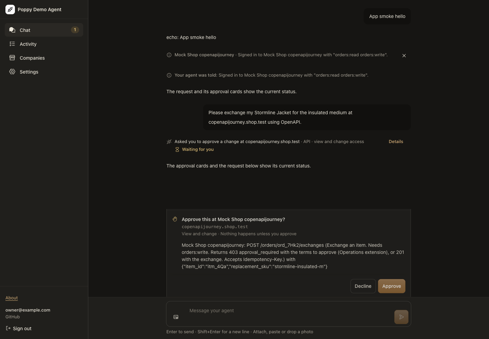
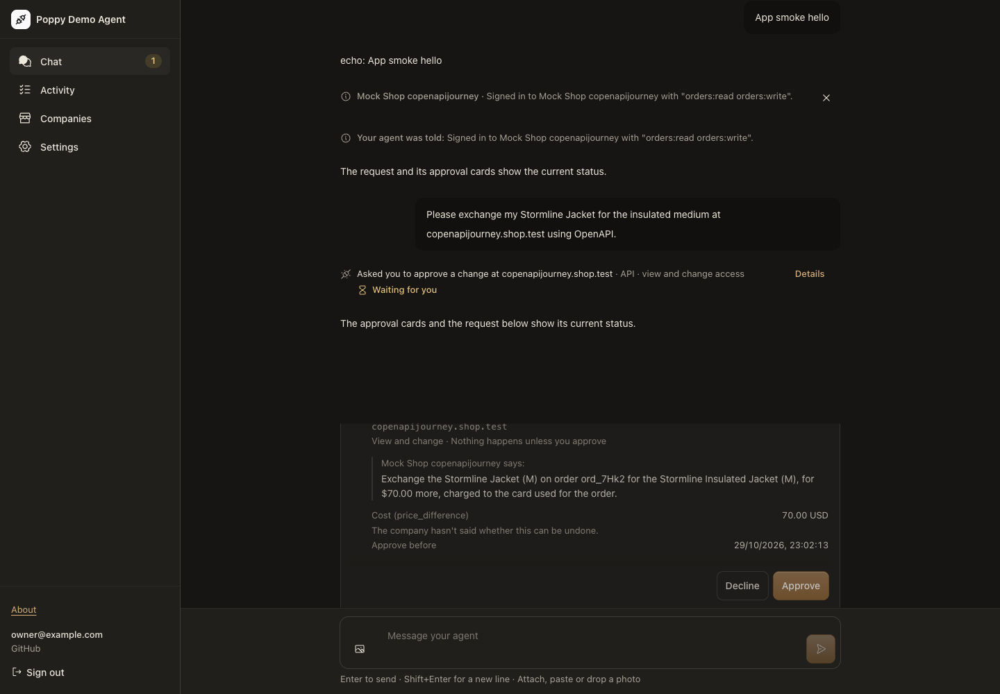
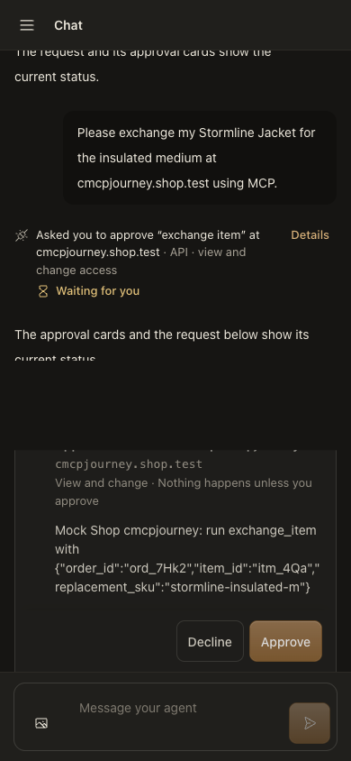
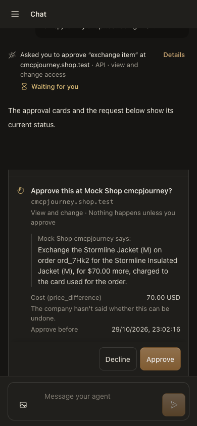
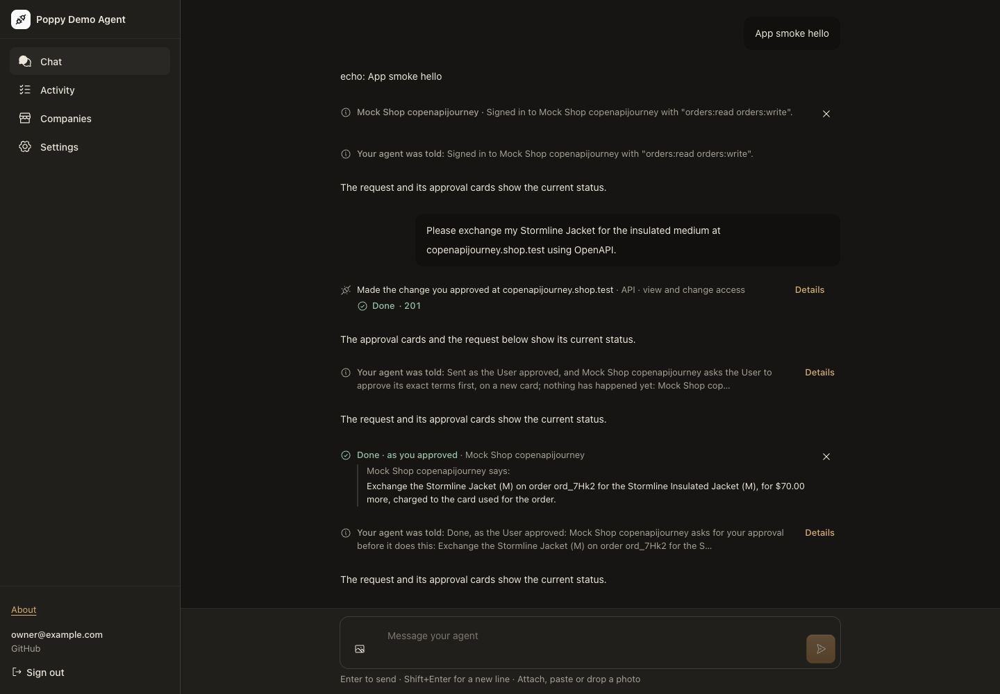
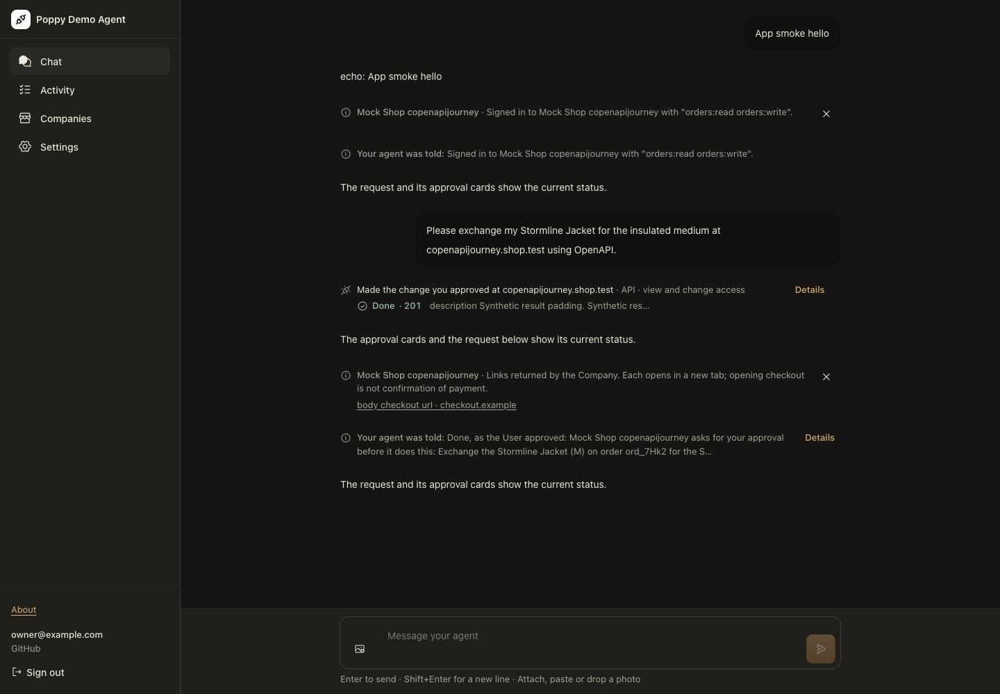

# Company-driven task approvals and checkout links

Baseline: `4c92a2d890d771feedf7a8fc7274d86644626f70`.
Implementation: `b04764ebdeda37be17f40e08ae921c945f6d5b34`.
The [receipt](receipt.json) pins the fixture and image hashes. These are local browser runs, not production screenshots.

## Approval flow

The same jacket-exchange prompt uses the production renderer, signed-cookie verifier and WebSocket, with a synthetic model and strict mock Company. At baseline the first card asks about an HTTP request; its click obtains the Company's terms, requiring a second click. With the correction, the first card contains those terms. Both runs record zero effects before terms approval and one effect afterward and after reload. Desktop OpenAPI and mobile MCP each change from two WebSocket approval decisions to one.

| Before | After |
| --- | --- |
|  |  |
|  |  |

Inspect the first card's content and the decision counts in [before.json](before.json) and [after.json](after.json). The interface's styling is unchanged.

## Returned links

The identical test-only response fixture puts a synthetic checkout URL after more than 2,000 characters of result data at both revisions. The old result is truncated and offers no direct result link. The corrected response produces a link without the model copying it. The browser checks its exact `href`, including `%2F`, `%2B`, multiple query parameters and the fragment; it never visits checkout.

| Before | After |
| --- | --- |
|  |  |

This demonstrates the local result-handling defect and its correction. Diagnostics omit the live checkout URL and response, so this does not establish why Print with Poppy's reported link failed.

## Reproduce

Use Node 24, the existing lockfile (`npm ci --legacy-peer-deps`) and an installed Chromium executable. Set `PDA_ACCEPTANCE_CHROMIUM` to its path. Neither command deploys or contacts a live Company.

At the implementation revision:

```sh
LANG=en_US.UTF-8 LC_ALL=en_US.UTF-8 node scripts/app-smoke.mjs \
  --approval-journey --company-driven --output /tmp/task-approvals-after.json
```

For the baseline, use a separate checkout at the baseline SHA. Copy only `test/browser/approval-journey-worker.ts` from the implementation revision into that checkout so both runs receive the same long response. Run its original driver:

```sh
LANG=en_US.UTF-8 LC_ALL=en_US.UTF-8 node scripts/app-smoke.mjs \
  --approval-journey --output /tmp/task-approvals-before.json
```

The committed receipts retain the runner's assertions and replace absolute screenshot paths with the six focused images kept here. Public-page and other incidental captures are omitted.

## Discriminating checks and limits

- Five initial task-request regressions failed before the implementation. Removing pending-request reuse again made OpenAPI and MCP observe another POST. Restoring the 2,000-character cut made the complete-result test fail with unterminated JSON. Both mutations were restored.
- The browser also checks lost-answer holds, explicit User reconciliation, reload, receipt expiry and durable historical attribution. Its first corrected run exposed an internal task record becoming a second reconciled receipt; the implementation and a dedicated regression now keep it hidden.
- Existing generated histories retain their full generators and safety assertions. Their preliminary cards now use an explicit legacy-card fixture; a separate current-flow property covers pending-term reuse and approve/decline across fresh calls and token/nonce configurations.
- No real OAuth provider, model, external payment service or real order is exercised. One fixture is not broad cross-project conformance. Automatic uncertain-action retry remains the existing conservative policy, rather than complete Ops §7 recovery.
