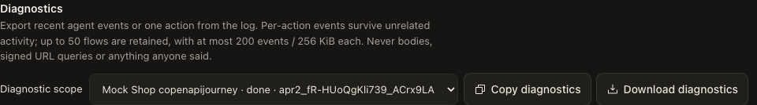
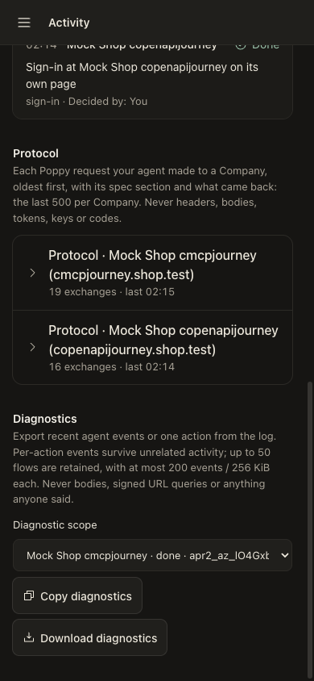
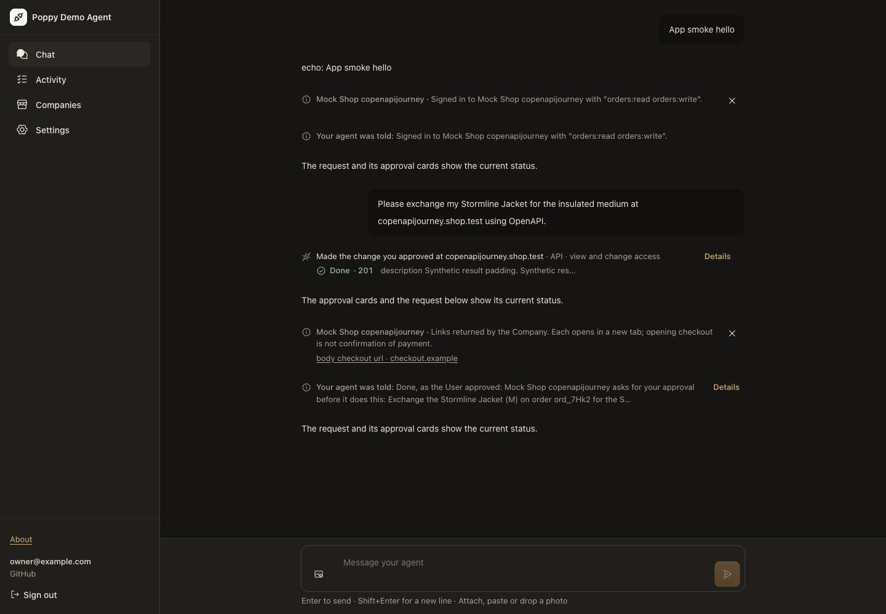

# PR #38 audit follow-up — 30 October 2026

Application and browser fixture: `f8400012a2d17a1f4d05095a98c615ce2be5d48e`.
[Receipt and hashes](receipt.json), [browser assertions](browser.json), [interop summary](interop.json), [16 process-kill cases](process-crashes.json).
The full suite ran at `5473d11f3bb8b4a9c44ac3f7328feae5525ba754`: **2,124 passed in 117 files, none skipped**. Its `src/` tree is identical to the rendered revision; the intervening change only adjusts the browser screenshot framing. The main checkout includes the deployer's untracked configuration, so its identity scan runs rather than conditionally skipping. No configuration or identity is included here.

## Visible checks

Claim: Activity exports the selected action, while successful result links preserve their exact source URL without putting it in diagnostics.

| Desktop | Mobile |
| --- | --- |
|  |  |

Inspect the scope selector and enabled download control. The real Chromium run receives the matching scoped response and rejects body fields and the synthetic signed query in that report. It also checks the selected controls fit each viewport. The mobile image retains its full viewport to avoid cropping the scroll container.



The browser checks both the exact source `href` attribute and its resolved value, observes the actual equality-report WebSocket frame, and finds only counts marked `client_reported` in the scoped export. It never follows checkout. [The current mobile approval](approval-mobile.png) still asks once about the Company's exact terms, with zero effects before that click and one afterward/reload. Earlier before/after comparison images remain [historical evidence at their stated revisions](../README.md).

## Fixes and discriminating evidence

- Every coalesced call retains its canonical request after settlement, decline, revisions and restart. Current-flow concurrency tests replace the old preliminary-card fixtures; generator domains and safety oracles were not reduced.
- Fresh attempts have immutable decision IDs. Delayed clicks on an earlier receipt cannot claim a later attempt, even when the Company repeats the same revision.
- A minimized Hegel history (`message → sign-in → sign-out → sign-in → task`, with the Company ending the old Session) exposed rejected initial-task recovery. Only a known `invalid_session` refusal may advance an unapproved task's Session, without changing account or withdrawal generation. All eight model properties pass their default 100 cases.
- Re-sampling authority while reading returned terms was mutation-tested: both OpenAPI and MCP regressions failed when transport bindings were replaced with current account state, then passed after restoration.
- A changed MCP read-only annotation bypassed the saved outcome. The new regression observed a different exchange result and the strict mock's `exchange.performed-twice`; recorded calls now take precedence over current hints.
- A deterministic logger test failed when `run_end` emitted before an in-flight tool settled. Turns now detach without blocking the next run, but wait for their tools before emission. This establishes that race, **not** the cause of the earlier CI foreign-text assertion. That privacy test now waits for the signed-in read's actual refusal before changing authority.
- The diagnostics reviewer found missing file-consent/batch capture. A regression failed before the fix and passes afterward. Proposal references and bounded batch references come from owned records, never arbitrary frame strings. Persistence is checked through a new logger instance over the same SQLite.
- The process verifier kills before committed terms are published and verifies recovery republishes the exact card without dispatch or decision. Its 16 cases retain the original eight approval boundaries, add six initial-task boundaries, and exercise real Pi MCP settlement plus an unsafe negative control.
- Link checks cover bounded hostile member labels, directional formatting, stored-envelope depth, fixed rejection reasons, scope matching, and retention by event count, UTF-8 bytes and flow eviction.

## Independent review

Two read-only re-reviews are pinned to `f10b24e1acab871797bce422cc366d1e83b91943`: [lifecycle/authority](review-lifecycle.md), [diagnostics/renderer](review-diagnostics.md). Neither found a merge blocker; the latter's P2 file-consent capture omission was reproduced and fixed in `0d73e9488c318e3e9a70e27974e7b993f08cfba6`. Those reports are source reviews, not independent executions of the parent checks.

## Reproduce

Node 24 and Chromium, from a configured checkout:

```sh
npm run typecheck
npm run check:spec
LANG=en_US.UTF-8 LC_ALL=en_US.UTF-8 npm test
npm run check:approval-crashes -- --output /tmp/approval-crashes.json
PDA_ACCEPTANCE_CHROMIUM='/path/to/chromium' LANG=en_US.UTF-8 LC_ALL=en_US.UTF-8 \
  node scripts/app-smoke.mjs --approval-journey --output /tmp/approvals.json
npm run interop -- --require-supported --agents pda --companies lenient-company,strict-company --scenarios AO,AS,O,OU,ODUP
npm run interop -- --require-supported --agents pda --companies print-with-poppy --scenarios D,SD,OU
```

The interop runs at `0d73e94` passed 10 own-project and three independent-demo cells, with zero unsupported cells or protocol warnings. The application source is unchanged since that run. Print with Poppy is pinned to `b340741d696d867ff3190c10c1f1d1e0c368e846`, in its synthetic demo; Docker's internal network rejects external egress. The summary preserves implementation pins, relaxations and isolation probes; full local traces are generated under `interop/results/`.

## Limits

No live OAuth provider, model, order, checkout or payment is exercised. Synthetic failures do not identify the reported live link's cause or prove duplicate live orders/payments. Client-reported equality is telemetry, not server proof. Shared turn/frame context can include other work; pruned events cannot be reconstructed. Per-flow limits bound event copies, not the lifecycle-state export envelope. Conservative unknown-outcome holds remain; full automatic Ops §7 retry recovery is not added. Old approval forms are refused, not migrated. The browser helper prints an RPC-stub disposal warning; uncaught browser errors and strict Company protocol violations/warnings are zero. No deployment is part of this verification.
