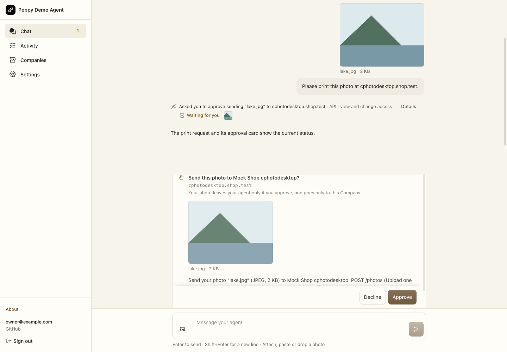
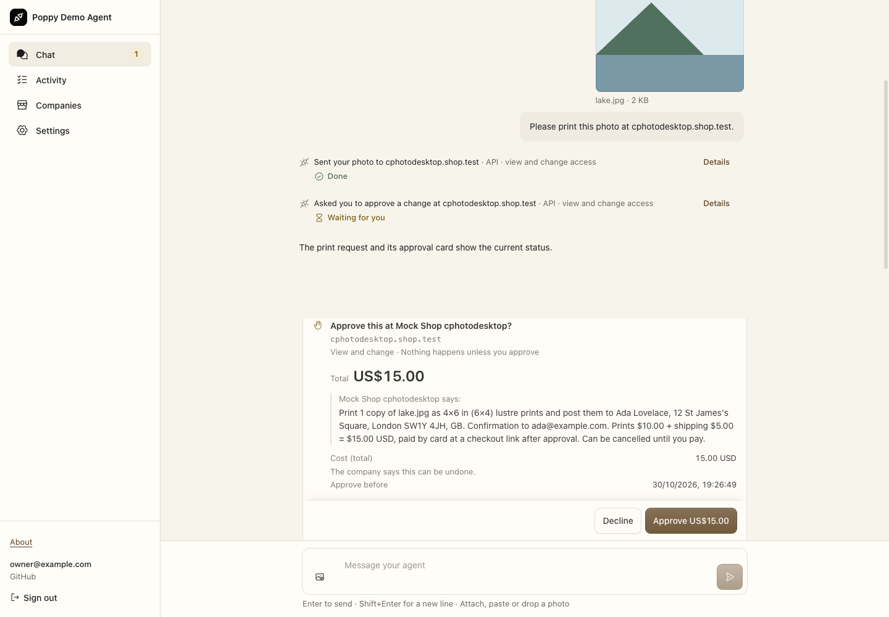
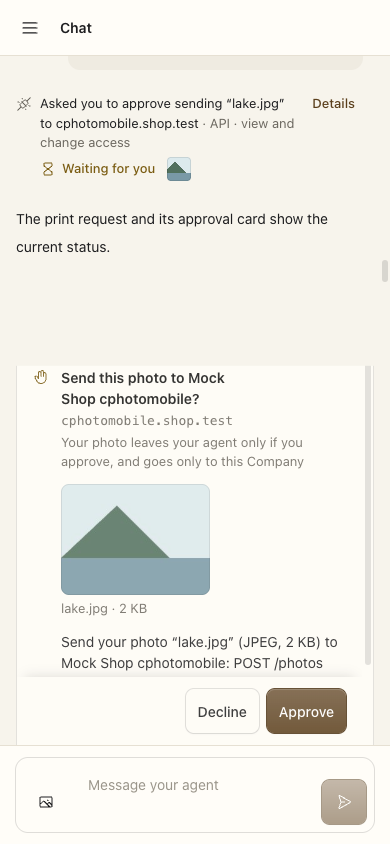
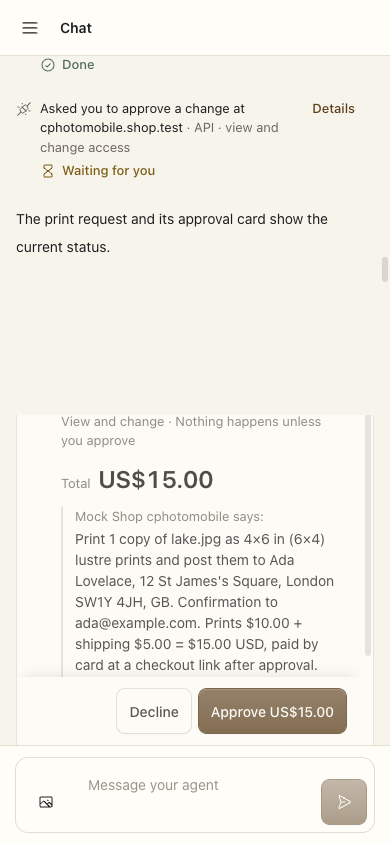

# Task-selected photo release evidence

**Claim:** the same photo-print fixture progresses from two approvals to one decision on the Company's exact terms. This is not a promise that every Company requests only one operation approval.

- Baseline application: `4ecbeb99c8e8dbce5449329f5ba5b5b4dea04283`.
- Reviewed application and harness: `17c5ba9b2acecf62086b90a4029244871f7b04e2`.
- Input: `photoJourneys` in `scripts/app-photo-journey.mjs`, its synthetic `lake.jpg`, and `test/browser/approval-journey-worker.ts`. Real composer/attachment route, signed-cookie verifier, WebSocket decisions, production Vite renderer and local workerd; synthetic identity/model/Company.
- Matched viewports: 1440×1000 and 390×844; light scheme. The baseline overlays only the same two driver scripts and test Worker; application paths were verified unchanged. This historical harness is evidence, not production compatibility.

| Before: disclosure still waits | After: upload complete, exact terms wait |
| --- | --- |
|  |  |
|  |  |

**Inspect:** the extra disclosure decision disappears; the Company's price and terms remain. These are different progress stages of the same task, not a layout redesign. Mobile uses nested scrolling: not all step/card headings fit in one frame. Browser assertions and click/effect counts, not the crop alone, establish completion.

## Executed checks

- [Before](browser-before.json) and [after](browser-after.json): desktop/mobile each upload once, create one Company operation and send one approved order request; statuses `[403,201]`; reload survives; zero strict warnings/violations or uncaught browser errors. Before requires two approvals; after one. No checkout opens.
- Final-source mobile negative control removes that current order's exact checkout receipt immediately before the decisive assertion: exit **1**, as intended. The positive run exits **0**. Desktop cannot satisfy the mobile oracle.
- `npm test`: **2,284 tests / 118 files**, none skipped; Workers 1,405, durability 3, page 268, interop unit/contract 415, properties 193. Default Hegel cases and original generators/assertions retained. Typecheck, pinned spec and docs-name checks pass. Documentation-name existence is not behavioral proof.
- [Process crashes](process-crashes.json): all **16** real process-group SIGKILL probes pass with the Company's ledger surviving. Includes the unsafe MCP negative control. These shared lifecycle probes are **not** a selected-multipart-specific physical crash matrix; the adopted-upload attribution checkpoint is a separate simulated-boundary regression.
- [Interop](interop.json): ten own-project cells and three pinned Print with Poppy cells pass, no unsupported cells/failures/warnings/tentative checks. Docker TCP/DNS egress probes are denied. Payment, printing and email are synthetic.
- [Audit disposition](../audit.md) and [source reviews](reviews/): broad lanes plus targeted corrections, ending in [security clearance](reviews/security-clearance.md). The UI/lifecycle correction was cleared at `d277eaa`; subsequent application changes are file-selection parsing only. Reviews did not execute these gates.
- CI first exposed an order assumption in the pre-existing feedback-race test: two calls await preflight before queue admission. The test now establishes the first transport with a barrier, retaining all assertions. Removing queued rejection recovery makes the corrected test fail. This test-only adjustment does not change the application pin; it does not prove the precise CI scheduler ordering.

[Receipt and input/log hashes](receipt.json); [artifact hashes](sha256.json). Only exit-zero positive browser runs are acceptance receipts; preceding cleanup timeouts and skip-build diagnostics are excluded.

## Reproduce

Node 24; Chromium set through `PDA_ACCEPTANCE_CHROMIUM`; Docker for interop. Use the pinned application/harness and the commands in `receipt.json`. For the baseline, check out its application pin, overlay only the three listed harness files, and add `--baseline-photo-consent`. No authenticated production flow is required or authorized.

## Limits

No live OAuth, model-provider account or Gateway settings were verified. No checkout, charge, print or email service was exercised. File/recipient selection bounds availability; it does not prove semantic intent or universal prompt-injection immunity. [Privacy controls still missing](../../../privacy-review.md) remain missing: wording is not deletion/export/retention implementation. Local deletion cannot erase downstream copies.
