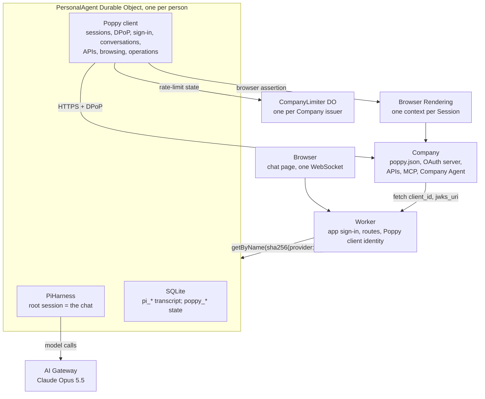

# Durable Personal Agent on Cloudflare — spec

Oct 11, 2026 · Ade Oshineye

Rewritten against **Personal Agent Protocol ("Poppy") Draft 0.1, updated Oct 9, 2026**, its Operations extension (version 1) and its Guides. Earlier versions of this spec designed PAP support before the protocol was published; everything in them about A2A, agent cards, signed receipts and `sub = HMAC(userKey, …)` is withdrawn.

## Summary

One Cloudflare Worker serves a chat page. Each signed-in person gets exactly one Durable Object running Pi via `PiHarness`, holding one never-ending conversation with Claude. That agent is also a **reference Personal Agent for Poppy**: it implements every part of Draft 0.1 that applies to a Personal Agent, plus the Operations extension, and it is built to be read, copied and tested against.

**Goals**

- Sign in with Google or GitHub, land in a chat with *your* agent.
- The agent's memory and in-flight work survive refreshes, deploys, crashes and closed tabs.
- **Complete Poppy coverage on the Personal Agent side**: discovery, agent identity, Sessions, DPoP, all three sign-in types, Account Tokens and sign-out, web browsing, OpenAPI and MCP APIs, conversations (including streaming, handoff and Direct Conversations), extensions, and the Operations extension.
- **Exemplary, not just compliant**: every MUST and MUST NOT for Personal Agents is mapped to code and a test (Appendix A), and the Guides' recommendations are followed unless this document says why not.
- Smallest possible surface: one Worker, a few Durable Object classes, no separate database, the chat UI reused from Cloudflare's Pi example.

**Non-goals**

- Multiple chats per user, sharing, teams, or a mobile app.
- The protocol's open topics: payments, push notifications and attachments are not in Draft 0.1, so they are not implemented beyond what the protocol already allows (for example, polling instead of push).
- Browsing websites that don't publish a `poppy.json`. Web browsing exists only to use a Company's site within a Poppy Session.
- Bring-your-own model keys or a model picker.
- The Company side of the protocol, except the mock Company used for tests (see Testing and conformance).

## Status

**Built and deployed (milestone 1)** at `https://personal-agent.adewale-883.workers.dev`:

- In-Worker Google and GitHub sign-in (this spec's former Option B); Cloudflare Access was dropped because Worker-level Access rejects WebSocket upgrades and a hostname-based Access app needs a custom domain.
- `/ws`, `/api/me`, `/auth/*`, `/logout`; the `PersonalAgent` Durable Object with `PiHarness`; the copied chat UI with sign-in and sign-out.
- 30 tests in the Workers runtime, verified on 9 Oct 2026 with `agents@0.28.0`, `@earendil-works/pi-durable` and `pi-ai` 1.1.0, Wrangler 4.149, Vitest 4.1.11 and `@cloudflare/vitest-plugin` 1.4.0.

**Not yet working on the deploy:**

- **Claude billing.** A real Claude call through AI Gateway returned `x-api-key header is required`; the `default` gateway needs Unified Billing credits or an Anthropic key (BYOK).
- **OAuth clients.** The Google and GitHub OAuth clients are not registered yet, so sign-in returns a 500 naming the missing setting.
- **Browser check.** The page has not been checked in a real browser.

**Not started:** milestones 2 to 6 (Build plan), including all of Poppy.

## Architecture



The Worker turns a verified app session into the person's Durable Object and forwards the WebSocket. It also serves the agent's public identity: the client metadata document, the JWKS, and the Direct Sign-In callback. Everything durable happens inside the person's object. A small `CompanyLimiter` Durable Object per Company shares rate-limit state across all users, because Companies limit by `client_id` and every user shares ours.

## Cloudflare stack

**Products and bindings**

| Product | Used for | Binding / config | When |
| --- | --- | --- | --- |
| Workers + Static Assets | Worker and the Vite-built chat page | `assets`, `run_worker_first` for `/ws`, `/api/*`, `/auth/*`, `/logout`, `/poppy/*` | v0 (`/poppy/*` in M3) |
| Durable Objects (SQLite) | `PersonalAgent` per person; `CompanyLimiter` per Company issuer | `durable_objects` + `new_sqlite_classes` migrations | v0; limiter M3 |
| Agents SDK | `PiHarness`, `Lifecycle`, `WebSockets`, Pi AI provider, durable wake-ups for polling | `agents` | v0 |
| AI binding → AI Gateway | Claude Opus 5.5 | `ai` binding `AI`; `AI_GATEWAY_ID` var | v0 |
| AI Gateway billing | Pays for Claude: Unified Billing or BYOK under `default` | dashboard | v0 (not yet set) |
| Browser Rendering | Poppy web browsing (section 5 of the protocol) | `browser` binding `BROWSER` | M5 |
| Workers Logs | Logs, with secrets redacted | `observability` | v0 |
| Workers Rate Limiting | Per-person burst limit on chat | `ratelimits` binding | M2 |

**Settings.** No setting has a default. A missing one stops the request with a 500 that names it.

| Name | Kind | Purpose | When |
| --- | --- | --- | --- |
| `MODEL_ID`, `THINKING_LEVEL`, `AI_GATEWAY_ID` | var | `anthropic/claude-opus-5-5`, `medium`, `default` | v0 |
| `SESSION_SECRET` | secret | HMAC key for the app's session cookie | v0 (set) |
| `GOOGLE_CLIENT_ID/SECRET`, `GITHUB_CLIENT_ID/SECRET` | secret | App sign-in | v0 (not set) |
| `PUBLIC_ORIGIN` | var | The one origin the Poppy `client_id`, `jwks_uri` and `redirect_uris` live on | M3 |
| `POPPY_CLIENT_NAME`, `POPPY_LOGO_URI` | var | Shown on Companies' consent pages | M3 |
| `POPPY_SIGNING_JWKS` | secret | Private ES256 JWKs (current and next), each with a `kid` | M3 |
| `TOKEN_ENC_KEY` | secret | 256-bit AES-GCM key for Account Tokens and pending sign-in state at rest | M3 |

**npm packages**

| Package | Version | Why |
| --- | --- | --- |
| `agents` | 0.28.0 | `PiHarness`, `Lifecycle`, `WebSockets`, Pi AI provider, `useAgent` |
| `@earendil-works/pi-durable`, `pi-ai`, `chord`, `pi-telemetry` | ^1.1.0 | Pi harness, registry, models |
| `jose` | ^6 | Session cookie claims, ID tokens; client assertions, Session assertions, browser assertions, DPoP proofs, JWKS |
| `@modelcontextprotocol/sdk` | pinned at M4 | Streamable HTTP MCP client, MCP 2025-06-18 or later |
| `@cloudflare/puppeteer` (or `@cloudflare/playwright`) | pinned at M5 | Browser Rendering |
| `react`, `react-dom`, `@cloudflare/kumo`, `streamdown`, `@streamdown/code`, `@phosphor-icons/react` | as in the example | Chat page |
| `vite`, `@cloudflare/vite-plugin`, `@vitejs/plugin-react`, `tailwindcss`, `@tailwindcss/vite`, `wrangler`, `typescript`, `vitest` 4.1.11, `@cloudflare/vitest-plugin` 1.4.0 (dev) | as installed | Build and test |

Install with `npm install --legacy-peer-deps`: `agents` declares many optional peers. The `agents/vite` plugin is not used; it only transforms decorators, which this app doesn't have, and needs `@babel/core`.

**Skills for whoever builds it.** Install Cloudflare's Skills plugin in the coding agent (Claude Code: `/plugin marketplace add cloudflare/skills`, then `/plugin install cloudflare@cloudflare`). `CLAUDE.md` points at this spec, names the test command, and says the four copied protocol files stay unchanged.

## Signing in to the app

App sign-in is the Worker's own Google and GitHub OAuth. It is separate from Poppy sign-in, which is the person signing in to a *Company* (see Signing in at a Company).

- **Flow.** `GET /auth/{google|github}` sends the browser to the provider with `state` and a PKCE S256 challenge. Both are kept in a signed, 10-minute `__Host-oauth` cookie. `GET /auth/{provider}/callback` checks `state` and swaps the code. Google returns an ID token from its token endpoint over TLS, so its claims are checked (issuer, audience, expiry, `email_verified`) without a signature check, as OpenID Connect allows. GitHub returns a token used to read the numeric user id and the primary verified email.
- **Session.** A `__Host-session` cookie (HttpOnly, Secure, SameSite=Lax, 30 days) holding `{provider, sub, email, exp}`, HMAC-SHA256 signed with `SESSION_SECRET`. Rotating the secret signs everyone out. `POST /logout` from the same origin clears it.
- **Agent name.** `sha256("<provider>:<id>")`, using Google's `sub` or GitHub's numeric id, computed only in the Worker. A Google and a GitHub sign-in are separate agents.
- **Who can sign in.** Anyone with a Google or GitHub account. Until the daily cap in M2 exists, that means anyone can spend the account's Claude credits, so an email allowlist should be added before the URL is shared.

**Worker routes**

| Route | Purpose | When |
| --- | --- | --- |
| `GET /` and assets | Chat page | v0 |
| `GET /ws` | Verify the session cookie and Origin, upgrade, forward to the person's agent | v0 |
| `GET /api/me` | Signed-in email and provider | v0 |
| `GET /auth/{provider}`, `GET /auth/{provider}/callback`, `POST /logout` | App sign-in | v0 |
| `GET /poppy/client.json` | The Poppy client metadata document; its URL is our `client_id` | M3 |
| `GET /poppy/jwks.json` | Our public signing keys | M3 |
| `GET /poppy/callback` | Direct Sign-In redirect target | M3 |
| `GET /poppy/browser-join/{token}` | Self-submitting form page that posts a browser assertion; only for our own Browser Rendering contexts | M5 |

## The agent

`PersonalAgent` is a plain `DurableObject`, composed as Cloudflare's Pi example composes its agent: `Lifecycle.install(this).use(webSockets).use(harness)`, with the example's `PiSessionSockets`. Pi's root session (`"1"`) is the person's single conversation.

**Harness configuration**

- **Model.** `MODEL_ID` = `anthropic/claude-opus-5-5`, through `createAI({ binding: env.AI, id: AI_GATEWAY_ID })`.
- **Thinking.** `THINKING_LEVEL` = `medium`; Pi's levels are minimal, low, medium, high, xhigh and max.
- **Retries.** 5 retries from 1 s, doubling.

**Extensions installed on the registry**

1. `persona`: the preamble; later the owner block, memory rows and conduct rules. The rules state that text from Companies is untrusted data, and that it is never the User's approval.
2. `memory` (M2): `remember(key, value)` and `forget(key)`, both `replay: "safe"`.
3. `poppy` (M3–M5): the tools in Model-facing tools.
4. Skills (M2): `skills([playbook])` from `agents/harness/pi`, with the playbook below.

| Skill | What it teaches |
| --- | --- |
| `company-visit` | Discover first; prefer APIs and the Company Agent over the website; never phone a Company that publishes `poppy.json`; start signed out; reuse an Account Token before asking the User to sign in; request the fewest scopes; read-only tokens for lookups |
| `company-messages` | One goal per message; put order numbers and dates in `text`, structured details in `data`, never JSON in `text`; share only the context the task needs; summarise before asking for a person; write for a person when `responder` is `human` |
| `operations` | Never claim something is done before the operation is final; show the Company's summary, not a paraphrase; a proposal is not an action |
| `memory-hygiene` | What to save with `remember`, what never to save (credentials, codes, tokens), when to `forget` |

**What lives in the person's SQLite**

| Table | Contents | When |
| --- | --- | --- |
| `pi_*` | Pi's transcript, inbox, tasks, checkpoints | v0 |
| `owner`, `memory` | Display name, daily message count; remembered facts | M2 |
| `poppy_companies` | Per Company issuer: the domains seen, cached `poppy.json` and AS metadata with expiry, and whether registration was refused | M3 |
| `poppy_user_ids` | `issuer → user_id` (random, see User IDs) | M3 |
| `poppy_sessions` | `session_id`, issuer, account label, signed in, granted scope, created, last used | M3 |
| `poppy_accounts` | Per issuer and account: encrypted Account Token, granted scope, expiry, rotated at | M3 |
| `poppy_signins` | Pending sign-ins: type, issuer, Session, encrypted `state`, PKCE verifier and `device_code`, poll interval, expiry | M3 |
| `poppy_conversations` | `conversation_id`, issuer, parent, direct flag, status, responder, saved cursor, handled event ids | M3 |
| `poppy_messages` | Message ids and content hashes of our outgoing messages, stored before sending | M3 |
| `poppy_operations` | `operation_id`, issuer, latest revision, state, summary, terms, approval, confirmation, result | M4 |
| `poppy_permissions` | Standing permissions: Company, account, action kind, limits, uses, reserved uses, expiry | M4 |
| `approvals` | Writes at Companies without the Operations extension | M4 |

Session Tokens and DPoP private keys are **never** written to storage (see Sessions, tokens and DPoP).

## Chat transport and UI

The wire protocol and chat UI come from Cloudflare's Pi harness example (`cloudflare/agents`, `examples/next/harnesses/pi`, commit `48d9c36`, MIT). `protocol.ts`, `sockets.ts`, `view.ts` and `transcript.ts` stay byte-for-byte unchanged so they can be re-synced. The hook connects with `useAgent({ agent: "personal-agent", basePath: "ws" })`.

**Poppy on the socket.** Poppy needs UI the chat transcript can't carry, such as a sign-in link, a password form or an approval button. It gets its own message types, defined in a new `src/poppy/wire.ts`. `PersonalAgent` wraps `PiSessionSockets`' handlers: frames whose `type` starts with `poppy.` go to the Poppy client, and every other frame passes through unchanged.

| Direction | Type | Carries |
| --- | --- | --- |
| server → client | `poppy.cards` | Cards to show: sign-in link or code, credentials form, one-time-code form, operation approval, operation status, Direct Conversation invitation, notices |
| server → client | `poppy.direct` | Messages and state for an open Direct Conversation, including `text-delta` pieces for display only |
| client → server | `poppy.context` | The browser's `locale` and `time_zone` (from `Intl`), sent on connect |
| client → server | `poppy.credentials` | Mediated Sign-In fields, sent straight to the sign-in code; never to the model |
| client → server | `poppy.code` | A one-time sign-in code |
| client → server | `poppy.approve` / `poppy.decline` | A decision on one operation revision or local approval |
| client → server | `poppy.direct.start` / `poppy.direct.say` / `poppy.direct.close` | Agree to a Direct Conversation, send the User's own words, leave it |
| client → server | `poppy.signout` / `poppy.permission.*` | Disconnect a Company account; add or remove a standing permission |

**Pages and panels added to the chat UI**

- **Connected companies:** each Company and account, its scopes and expiry, and a sign-out button.
- **Standing permissions:** each permission with its limits, uses left and expiry, and controls to edit or remove it.
- **Direct Conversation panel:** the User talks with the Company here. It shows `responder` (Company agent or person) and each message's `sender`.

## Poppy client

The client targets **Draft 0.1** exactly, and treats the document's `protocol_version` major `0` as the only supported major. Section numbers below (§) refer to the specification; "Guides" means the protocol's Guides page; "Ops" means the Operations extension.

### Our agent's identity (§4.1)

- **The metadata document** is served at `https://{PUBLIC_ORIGIN}/poppy/client.json`, and `client_id` is that exact URL. The Worker serves it only on `PUBLIC_ORIGIN`, without redirects, so a Company that fetches it (Guides: without following redirects) gets a document whose `client_id` equals the URL it fetched. The document looks like this:

  ```json
  {
    "client_id": "https://{PUBLIC_ORIGIN}/poppy/client.json",
    "client_name": "{POPPY_CLIENT_NAME}",
    "logo_uri": "{POPPY_LOGO_URI}",
    "jwks_uri": "https://{PUBLIC_ORIGIN}/poppy/jwks.json",
    "redirect_uris": ["https://{PUBLIC_ORIGIN}/poppy/callback"],
    "token_endpoint_auth_method": "private_key_jwt",
    "extensions": { "operations": { "version": "1" } }
  }
  ```

- `jwks_uri` and `redirect_uris` are HTTPS on the `client_id` domain, and the JWKS contains public keys only. Both documents are served with `Cache-Control: public, max-age=3600`.
- **Keys** are ES256 (Guides: sign with ES256), each with a `kid`, held in `POPPY_SIGNING_JWKS`. They are used only by code the model can't reach. They sign client assertions (RFC 7523 `private_key_jwt`), Session assertions and browser assertions. DPoP keys are separate and never published.
- **Rotation (Guides).**
  1. Publish the next key at least a day before signing with it.
  2. Switch signing to it.
  3. Keep the old public key published until everything it signed has expired, which is minutes.

  Account Tokens survive rotation, because they belong to the `client_id`.
- **Domain.** `client_id` is tied to `PUBLIC_ORIGIN` forever: changing the domain is a new Personal Agent to every Company. Choose the final domain before registering with any Company.
- **Registration.** Some Companies require it, and the protocol leaves the process to them. `invalid_client` on starting a Session is recorded on the Company and reported to the User as "this Company hasn't approved this agent yet", with no retry loop.

### Discovery (§3)

For a domain the User or the model names:

1. **Fetch the document.** `GET https://{domain}/.well-known/poppy.json` with `redirect: "manual"`, following at most 3 redirects, each of which MUST be HTTPS. The fetch is safe by construction:
   - **Limits:** a 100 KB size cap and a 5 s timeout.
   - **No credentials:** no cookies, tokens or credentials are sent.
   - **No private hosts:** refuse IP-literal and `localhost` hosts. Workers can't reach private networks, which covers the "address you actually connect to" check.
   - **Strict JSON:** a UTF-8 parser that rejects duplicate member names (Guides).
2. **Check the document.**
   - Refuse a document whose `protocol_version` major isn't `0`.
   - Require `organization.domain` to equal the requested host, ignoring a leading `www.`. The host of a redirect target doesn't count.
   - Ignore unknown fields.
   - Keep only extensions we support (`operations` version `1`), API types we know (`openapi`, `mcp`) and conversation types we know (`poppy`).
3. **Check the issuer (§3.2).** If `auth` is present:
   - Fetch `{auth.issuer}/.well-known/oauth-authorization-server` under the same limits.
   - Require its `issuer` to equal `auth.issuer` exactly, and its `poppy_domains` to include `organization.domain`.
   - Require `token_endpoint` and `revocation_endpoint`, plus `authorization_endpoint` or `device_authorization_endpoint` when `auth.direct` or `auth.device` is present.
4. **Cache** both documents by their HTTP caching headers, bounded to at least 1 minute and at most 1 day.
5. **Key Companies by issuer.** The Company's identity is `auth.issuer`. Several domains naming one issuer are one Company, with one User ID, the same Sessions and the same Account Tokens.

A document without `auth` can only be browsed as an ordinary website (§3.1), and the tools say so.

### User IDs (§4.2)

- **What it is.** A random `usr_` + 22 base64url characters (128 bits), created the first time the User needs a Session at that issuer and stored in `poppy_user_ids`. This is the Guides' "simplest choice".
- **Why not derived.** It is not derived from the app identity (`provider:sub`) or the email, keyed or not, because §4.2 forbids deriving it from personal information.
- **Lifetime.** Deleting the agent (`ctx.storage.deleteAll()`) deletes it.

### Sessions, tokens and DPoP (§4.2–§4.3)

**One HTTP client for Poppy.** Every Poppy request goes through it:

- **Redirects:** it never follows redirects with credentials.
- **DPoP:** it signs a fresh DPoP proof in a request hook that sees the final method and URL (`htm`, and `htu` without query or fragment). Proofs include `ath` except at the token endpoint, and `nonce` when the server has given one.
- **Nonces:** on `use_dpop_nonce` it takes `DPoP-Nonce`, keeps it in memory per server origin, and retries once with a new proof.
- **Retries:** each retry gets a new proof, and a retried token request gets new assertions.
- **Rate limits:** it waits at least `Retry-After` on 429 and 503. Otherwise it backs off exponentially with jitter, capped, with a limited number of attempts. It reads the `RateLimit` and `RateLimit-Policy` headers into the `CompanyLimiter`.
- **Logging:** `Authorization`, `DPoP` and `Cookie` headers and credential fields are redacted before anything reaches a log.

**Token requests.** Every request to the token endpoint carries:

- **The client assertion:** `iss` and `sub` are the `client_id`; `aud` is the exact `token_endpoint` string; `iat`, `exp` = `iat` + 60 s, and `jti` with 128 random bits.
- **A DPoP proof**, except Bearer requests for MCP (below).

**Sessions.**

| Step | Request | Notes |
| --- | --- | --- |
| Start | JWT bearer grant with a Session assertion: `iss` = `client_id`, `sub` = User ID, `aud` = `token_endpoint`, 60 s, fresh `jti` | Record `session_id`, `signed_in`, `scope`; check `expires_in > 0` |
| Renew, signed out | Same request with `session_id` | `invalid_session` starts a new Session |
| Renew, signed in | `grant_type=refresh_token` with the Account Token and `session_id` | See Account Tokens |
| Parallel tasks | Separate Sessions for the same User | Each task names the Session it uses |

**Rules for using tokens (§4.3).**

- **Session Tokens** are opaque and are never parsed.
- **Always sent:** a Session Token goes in the `Authorization: DPoP` header on every API and conversation request. No request is ever sent without one to appear as a person.
- **Newest wins:** the newest token for a Session replaces the old one at once.
- **Never in URLs:** tokens never go in a URL.
- **Narrower tokens:** a request can carry `scope`, to ask for fewer scopes, or `resource` (RFC 8707). A `poppy.json` entry that has a `resource` gets tokens requested for that resource.

**Where keys and tokens live.**

- **DPoP keys** are generated per User per Company as non-extractable WebCrypto ES256 keys, held only in the Durable Object's memory. After an eviction the object generates a new key pair and binds the next token request to it (Guides: "To switch to a new DPoP key, request a new session token with a proof signed by the new key"). No DPoP private key is ever stored, so one can't be read from storage or backups.
- **Session Tokens** are kept in memory and dropped on expiry. After an eviction the object renews them: signed-out Sessions with the assertion, signed-in ones with the Account Token.
- **MCP Bearer tokens.** For each MCP server, the token request omits the `DPoP` header and includes `resource` = that server's `url`. The resulting Bearer token is used only there, and is narrowed with `scope` where possible.

### Signing in at a Company (§4.4–§4.9)

**Before asking the User:**

1. Check `poppy_accounts` for an Account Token whose scope covers the task, and use it if there is one (§4.4, §4.8).
2. Otherwise pick a sign-in type the Company offers whose `scopes` include what's needed, preferring **Direct**, then **Device**, then **Mediated** (Guides).
3. Request the fewest scopes the task needs, always as a space-separated `scope`.
4. After any sign-in, check the granted `scope`, because the User may approve fewer.

**The trust rule (§4.4).** Direct and Device Sign-In happen only in the User's own browser, with the User signing in themselves. The agent never automates these pages, never types the User's password or one-time code into them, and never clicks a Company's approval controls. Browser Rendering is never pointed at a sign-in page.

**Direct Sign-In (§4.5)**

1. **Prepare.** Create a single-use random `state` and a PKCE verifier (S256). Store them encrypted in `poppy_signins` with the issuer and `session_id`.
2. **Send the User.** Push a sign-in card with the authorization URL, opened in a new tab of the User's own browser. The tool returns "waiting for the User", and the model ends its turn.
3. **Route the callback.** `GET /poppy/callback` arrives in the User's browser, so the Worker routes it to their agent by the app session cookie.
   - If the cookie is missing, the Worker asks the User to sign in to the app and start the Company sign-in again.
   - The authorization code is single-use and short-lived, so it is never parked or retried.
4. **Check the callback.** The agent finds the pending sign-in by `state` and rejects any that is missing, expired, already used, or for another Company. It requires `iss` to equal the stored issuer's `auth.issuer` exactly, and handles `error=access_denied`.
5. **Exchange the code.** Exchange it at **that** Company's `token_endpoint`, with `redirect_uri` set exactly to our registered URI, the verifier, `session_id`, the client assertion and a DPoP proof.
6. **Respond.** The callback response carries `Cache-Control: no-store`. The browser tab shows "Connected to {Company}; you can close this tab".

**Device Sign-In (§4.6)**

1. **Start.** POST the `scope` and client assertion to `device_authorization_endpoint`. Store `device_code` encrypted; it is never shown to the User or the model.
2. **Show the code.** Push a card with `verification_uri_complete` as a link and a QR code, and `user_code` shown too, so the User can check it matches.
3. **Poll.** A durable wake-up polls the token endpoint every `interval` seconds with the device-code grant, `session_id`, the client assertion and a DPoP proof. The poll survives eviction.
   - On `authorization_pending`, keep polling.
   - On `slow_down`, add 5 s to the interval.
   - Stop on `access_denied` or `expired_token`, and tell the User.

**Mediated Sign-In (§4.7)**

1. **Collect.** Push a credentials card built from `auth.mediated.fields`: one input per field, labelled with `label`. Fields marked `secret` are password inputs.
2. **Send.** The card's submit sends a `poppy.credentials` frame straight to the sign-in code. Credentials never enter the model's context, the transcript, logs, storage or any request except the one POST to `auth.mediated.endpoint` with the current Session Token. The endpoint must be the one in the verified `poppy.json`. Secret values are never echoed back.
3. **One-time codes.** `code_required` pushes a code card naming `code.sent_to`. Only the code goes to `{auth.mediated.endpoint}/{sign_in_id}`, from the same Session, never the credentials again.
4. **Finish.** On `complete`, store the Account Token. On `failed` or `expired`, tell the User. In every case, drop the credentials from memory at once.

**Scopes and step-up (§4.4, §6, §7.11)**

- `poppy:read` and `poppy:write` are independent, so both are requested when both are needed. Custom scopes are shown to the User with the Company's description from `auth.custom_scopes`.
- An `insufficient_scope` from an API or an `authorization` event in a conversation triggers sign-in again for all the scopes needed, through a type that allows them.
  - The new Account Token replaces the old one, which is then revoked.
  - A pending or failed sign-in leaves existing tokens alone.
- `sign_in_required` means: use a covering Account Token, or sign in.

**Account Tokens (§4.8)**

- **Storage.** Encrypted with AES-GCM under `TOKEN_ENC_KEY`, with additional authenticated data of `issuer | user_id | account`.
- **Never exposed.** They are never put in model context, messages, logs or URLs. Tools see an opaque account label, never the token.
- **Rotation.** A rotated `refresh_token` replaces the stored one immediately, before the response is used.
- **Read-only tasks** request a narrower `scope`.
- **Expiry and revocation.** On `invalid_grant`, delete the token, continue signed out, and tell the User the Company needs them to sign in again.
- **Multiple accounts.** A User with two accounts at one Company has two Account Tokens and separate Sessions. `account_mismatch` starts a new Session.

**Signing out (§4.9).**

- **Sign out.** The "Connected companies" page revokes an Account Token at `revocation_endpoint`, with `token_type_hint=refresh_token` and the client assertion.
- **What follows.** Sessions continue signed out: renew them with the assertion, or start new ones on `invalid_session`.
- **Ending a Session** means simply stopping use of it.
- **Disconnect from the Company's side** surfaces as `invalid_token`, `sign_in_required` or `invalid_grant`, and is handled the same way.

### Web browsing (§5)

Browsing uses Cloudflare Browser Rendering, never the User's browser.

- **One context per Session.** Each Poppy Session that browses gets its own browser context, with separate cookies and storage, never shared across Users. The context is closed when the Session ends.
- **Joining the Session.** If `web.browser_session_endpoint` is present, the browser MUST join the Session before loading any Company page.
  1. **Sign a browser assertion** with header `typ: poppy-browser+jwt`, signed with a `jwks_uri` key. Its claims are `iss` (the `client_id`), `sub` (the User ID), `aud` (the endpoint), `session_id`, `return_to`, `iat`, `exp` ≤ `iat` + 60 s, and a fresh `jti`.
  2. **Check `return_to`:** it must be HTTPS on `organization.domain` or a subdomain.
  3. **Post it from our browser.** The browser opens a page that holds a self-submitting form, which POSTs `assertion` in the body as a top-level navigation. The assertion is never put in a URL. The page is `/poppy/browser-join/{one-time token}`, valid for 60 s and usable once, or it is set directly with the page content.
  4. **Expect a `303`** to `return_to`. A 400 means the join failed.
- **Without the endpoint,** the browser is an ordinary signed-out visitor.
- **Keeping the Session.** A new assertion is posted when the site stops recognising the Session, and right before browsing resumes after sign-in.
- **What the model gets.** Browsing tools return page text, links and an accessibility snapshot. They never return cookies, and never type credentials into a website (Guides).
- **Interface preference.** Browsing is the last resort: APIs, then the Company Agent, then the website.

### APIs (§6)

- **Types.** Only `openapi` and `mcp` are used; other types are skipped.
- **Picking an API.** The `description` from `poppy.json` is shown to the model so it can choose.

**OpenAPI**

- **Description.** The OpenAPI 3.0 or 3.1 description is fetched with the safe-fetch rules (with a 1 MB cap) and cached.
- **Tools.** The model gets `poppy_api_describe` to read an operation's schema, and `poppy_api_call` to call it with a DPoP Session Token.
- **Idempotency.** Writes send an `Idempotency-Key` (a v4 UUID) when the operation accepts one, and reuse it on retry. The key is stored before sending.

**MCP**

- **Connection.** A Streamable HTTP client, MCP 2025-06-18 or later, using the Bearer token for that server's `url`.
- **Protected resource metadata.** The server's metadata (RFC 9728) must list `auth.issuer` in `authorization_servers`. If it doesn't, the server is not used.
- **Tools.** The model gets `poppy_mcp_list` and `poppy_mcp_call`. A tool's `readOnlyHint` sets its replay rule and whether the local approval gate applies.

**Errors (§6)**

| Error | Response |
| --- | --- |
| `invalid_token` | Get a new token and retry once |
| `sign_in_required` | Use an Account Token or sign in |
| `insufficient_scope` | Step-up with the named `scope` |
| `extension_required` | Tell the User that the Company needs an extension we don't support, naming it from `extension` |

### Conversations (§7)

**Choosing a protocol.** The first `agent.protocols` entry with `type: "poppy"` is used; other types are skipped. An entry with `resource` gets tokens for that resource.

**Sending (§7.3–§7.4)**

- **Message ids.** Each message `id` is `msg_` + 128 random bits, unique for the User. It is stored with a content hash in `poppy_messages` **before** sending. A retry resends the same id with identical content, so the send tool is replay-safe after a crash. `message_id_conflict` is reported as a bug and never "fixed" by changing the id.
- **Fields.** Every message has `text`, `data` or `context`. Natural language and simple values go in `text`, structured details in `data`, and never JSON in `text`.
- **Context.** `context` uses only the protocol's fields and formats:
  - `locale` (BCP 47) and `time_zone` (IANA) come from the User's browser.
  - `user_available` is `true` while the User has the chat open and was active recently. A context-only message updates it when that changes.
  - Nothing else is shared unless the task needs it.
- **Sender.** `sender` is `agent` for anything the agent writes, including summaries, paraphrases and translations of what the User said. It is `human` only for the User's own words, sent unchanged: the User typing in a Direct Conversation, or the User explicitly saying "send this exactly".
- **Waiting.** `wait` on a POST returns the reply in the same request when the model is waiting for an answer.

**Reading (§7.5–§7.7)**

- **Background reading.** Each open conversation is read by a durable background loop, never by the model polling.
  - It uses a long poll (`wait=30`), or SSE when the Company streams. Streams reconnect with `Last-Event-ID`.
  - It reads again at once while `has_more` is true.
- **Handling events.** Events are handled strictly in order.
  - Ids already handled are skipped, and unknown event types are skipped.
  - The cursor is saved only after its events are handled, and cursors are never compared or sorted.
  - On `cursor_expired`, the loop reads from the start and tells the User that part of the conversation is missing.
- **Partial text.** `text-delta` pieces go only to the UI, for display. They are never acted on, never shown to the model, and dropped after a reconnect.
- **Status.** `status` (working, idle, queued, closed) and `responder` (agent, human) are tracked and shown. Company messages show their `sender`.
- **Waking the model.** Company messages reach the model as data, through `harness.submit` with an `operationId` derived from the event id, so each event wakes the agent at most once:

  ```
  [company message from Example Company, sender=agent]
  <text>
  <data as JSON>
  ```

**Handoff, Direct Conversations, sign-in, closing (§7.9–§7.12)**

- **Handoff.** First send a short message summing up the problem, then `POST {id}/handoff {}`. While the status is `queued`, the agent can keep sending context. When `responder` becomes `human`, it writes for a person.
- **Direct Conversation requested by the Company.** A `user_requested` event shows the User a card with the `reason`. If the User agrees, the agent opens a Direct Conversation with `parent_conversation_id`. If the User declines or isn't available, the agent says so in the parent conversation. Only the User's agreement starts one.
- **Direct Conversation requested by the User.** The User can open one from the conversation's card.
- **Inside a Direct Conversation.** The User's typed words are sent as `sender: "human"`, and the Company's replies are shown in the Direct Conversation panel. The parent's `direct_opened` and `direct_closed` events are tracked, and messages to the parent are held while a Direct Conversation is open.
- **Sign-in during a conversation.** `authorization` events trigger the step-up rules. The conversation continues on the new token, or in a new Session, as long as the owner matches.
- **Closing.** `POST {id}/close {}` when the task is done. Closing doesn't cancel what the conversation started.
- **Errors** (`conversation_not_found`, `conversation_closed`, `direct_conversation_open`, `message_id_conflict`, `invalid_cursor`, `cursor_expired`) are each handled as §7.13 says.

### Operations extension (Ops)

We list `operations` version `1` in the client metadata document, so Companies that support it propose actions instead of performing them.

**Where proposals come from.** Ops §4 lists four places:

- An OpenAPI `202` with `operation`.
- An MCP tool result's `structuredContent.operation`.
- A conversation message's `operation`.
- An operation's `url` on the website.

All four go to one handler. It stores the operation and its revision, and pushes an **approval card**. A message never confirms an operation, whatever it says.

**The approval card (Ops §5.1).**

- **What it shows:**
  - The Company's name and the account.
  - The revision's `summary`, **verbatim**.
  - Any cost, date or condition from `terms`, and whether the action can be undone.
  - For a new revision, what changed since the last one.
- **How the answer arrives.** The decision comes only through the card's buttons, as `poppy.approve` or `poppy.decline`. The model can't approve, and Company text is never approval.

**Standing permissions.**

- **Who creates them.** The User creates them on the Standing permissions page, never the model.
- **What each one holds:** the Company issuer, the account, the action kind, limits (such as a maximum amount, number of uses, or other term constraints) and an expiry.
- **When one applies.** It is used as `approved_by: "standing_permission"` only if every limit is checked against the revision's `terms`. If a needed term is missing, ask the User instead. It never applies when `user_approval_required` is true.
- **Limited uses.** A use is reserved before confirming and released if the Company rejects the confirmation.

**Confirming (Ops §5.2, §6).**

- **Who confirms.** Code confirms, not the model: `POST {endpoint}/{operation_id}/confirm {revision, approved_by}` with a DPoP token. The model is told the outcome.
- **Responses:**

  | Response | Action |
  | --- | --- |
  | `terms_changed` | Show the new revision for approval |
  | `user_approval_required` | Ask the User directly |
  | `insufficient_scope` / `sign_in_required` | Step-up, then confirm the same revision |
  | `in_progress` | Read again after `Retry-After` |

- **Timeouts.** A timeout leads to a read of the operation or a repeat confirm, with the same operation id. A new proposal of the same action is never requested until this one is final.
- **Final states.** These are succeeded, failed, cancelled and expired. `result.summary` is shown to the User as the Company's account of what happened, and recorded.
- **Withdrawn approval.** If the User withdraws approval before confirmation, the agent doesn't confirm. After confirmation, it cancels.

**Cancelling (Ops §7)** comes from the card or the User's explicit request, as `POST {endpoint}/{operation_id}/cancel`.

### Rate limits and errors across the client

- **`CompanyLimiter`.** One Durable Object per Company issuer holds the shared state for our `client_id`: `Retry-After` deadlines, and the limits read from the `RateLimit` and `RateLimit-Policy` headers. Every person's agent checks it before sending and reports what it learns, so one busy User can't get every User limited.
- **`rate_limited` (429) at the token endpoint** pauses Session creation for that Company for all Users.
- **Background work** such as order-status checks is spread out and kept off busy hours. Polls are long polls or streams, as rare as the task allows.
- **Errors** follow the tables in §4.2, §6 and §7.13, and Ops §9. Unknown error codes are surfaced to the User as "the Company said: {code}".

### Model-facing tools (the `poppy` extension)

Tools take a `domain` (resolved to its issuer), and optionally a `session` label for parallel tasks and an `account` label. They never take or return tokens, keys, codes or credentials.

| Tool | Does | replay |
| --- | --- | --- |
| `poppy_discover(domain)` | Discovery; returns organization, sign-in types and scopes, APIs, Company Agent, extensions | safe |
| `poppy_sign_in(domain, scopes, reason)` | Uses a covering Account Token, or starts the preferred sign-in type and pushes its card; returns "waiting for the User" | safe |
| `poppy_status(domain)` | Sessions, signed-in accounts, granted scopes, open conversations and operations | safe |
| `poppy_message(domain, text?, data?, conversation?, wait?)` | Start a conversation or send a message; the id is stored before sending | safe (same id on replay) |
| `poppy_read(conversation)` | Latest events already received by the background reader | safe |
| `poppy_handoff(conversation, summary)` | Summary message, then handoff | safe (message id; handoff is idempotent) |
| `poppy_invite_user(conversation, reason)` | Offers the User a Direct Conversation | safe |
| `poppy_close(conversation)` | Close | safe |
| `poppy_api_describe(domain, api, operation?)` | OpenAPI schema lookup | safe |
| `poppy_api_call(domain, api, operation, params, body)` | OpenAPI call; GETs and writes with a stored `Idempotency-Key` are safe, other writes go through approval | safe / unsafe |
| `poppy_mcp_list(domain, server)` / `poppy_mcp_call(domain, server, tool, args)` | MCP tools | list safe; call by `readOnlyHint` |
| `poppy_browse(domain, url, action?)` | Browser Rendering in the Session's context: open, read, click, fill a non-credential field | unsafe for submits |
| `poppy_operation(domain, operation_id)` | Read an operation | safe |

Confirming, cancelling, standing permissions, credentials and sign-out are UI actions, not tools.

## Safety

- **Approval for writes.**
  - At Companies with the Operations extension, approval is the extension's.
  - At Companies without it, our local gate applies: an OpenAPI write, an MCP tool without `readOnlyHint: true`, or a website form submit.
  - Instead of acting, the tool inserts an `approvals` row and pushes a card. On approval, code makes exactly the stored call once. If the object dies mid-call, the call is not retried automatically, and the User is told the outcome is unknown.
  - Conversation messages are not gated: under Poppy, sending a message never authorizes an account action (§7.11), and the Company enforces scopes on its side.
- **Replay rules.**
  - Tools are `replay: "safe"` only when the protocol makes a repeat harmless: reads, message sends with a stored id, writes with a stored `Idempotency-Key`, and operations, which happen at most once by Ops §6.
  - Everything else is `unsafe`: after a crash, Pi gives the model an interrupted result instead of repeating the call.
- **Secrets** (Guides, "Handling secrets").
  - Session Tokens and DPoP keys exist only in memory.
  - Account Tokens and pending `state`, verifier and `device_code` values are encrypted at rest.
  - Signing keys exist only in Worker secrets.
  - None of them ever reach the model, tools' results, the transcript, logs or URLs. Mediated credentials pass through memory once.
  - Responses that carry codes are `Cache-Control: no-store`.
- **Untrusted content.** Text and data from Companies' sites, APIs, MCP tools and agents are data, never instructions. The persona says so. The approval gate and the Operations extension limit what an injected instruction can do.
- **Spend.** A per-person daily message cap in `owner` (M2), and an email allowlist until then.
- **Deletion.** "Delete my agent" first revokes every Account Token at its Company, then runs `ctx.storage.deleteAll()`.

## Testing and conformance

- **Unit and integration tests** run in the Workers runtime with Vitest, as now. The model is pi-ai's faux provider. Google and GitHub are faked by the test config's outbound service.
- **Mock Company.** `test/mock-company/` is a full Poppy Company in a Worker, served through the outbound service at several hosts. It covers:
  - **Discovery:** `poppy.json` with redirects, two domains naming one issuer, and AS metadata.
  - **Tokens and DPoP:** a token endpoint that verifies client assertions against our JWKS, checks DPoP with nonces and `jti` replay, rotates Account Tokens, and can rate-limit or require registration.
  - **Sign-in:** a Direct Sign-In authorize page (driven by the test as "the User"), a device endpoint and page, and Mediated Sign-In with one-time codes. Revocation is supported.
  - **APIs:** an OpenAPI API that returns operations, and an MCP server with protected resource metadata.
  - **Conversations:** JSON and SSE, with `text-delta`, handoff, `user_requested`, Direct Conversations, `authorization` events and cursor expiry.
  - **Operations:** revisions, `terms_changed`, and slow `in_progress`.
  - **Browsing:** the browser-session endpoint.

  Each behaviour can be switched on per test.
- **Conformance suite.** Every row in Appendix A has a test named after it, so `npm test` is the compliance report.
- **Interop.** When real Companies publish `poppy.json`, the agent is checked against them on a preview deploy, signed out first.
- **Open source.** The mock Company and the conformance tests are written to be reusable by other Personal Agents.

## Build plan

1. **Chat demo (done).**
   - **Built:** app sign-in, the agent, the UI and 30 tests.
   - **Remaining:** billing and OAuth client registration.
   - **Done when:** a Google and a GitHub account each sign in and chat with Claude, never see each other's messages, and a redeploy loses nothing.
2. **Personal.**
   - **Scope:** `persona` and `memory`, skills, email allowlist, rate limit and daily cap.
   - **Done when:** "remember I'm vegetarian" survives a week and a redeploy.
3. **Poppy core.**
   - **Scope:** `PUBLIC_ORIGIN` and the final domain; identity routes and key rotation; discovery; User IDs; Sessions and DPoP; Direct and Device Sign-In; Account Tokens and sign-out; conversations with handoff and Direct Conversations; `CompanyLimiter`; the mock Company.
   - **Done when:** against the mock Company, "return my jacket" runs:
     1. discovery
     2. a signed-out conversation
     3. an `authorization` event, then Direct Sign-In and Device Sign-In
     4. the signed-in conversation
     5. handoff to a person
     6. a Direct Conversation
     7. close

     All of this happens with conformance tests for every §3–§4 and §7 row.
4. **APIs and operations.**
   - **Scope:** OpenAPI and MCP clients, the Operations extension, standing permissions and the local approval gate.
   - **Done when:** an exchange proposed in a conversation is approved in the UI, confirmed once despite an injected timeout, and its `result.summary` is shown. A standing permission confirms a second exchange within its limits and refuses one outside them.
5. **Mediated Sign-In and web browsing.**
   - **Scope:** credentials and code cards, Browser Rendering contexts, browser assertions.
   - **Done when:** a mediated sign-in with a one-time code never puts a secret in a log, the transcript or storage (checked by a test that scans them), and the browser joins a signed-in Session and sees the account page.
6. **Reference release.**
   - **Scope:** every Appendix A row green; the mock Company and conformance suite documented for reuse; feedback on the draft sent to the protocol's maintainers.
   - **Done when:** a third party can run the suite against their own Personal Agent.

## Open questions and risks

- [ ] **Claude billing:** Unified Billing credits or an Anthropic BYOK key on the `default` gateway?
- [ ] **Final domain** for `client_id` before registering anywhere; is a `workers.dev` host acceptable to Companies?
- [ ] **Browser Rendering:** cost and limits for one context per Session; confirm that separate contexts isolate cookies and storage.
- [ ] **MCP client choice** inside a Durable Object, the MCP TypeScript SDK or the Agents SDK's client, and whether Pi's registry can add Companies' MCP tools at runtime or they stay behind `poppy_mcp_call`.
- [ ] **Eviction.** In tests, `evictDurableObject()` timed out after a completed Pi run. If idle agents stay resident, DPoP keys live longer than assumed (harmless); if they are evicted often, token requests increase.
- [ ] **Compaction** of the never-ending conversation.
- [ ] **Push notifications** are an open topic, so the agent polls. Revisit when the protocol defines push.
- [ ] **Registration.** How will Companies run it, and will it be per `client_id` domain?

* **Risk:** Poppy is Draft 0.1 and "can change before a stable version, including in ways that aren't backward compatible". The client pins to Draft 0.1, and Appendix A cites section numbers so changes can be diffed.
* **Risk:** `PiHarness`, the Pi AI provider and Pi Durable are beta. The four copied example files are where Pi's event format is interpreted.
* **Risk:** the trust rules — who signed in, and how an approval was given — are promises Companies can't verify. Breaking them can get our `client_id` revoked for every User. Tests assert the agent never automates sign-in pages or approvals.
* **Risk:** one model stream longer than 15 minutes can be cut off by the alarm limit.

## Appendix A: Personal Agent requirements

Every MUST and MUST NOT in Draft 0.1 and Operations v1 that falls on a Personal Agent, then the Guides' recommendations we adopt. "Where" names the component; each row gets a conformance test.

**Specification**

| § | Requirement | Where |
| --- | --- | --- |
| 3 | Follow redirects for `poppy.json`; every redirect MUST be HTTPS | Discovery |
| 3 | Cache `poppy.json` per HTTP caching headers (SHOULD) | Discovery |
| 3.1 | MUST NOT use a document whose major version isn't supported; ignore unknown fields | Discovery |
| 3.1 | `organization.domain` must match the requested host, ignoring `www.`; a redirect's host doesn't count | Discovery |
| 3.2 | MUST check AS metadata `issuer` equals `auth.issuer` exactly and `poppy_domains` includes `organization.domain` before using the document | Discovery |
| 3.2 | Treat domains that name one issuer as one Company (User IDs, Sessions, Account Tokens) | Discovery, storage |
| 3.3 | MUST ignore unsupported extensions and unknown fields; list supported extensions in client metadata | Discovery, identity |
| 3.3 | Handle `extension_required` (403, `extension`) | Errors |
| 4.1 | `client_id` MUST be an HTTPS URL returning the metadata document, and MUST equal that URL | Identity routes |
| 4.1 | `jwks_uri` and `redirect_uris` MUST be HTTPS on the `client_id` domain; JWKS has public keys only | Identity routes |
| 4.1 | Authenticate at the token endpoint with `private_key_jwt`; DPoP keys separate and unpublished | HTTP client |
| 4.1 | Handle `invalid_client` (unregistered, blocked, revoked) | Sessions |
| 4.2 | MUST give each User a User ID per Company (by issuer); stable, opaque, different per Company | User IDs |
| 4.2 | User ID MUST NOT contain or derive from personal information, even with a keyed hash | User IDs |
| 4.2 | Session assertion: `iss` = `client_id`, `sub` = User ID, `aud` = `token_endpoint` as a single string, short `exp`, `jti` ≥ 128 bits | Sessions |
| 4.2 | MUST NOT depend on Session Token contents | Sessions |
| 4.2 | Renew with `session_id`; on `invalid_session` start a new Session | Sessions |
| 4.3 | API and conversation requests MUST carry `Authorization: DPoP` and a DPoP proof | HTTP client |
| 4.3 | New proof per request, including token requests; `ath` except at the token endpoint; `htu` without query or fragment | HTTP client |
| 4.3 | MUST support DPoP nonces | HTTP client |
| 4.3 | MCP: request a Bearer token without `DPoP`, and MUST include `resource` = the MCP server `url` | MCP |
| 4.3 | MUST send a Session Token on every API and conversation request; MUST NOT omit it to appear as a person | HTTP client |
| 4.3 | MUST use the newest Session Token for a Session | Sessions |
| 4.3 | MUST NOT send tokens in a URL | HTTP client |
| 4.3 | On 429, MUST wait at least `Retry-After` | HTTP client, `CompanyLimiter` |
| 4.4 | MUST use Direct or Device Sign-In only when the User signs in themselves | Sign-in |
| 4.4 | Each sign-in request MUST include `scope` (space-separated); handle `invalid_scope` | Sign-in |
| 4.4 | Check the granted `scope` | Sign-in |
| 4.4 | Revoke the replaced Account Token after step-up (SHOULD); a failed sign-in leaves tokens unchanged | Account Tokens |
| 4.4 | Check for a covering Account Token before a new sign-in (SHOULD) | Sign-in |
| 4.4 | One account per Session; `account_mismatch` → new Session | Sessions |
| 4.5 | Random `state` and PKCE; MUST check `iss` equals the started Company's `auth.issuer`; exchange with `session_id` | Direct Sign-In |
| 4.5 | `redirect_uri` exactly a registered URI; handle `error=access_denied` | Direct Sign-In |
| 4.6 | Show `verification_uri` and `user_code` or `verification_uri_complete`; keep `device_code` private | Device Sign-In |
| 4.6 | Poll at `interval`; honour `slow_down`; stop on `access_denied` or `expired_token` | Device Sign-In |
| 4.7 | Secret fields MUST never be shown back, logged, or sent elsewhere | Mediated Sign-In |
| 4.7 | MUST NOT send credentials anywhere but `auth.mediated.endpoint` | Mediated Sign-In |
| 4.7 | Submit only the code to `{auth.mediated.endpoint}/{sign_in_id}` from the same Session; handle all four statuses | Mediated Sign-In |
| 4.8 | MUST use a rotated Account Token from then on | Account Tokens |
| 4.8 | MUST store Account Tokens as secrets; MUST NOT put them in model context, messages, logs or URLs | Account Tokens |
| 4.8 | `scope` may narrow, never broaden; `invalid_grant` → continue signed out | Account Tokens |
| 4.9 | Sign out by revoking at `revocation_endpoint` with the client assertion; renew Sessions signed out | Sign-out |
| 4.9 | Detect disconnection via `invalid_token`, `sign_in_required`, `invalid_grant` | Sign-out |
| 5 | If `browser_session_endpoint` exists, MUST join the browser to a Session before browsing | Browsing |
| 5 | Browser assertion: `typ: poppy-browser+jwt`, `aud` = endpoint, `session_id`, `exp` ≤ `iat` + 60 s, fresh `jti` | Browsing |
| 5 | `return_to` MUST be HTTPS on `organization.domain` or a subdomain | Browsing |
| 5 | Assertion MUST go in the POST body as a top-level navigation, never in the URL | Browsing |
| 5 | MUST post browser assertions only from a browser we control, never the User's | Browsing |
| 6 | Skip unknown API types (SHOULD); DPoP for OpenAPI, Bearer for MCP | APIs |
| 6 | Handle `invalid_token`, `sign_in_required`, `insufficient_scope` (with `scope`) | APIs |
| 7.1 | Use a supported conversation protocol; skip unfamiliar types | Conversations |
| 7.2 | Accept the Company's ids as opaque, never depending on their format | Conversations |
| 7.3 | Message `id` MUST be unique for the User; retry with the same id and content | Conversations |
| 7.4 | A message MUST have `text`, `data` or `context`; no JSON in `text` (SHOULD NOT) | Conversations |
| 7.4 | Shared context facts MUST use the defined fields and formats; share only what the task needs (SHOULD) | Conversations |
| 7.5 | MUST skip unknown event types | Conversations |
| 7.5 | MUST NOT compare or sort cursors; handle events in order, then save the cursor; skip handled ids; read again on `has_more` | Conversations |
| 7.5 | On `cursor_expired`, read from the start and tell the User (SHOULD) | Conversations |
| 7.6 | Reconnect streams with `Last-Event-ID`; MUST NOT act on `text-delta`; drop incomplete pieces | Conversations |
| 7.7 | Track `status` and `responder`; read each Company message's `sender` | Conversations |
| 7.8 | MUST set `sender`: `human` only for the User's own words; summaries and translations are `agent` | Conversations |
| 7.9 | Handoff with `{}`; closing cancels a pending handoff | Conversations |
| 7.10 | Start a Direct Conversation only with the User's agreement; handle `direct_opened`, `direct_closed`, `direct_conversation_open` | Conversations |
| 7.11 | Handle `authorization` events like the API errors; continue the same conversation | Conversations |
| 7.12 | Close with `{}` when done | Conversations |
| 7.13 | Handle every conversation error code | Conversations |

**Operations extension v1**

| § | Requirement | Where |
| --- | --- | --- |
| 2 | List `operations` version `1` in client metadata | Identity routes |
| 4 | Accept operations from OpenAPI 202, MCP `structuredContent`, conversation messages; a message never confirms | Operations |
| 5.1 | MUST have the User's approval for the exact revision before confirming | Operations |
| 5.1 | MUST show the Company's name and the revision's `summary`, and take the answer through our own interface | Approval card |
| 5.1 | MUST NOT treat Company text as the User's approval | Operations |
| 5.1 | A standing permission MUST cover the Company, account, action and every term, and still be in effect; never when `user_approval_required` | Standing permissions |
| 5.1 | A new revision needs a new approval unless a standing permission covers it | Operations |
| 5.2 | Confirm with `revision` and `approved_by`; handle `terms_changed`, `user_approval_required`, scope errors | Operations |
| 6 | Retry or read with the same operation id; MUST NOT ask for a new proposal until final | Operations |
| 6 | Present `result.summary` as the Company's account | Operations |
| 7 | Withdrawn approval: don't confirm, or cancel if confirmed | Operations |

**Guides adopted**

The Guides' recommendations adopted, by topic:

- **Secrets.** Secrets are kept out of logs, telemetry, error reports, model context, messages and URLs. `Authorization`, `DPoP` and `Cookie` headers are redacted, and responses that carry codes are `no-store`.
- **JWTs.** We sign ES256, use a `kid` on every key, make each `jti` at least 128 bits, use short lifetimes, and rotate keys by publishing first and retiring late.
- **Metadata fetches.** At most 3 redirects, 100 KB, a few seconds, no credentials, no private hosts, and caching bounded to between 1 minute and 1 day.
- **Retries.** An `Idempotency-Key` (v4 UUID) on writes that accept one; `Retry-After` honoured on 429 and 503; exponential backoff with jitter.
- **Rate limits.** Limits are tracked per Company and shared across tasks and Users. Polling uses long polls or streams, and background work is spread out.
- **JSON and time.** UTF-8, duplicate member names rejected, RFC 3339 timestamps with an offset, unknown fields ignored.
- **User IDs.** Random, stored per User per Company.
- **DPoP.**
  - Keys are non-extractable WebCrypto keys, per User per Company.
  - Signing happens in code the model can't reach.
  - Proofs are made in a hook that sees the final URL.
  - Redirects are never followed with old proofs.
  - A nonce is kept per server, with one retry.
- **Tokens.** Account Tokens are encrypted, and tools only see references to them. Session Tokens stay in memory. Bearer tokens are used only for MCP. A rotated token is replaced at once, an old token is revoked after step-up, and a token is deleted on `invalid_grant`.
- **Sign-in choice.** Direct, then Device, then Mediated. The fewest scopes, read-only tokens for lookups, and a check of the granted `scope`.
- **Direct and Device Sign-In.**
  - Sign-in happens only in the User's own browser.
  - `state` is single-use and bound to its Company and Session.
  - PKCE uses S256.
  - Device codes are shown as a link and QR code with the `user_code`, and polling adds 5 s on `slow_down`.
- **Mediated Sign-In.** A form posts straight to the sign-in code. Credentials are discarded after the Account Token arrives, and only the one-time code is submitted.
- **Web browsing.** A separate storage context per Session, never typing credentials into a website, joining right before browsing, re-posting the assertion when the site loses the Session, and closing the context at the end.
- **Conversations.** Long `wait` or streaming, a summary before handoff, writing for a person when one is present, and closing when done.
- **Interface choice.** APIs and the Company Agent before the website, and never phoning a Company that publishes `poppy.json`.
- **Operations.**
  - Show the summary verbatim, with the Company, the account, costs, dates, conditions and reversibility.
  - Show what changed between revisions.
  - Check standing permissions term by term.
  - Reserve limited uses before confirming.
  - Read or re-confirm after a timeout, respecting `Retry-After`.

## Sources

- [Personal Agent Protocol: home](https://personalagentprotocol.org/), [Overview](https://personalagentprotocol.org/docs/overview), [Specification, Draft 0.1](https://personalagentprotocol.org/docs/spec), [Extensions](https://personalagentprotocol.org/docs/extensions), [Operations extension](https://personalagentprotocol.org/docs/extensions/operations), [Guides](https://personalagentprotocol.org/docs/guides), [Open topics](https://personalagentprotocol.org/docs/open-topics), [License](https://personalagentprotocol.org/license) (Apache 2.0)
- [Cloudflare agents repo: Pi harness example](https://github.com/cloudflare/agents/tree/main/examples/next/harnesses/pi)
- [Cloudflare Agents docs: Pi harness](https://developers.cloudflare.com/agents/harnesses/pi/), [extensions and skills](https://developers.cloudflare.com/agents/harnesses/pi/extensions/), [Pi AI model provider](https://developers.cloudflare.com/agents/models/pi-ai/)
- [Cloudflare AI Gateway: Unified Billing](https://developers.cloudflare.com/ai-gateway/features/unified-billing/)
- [Cloudflare Workers: Cloudflare Access (WebSocket limitation)](https://developers.cloudflare.com/workers/configuration/cloudflare-access/)
- [Cloudflare Browser Rendering](https://developers.cloudflare.com/browser-rendering/)
- RFCs: 6749, 6750, 7009, 7519, 7523, 7636, 8414, 8628, 8707, 9207, 9449, 9728; OAuth Client ID Metadata Document draft; OpenAPI 3.1; MCP 2025-06-18

Copied files were read from the Pi example at commit `48d9c36`. The protocol pages were read in full on 11 Oct 2026.
