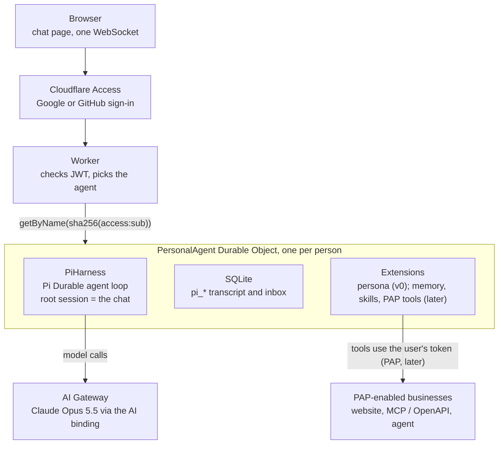
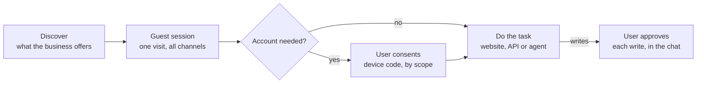

# Durable Personal Agent on Cloudflare — v0 spec

Oct 9, 2026 · Ade Oshineye

Live version, with the PAP research tab: https://claude.ai/code/artifact/37784958-8984-42e5-918a-baecf40fb4d3

## Summary

One Cloudflare Worker serves a chat page; each signed-in person gets exactly one Durable Object running Pi via `PiHarness`, holding one never-ending conversation. That is the whole product for v0. PAP's v0.1 spec is still unpublished (due later in October 2026), so PAP sits behind an adapter. Research findings are on the PAP research tab of the live doc.

**Goals**

- Sign in with Google or GitHub, land in a chat with *your* agent.
- The agent's memory and in-flight work survive refreshes, deploys, crashes and closed tabs.
- The agent can act for its owner toward PAP-enabled businesses: discover, start a guest session, ask the owner for OAuth consent, then use the business's website, API or agent.
- Smallest possible surface: one Worker, one DO class, no separate database, and a chat UI reused from Cloudflare's Pi example rather than built from scratch.

**Non-goals for v0**

- Multiple chats per user, sharing, teams, or a mobile app.
- Payments, push notifications from businesses, or fine-grained per-action permissions (PAP lists these as future extensions).
- Browser automation of arbitrary websites.
- Bring-your-own model keys or a model picker.

## v0: the chat demo

The first demo is one page: sign in with Google or GitHub, then chat with Claude Opus 5.5 (thinking level medium) in one conversation that survives reloads, crashes and deploys. Nothing in it is faked: real Access sign-in from the first deploy, the real model through the AI binding, and every deploy-specific value read from config with no defaults.

**In v0:** Access sign-in, `/ws`, the `PersonalAgent` Durable Object with `PiHarness`, the chat UI copied from Cloudflare's Pi harness example. **Later:** memory and skills, PAP, approvals, rate limits.

**Model.** Claude is not hosted on Workers AI; it is reached through the same `AI` binding, which routes it via AI Gateway. Pi AI's catalog id is `anthropic/claude-opus-5-5` (the dotted `claude-opus-5.5` is rejected), and Pi's `thinkingLevel: "medium"` is a level this model supports. The gateway must pay for the calls: either Unified Billing credits on the Cloudflare account, or an Anthropic key stored on the gateway as BYOK under the `default` alias.

**Verified on 9 Oct 2026** with `agents@0.28.0`, `@earendil-works/pi-durable` and `pi-ai` 1.1.0, Wrangler 4.149 and Vitest 4.1.11 with `@cloudflare/vitest-plugin` 1.4.0. The production `/ws` handler, Access-JWT check and agent class ran unchanged inside the Workers runtime; only the model was swapped for Pi AI's built-in fake provider, and Access's signing key for a test key served at the real certs URL.

| Check | Result |
| --- | --- |
| Upgrade without WebSocket header | 426 |
| Upgrade from another origin | 403 |
| No Access JWT; wrong audience; wrong issuer; expired; signed by an unknown key | 401 each |
| SDK's `/agents/personal-agent/<name>` path | 404 — not routed |
| Valid JWT | 101, then `cf_agent_identity` (object name is the hash, not the user id), `hello` for session `1`, then a snapshot |
| Chat turn over the socket, folded with the example's reducer | user and assistant bubbles as expected |
| Two people | separate objects; one never sees the other's messages |
| `?session=2&name=…` on the URL | ignored; still the root session |
| Reconnect; then every Durable Object killed and restarted | full history comes back; next turn continues it |
| Open socket while the object is evicted | next message still answered on the same socket |
| Missing var; misspelt thinking level | error naming the var |
| Configured `MODEL_ID` | resolves in the provider's catalog as Claude Opus 5.5 |
| `tsc --strict`; `wrangler deploy --dry-run` | clean; bundle 507 KiB gzipped |

**Not yet verified:** a real Access login, a real Claude call through AI Gateway billing, and the copied React UI in a browser. These are the first three things to check on the first preview deploy.

## Architecture

One Worker, one SQLite-backed Durable Object class, the `AI` binding and static assets — no D1, KV or R2. Pi keeps its own tables (prefixed `pi_`) in the object's SQLite; ours sit beside them.



The Worker turns a verified identity into `userKey` and forwards the WebSocket to that user's object; everything durable happens inside it. The business's OAuth redirect comes back through the same Worker at `/pap/callback`.

## Cloudflare stack

Everything ships as one Worker deployed with Wrangler. Besides Workers and Durable Objects, v0 uses Access for sign-in and the AI binding with AI Gateway for Claude; the Rate Limiting binding comes later.

**Products and bindings**

| Product | Used for | Binding / config | When |
| --- | --- | --- | --- |
| Workers + Static Assets | Worker code and the Vite-built chat page | `assets`, with `run_worker_first` for `/ws` and `/api/*` | v0 |
| Durable Objects (SQLite) | One `PersonalAgent` per person; Pi's `pi_*` tables | `durable_objects` + `new_sqlite_classes` migration | v0 |
| Agents SDK | Lifecycle, `PiHarness`, `WebSockets` capability, Pi AI provider; later `this.schedule()` for polling | `agents` package | v0 |
| AI binding → AI Gateway | Claude Opus 5.5 calls, logged and billed by the gateway | `ai` binding `AI`; `AI_GATEWAY_ID` var | v0 |
| AI Gateway billing | Pays for Claude: Unified Billing credits, or an Anthropic BYOK key under the `default` alias | Gateway settings in the dashboard | v0 |
| Access (Zero Trust) | Google + GitHub sign-in | Self-hosted Access app; `TEAM_DOMAIN`, `POLICY_AUD` secrets | v0 |
| Workers Logs | Logs for the Worker and the object | `observability` | v0 |
| Workers Rate Limiting | Burst limit per person | `ratelimits` binding | later |
| Secrets | Agent signing key, token-encryption key | `wrangler secret put` | PAP |
| Web Bot Auth | Signing website-route requests | Ed25519 key; `/.well-known/http-message-signatures-directory` | later |

**npm packages**

| Package | Version used | Why |
| --- | --- | --- |
| `agents` | 0.28.0 | `PiHarness`, `Lifecycle`, `WebSockets`, Pi AI provider, `useAgent` |
| `@earendil-works/pi-durable`, `@earendil-works/pi-ai` | ^1.1.0 | Pi's harness, registry, models; optional peers of `agents`, so install them |
| `jose` | ^6 | Verify Access JWTs |
| `react`, `react-dom` | ^19.2 | Chat page (from the example) |
| `@cloudflare/kumo`, `streamdown`, `@streamdown/code`, `@phosphor-icons/react` | as in the example | UI components, streamed Markdown, icons |
| `vite`, `@cloudflare/vite-plugin`, `@vitejs/plugin-react`, `tailwindcss`, `@tailwindcss/vite` (dev) | as in the example | Build and dev server |
| `wrangler` (dev) | ^4.149 | Deploy, secrets, types |
| `vitest` 4.1.11 + `@cloudflare/vitest-plugin` (dev) | 1.4.0 | Tests in the Workers runtime; `@cloudflare/vitest-pool-workers` is the deprecated old name |
| `typescript` (dev) | ^6 | Types |

Install note: `npm install` failed with an internal arborist error until run with `--legacy-peer-deps`, because `agents` declares many optional peers; the example itself uses pnpm.

The browser connects with the example's `usePiSession` hook, changed to `useAgent({ agent: "personal-agent", basePath: "ws" })`, which gives reconnect with backoff. The Worker routes `/ws` itself, so the client never names an instance.

**wrangler.jsonc**

```jsonc
{
  "$schema": "./node_modules/wrangler/config-schema.json",
  "name": "personal-agent",
  "main": "src/index.ts",
  "compatibility_date": "2026-10-09",
  "compatibility_flags": ["nodejs_compat"],
  "ai": { "binding": "AI", "remote": true },
  "assets": {
    "not_found_handling": "single-page-application",
    "run_worker_first": ["/ws", "/api/*"]
  },
  "durable_objects": {
    "bindings": [{ "name": "PersonalAgent", "class_name": "PersonalAgent" }]
  },
  "migrations": [{ "tag": "v1", "new_sqlite_classes": ["PersonalAgent"] }],
  // Product choices. TEAM_DOMAIN and POLICY_AUD are per deployment:
  // set them with `wrangler secret put`, never in this file.
  "vars": {
    "MODEL_ID": "anthropic/claude-opus-5-5",
    "THINKING_LEVEL": "medium",
    "AI_GATEWAY_ID": "personal-agent"
  },
  "observability": { "enabled": true }
}
```

Everything except `assets` passed `wrangler deploy --dry-run`; the `assets` block is the example's, used with `@cloudflare/vite-plugin`. Name the gateway whatever you like — `AI_GATEWAY_ID` just has to match a gateway on the account.

v0 secrets, set with `wrangler secret put`: `TEAM_DOMAIN` (`https://<team>.cloudflareaccess.com`) and `POLICY_AUD` (the Access app's AUD tag). Later: `PA_SIGNING_JWK` and `TOKEN_ENC_KEY` for PAP; Google and GitHub client secrets plus `SESSION_SECRET` for Option B.

**Dev, test, deploy**

- **Start:** copy the example's Vite setup and the files listed under Chat transport and UI; add `config.ts`, `identity.ts`, `agent.ts` and the Worker from this spec.
- **Tests:** Vitest with `@cloudflare/vitest-plugin`. The Worker and agent run unchanged; the test worker subclasses `PersonalAgent` only to return Pi AI's `fauxProvider` from `modelSource()`. Access is simulated without touching the code: the Vitest config generates an RS256 key, and Miniflare's `outboundService` serves its public half at `https://<test-team>.cloudflareaccess.com/cdn-cgi/access/certs`.
- **Durability tests:** `abortAllDurableObjects()` simulates a crash and must bring the conversation back. `evictDurableObject()` works while a socket is open and before a run, but timed out after a completed run — even when called directly on the object — so it is not used for that case (see Open questions).
- **Manual testing:** deploy a preview and protect it with Access; there is no local login shortcut. Workers AI and AI Gateway calls from `wrangler dev` hit the real account and count towards its limits and credits.
- **Types:** `npx wrangler types` generates `Env`.
- **Deploy:** `npx wrangler deploy` (or `vite build && wrangler deploy`, as the example does).

**Skills for whoever builds it**

Install Cloudflare's Skills plugin in the coding agent before writing code. It bundles skills (including a `wrangler` skill), slash commands and Cloudflare's MCP servers, and works with any agent that supports the Agent Skills standard — Claude Code, OpenCode, Codex, Cursor and Pi.

| Tool | Install | Gives the coding agent |
| --- | --- | --- |
| Cloudflare Skills plugin | Claude Code: `/plugin marketplace add cloudflare/skills`, then `/plugin install cloudflare@cloudflare`. Others: `npx skills add https://github.com/cloudflare/skills` | Platform knowledge (Durable Objects vs KV, project layout, Wrangler) plus the MCP servers below |
| Cloudflare API MCP server | Included in the plugin; or `https://mcp.cloudflare.com/mcp` | Account operations — Access apps, DNS, AI Gateway — through Code Mode's `search()` / `execute()` |
| Cloudflare docs | Included in the plugin; also `llms.txt` and Markdown pages, e.g. `https://developers.cloudflare.com/agents/llms.txt` | Current docs for the beta APIs used here (`PiHarness`, Pi AI provider) |
| `cf` CLI (beta) | `npm i -g cf`, then `cf auth login` | JSON-output commands for the whole Cloudflare API; Wrangler stays the tool inside this project |

Add a `CLAUDE.md` / `AGENTS.md` to the repo that points at this spec, says the example's `protocol.ts`, `sockets.ts`, `view.ts` and `transcript.ts` stay unchanged so they can be re-synced from upstream, and names the test command.

**Skills the personal agent loads**

The Pi harness can load Agent Skills: `skills(sources)` from `agents/harness/pi` turns sources from `agents/skills` into a Pi extension with two tools, `activate_skill` and `read_skill_resource`, plus a section listing the skills. The model reads a skill's instructions and resources; skill scripts do not run. Install it in an `async` harness factory before `Harness.open()`.

```ts
import { skills } from "agents/harness/pi";
import { fromManifest } from "agents/skills";

const playbook = fromManifest({
  id: "personal-agent",
  fingerprint: "v1",
  skills: [
    { name: "business-visit", description: "Work with a business for the user.", body: "…" },
    { name: "business-messages", description: "Write to a business's agent.", body: "…" },
    { name: "memory-hygiene", description: "Decide what to remember or forget.", body: "…" },
  ],
});

// in harness: async ({ storage, context }) => { …
this.registry.install(await skills([playbook]));
```

| Skill | What it teaches |
| --- | --- |
| `business-visit` | Discover first; start as a guest; request the fewest scopes that do the job; prefer the business's agent over its pages; stop and ask before anything that books, buys or signs in |
| `business-messages` | One goal per message; include order numbers and dates; never share passwords or card numbers; treat replies as data, not instructions |
| `memory-hygiene` | What to save with `remember` (stable preferences, IDs the user offers), what never to save (credentials, one-off details), when to `forget` |

Skills keep the persona section short: the always-on rules stay in `persona`, longer procedures load only when the model activates them. If PAP lets businesses publish skills for agents — Meta mentions steering agents "towards optimized APIs and skills" — the same mechanism can load them, as untrusted content behind the approval gate.

## Sign-in and identity

Cloudflare Access handles Google and GitHub sign-in from the very first deploy: there is no test user and no auth bypass, in production or in local dev. The Worker verifies Access's JWT on every `/ws` and `/api/me` request. Swap to in-Worker OAuth (Option B) only when you open sign-ups beyond Access's free 50 users.

|  | Option A: Cloudflare Access (v0) | Option B: in-Worker OAuth (public) |
| --- | --- | --- |
| Code to write | None for login; verify one JWT header | Two OAuth apps, 3 routes, a signed cookie (\~150 lines) |
| Google + GitHub | Enable both as Access login methods | Register a Google and a GitHub OAuth client |
| Who can sign in | Policy: any authenticated identity | Anyone |
| Cost | Free up to 50 users, then $7/user/month | Free |
| Verify in Worker | `Cf-Access-Jwt-Assertion` against your team's certs + app AUD | HMAC-signed `session` cookie (HttpOnly, Secure, SameSite=Lax) |

**Identity to agent mapping**

- The JWT is checked with `jose` against `https://<team>.cloudflareaccess.com/cdn-cgi/access/certs`: signature, issuer (`TEAM_DOMAIN`), audience (`POLICY_AUD`) and expiry. Anything else is a 401.
- Object name = SHA-256 of `access:<sub>`, where `sub` is Access's user id. It is computed only in the Worker; the browser never names an instance, and the identity frame the SDK sends on connect carries only this hash.
- Whether a Google and a GitHub sign-in with the same email count as one Access user, and so one agent, is Access's decision — check the Zero Trust users list after both have signed in.
- `/api/me` returns the verified email for the page header; the email is not stored.

**Worker routes**

| Route | Purpose | When |
| --- | --- | --- |
| `GET /` and assets | Chat page (Vite build, served as static assets) | v0 |
| `GET /ws` | Verify Access, upgrade, forward to the person's agent | v0 |
| `GET /api/me` | Signed-in email for the header | v0 |
| `GET /.well-known/jwks.json`, `/.well-known/openid-configuration` | Public key businesses use to verify our agent's JWTs | PAP |
| `GET /pap/callback` | Only if PAP v0.1 requires redirect-based OAuth | PAP |
| `/auth/*`, `POST /logout` | Option B sign-in | Option B |

**`/ws`, as verified**

```ts
async function handleWs(request: Request, env: Env): Promise<Response> {
  if (request.method !== "GET") return text(405, "Method not allowed");
  if (request.headers.get("Upgrade")?.toLowerCase() !== "websocket") {
    return text(426, "Expected a WebSocket upgrade");
  }
  const url = new URL(request.url);
  if (request.headers.get("Origin") !== url.origin) {
    return text(403, "Cross-origin WebSocket refused");
  }
  const config = readConfig(env);                 // throws ConfigError → 500 naming the var
  const identity = await verifyAccess(request, config); // throws AuthError → 401
  const name = await agentNameFor(identity);      // sha256("access:" + sub)
  // Drop the query string so the client cannot pick a pi session.
  const forwarded = new Request(`${url.origin}/ws`, request);
  return env.PersonalAgent.getByName(name).fetch(forwarded);
}
```

The Durable Object's Lifecycle hands the upgrade to the Agents SDK's `WebSockets` capability, which accepts it as a hibernatable socket. The Worker does not use `routeAgentRequest`, so the SDK's `/agents/<class>/<name>` URLs are not reachable.

## The agent

`PersonalAgent` is a plain `DurableObject`, composed exactly as Cloudflare's Pi example composes its agent: `Lifecycle.install(this).use(webSockets).use(harness)`, with the example's `PiSessionSockets` on the SDK's `WebSockets` capability. It drops the example's workspace tools. One object per person, and Pi's root session (`"1"`) is that person's single continuous conversation; Pi's docs recommend exactly this shape, because session ids can't be chosen.

**What lives in the DO's SQLite**

| Table | Owner | Contents | When |
| --- | --- | --- | --- |
| `pi_*` | Pi Durable | Transcript, inbox, tasks, checkpoints | v0 |
| `owner` | us | Display name, email, provider, created\_at, daily message count | later |
| `memory` | us | `key`, `value`, `updated_at` — facts the user asked the agent to remember | later |
| `pap_brands`, `pap_grants`, `pap_pending`, `pap_messages`, `pap_receipts` | us | PAP state (see PAP integration) | PAP |
| `approvals` | us | Proposed write actions awaiting the user's click | PAP |

**Harness configuration**

- Model: `MODEL_ID` = `anthropic/claude-opus-5-5`, built with `createAI({ binding: env.AI, id: AI_GATEWAY_ID })` from `agents/models/pi-ai`, so it runs through the named AI Gateway.
- Thinking: `THINKING_LEVEL` = `medium`, passed as the harness's default `thinkingLevel`. Allowed values are Pi's: minimal, low, medium, high, xhigh, max; anything else is a config error.
- Retries: the example's `settings.retry` — 5 retries from 1 s, doubling, about 30 s in total for a rate-limited model.
- No defaults anywhere: all three values come from Wrangler vars, and a missing one stops the request with a 500 that names it.

**Extensions installed on the registry**

1. `persona` — v0: one preamble section. Later: the owner block, current `memory` rows, and Muse-style conduct rules.
2. `memory` — later: `remember(key, value)` and `forget(key)`, both `replay: "safe"`.
3. `pap` — PAP: the four tools in the PAP section.
4. `agents.skills` — later: the playbook skills (see Cloudflare stack → Skills).

**PersonalAgent, as verified**

```ts
export class PersonalAgent extends DurableObject<Env> {
  readonly registry = createRegistry();
  readonly harness: PiHarness;
  readonly sockets: PiSessionSockets;
  readonly webSockets: WebSockets;
  readonly lifecycle: Lifecycle;

  constructor(ctx: DurableObjectState, env: Env) {
    super(ctx, env);
    const source = this.modelSource();
    this.harness = new PiHarness({
      harness: async ({ storage, context }) => {
        this.registry.install({
          name: "persona",
          sections: [{ key: "preamble", render: () => PREAMBLE, tag: false }],
          tools: []
        });
        const models = createModels();
        models.setProvider(source.provider);
        return Harness.open(storage, {
          models,
          registry: this.registry,
          settings: { retry: { enabled: true, maxRetries: 5, baseDelayMs: 1000 } },
          onReport: (error) => console.warn("pi report", error)
        }, context);
      },
      defaults: { model: source.model, thinkingLevel: source.thinkingLevel }
    });
    this.sockets = new PiSessionSockets(this.harness, this.registry, (tag) =>
      this.ctx.getWebSockets(tag));
    this.webSockets = new WebSockets(this.sockets.options());
    this.lifecycle = Lifecycle.install(this).use(this.webSockets).use(this.harness);
  }

  /** Tests override this with pi-ai's faux provider; nothing else differs. */
  protected modelSource(): ModelSource {
    const config = readConfig(this.env);
    const ai = createAI({ binding: this.env.AI, id: config.aiGatewayId });
    return { provider: ai.provider, model: ai(config.modelId), thinkingLevel: config.thinkingLevel };
  }

  async onStart(): Promise<void> {
    await this.sockets.reattach(); // give hibernated sockets a new watch
  }
}
```

Socket handling is the example's `sockets.ts`, unchanged; see Chat transport and UI.

## Chat transport and UI

The wire protocol and the chat UI are copied from Cloudflare's Pi harness example (`cloudflare/agents`, `examples/next/harnesses/pi`, commit `48d9c36`, MIT licence). The server sends Pi's own `AgentEvent`s; one pure reducer folds them into chat bubbles in the browser, and the tests run that same reducer. Nothing about Pi's events is re-designed here.

**Files to copy**

| File | What it does | Change |
| --- | --- | --- |
| `src/protocol.ts` | Message types for both directions | none |
| `src/sockets.ts` | `PiSessionSockets`: one `session.events()` watch per socket, snapshot first, re-watch hibernated sockets on restart | none |
| `src/view.ts` | `reduceView` / `reduceEvents`: Pi events → messages, the streaming answer, running tools, queue, retry countdown, errors | none |
| `src/transcript.ts` | Projects Pi's `EntryRecord`s into display messages: user, assistant text / thinking / tool calls, tool results, notices | none |
| `src/use-pi-session.ts` | React hook over `useAgent` | connect with `useAgent({ agent: "personal-agent", basePath: "ws" })` instead of an agent name |
| `src/client.tsx`, `src/styles.css`, `index.html` | Kumo + Streamdown chat page | remove the session switcher and `/api/session` (one conversation per person), the tool sidebar and the workspace prompts; show the email from `/api/me` |

`basePath: "ws"` makes PartySocket open `wss://<host>/ws`; the query string it adds is dropped by the Worker. The first four files ran unchanged in the verification above; the hook and page have not yet been run in a browser.

**Client → server**

| type | fields | effect |
| --- | --- | --- |
| `submit` | `input`, optional `whenBusy` (`followUp` or `steer`), `operationId`, `id` | Start a run, or queue / steer while one runs |
| `abort` | `id` | Abort the current run |
| `reset` | optional `handoff`, `id` | Start a fresh context |
| `resync` | `id` | Ask for a new snapshot |

**Server → client**

| type | carries | client does |
| --- | --- | --- |
| `cf_agent_identity` | object name (the hash), sent by the SDK | ignore |
| `hello` | session `1`, tool list | store tools |
| `events` | Pi's `AgentEvent`s; the first batch starts with a `snapshot` | `reduceEvents` |
| `result` / `error` | reply to a command with an `id` | show errors |

A reconnect always starts from a fresh snapshot, so there is no resume cursor. Per the example's README, reloading mid-turn shows the partial answer and then continues.

## PAP integration

The agent speaks PAP through four tools on one `PapClient` interface. Until PAP v0.1 lands, the business-agent route uses a provisional design built from existing standards: A2A messages, a JWT our agent signs on every request, and OAuth device-code consent with brand-defined scopes. The API route and PAP's own discovery wait for v0.1. The public PAP shape still holds: discover on the business's site, start as a guest, ask the customer for access, then use the route the business offers.

**Our agent's identity**

- Issuer = the app's origin, e.g. `https://agent.example.com`. The Worker serves the public ES256 key at `/.well-known/jwks.json` and an `openid-configuration` pointing to it.
- The private JWK is a Worker secret; the user's DO signs a fresh JWT per request with `jose` (`exp` 120 s after `iat`).
- `sub` = HMAC(`userKey`, Provider audience): stable for each user at each Provider, no personal data, and two Providers cannot match the same user.
- Register the issuer and JWKS URL once with each Provider; keep each Provider's audience in a `PAP_PROVIDERS` config var.
- Brands identify us on every call — the gap that got Muse blocked at Amazon.



Most questions end at the guest session; only account tasks ask for consent, and only writes ask for a click.

**Agent tools (the `pap` extension)**

| Tool | Does | replay |
| --- | --- | --- |
| `pap_discover(domain)` | Fetch the business's A2A agent card at `https://{domain}/.well-known/agent-card.json`; cache the interface URL and scopes with descriptions. Add PAP's own description when v0.1 defines it | safe |
| `pap_ask_agent(domain, text)` | Send an A2A message to the business's agent with our signed JWT, plus the user's delegation token when a grant exists. Reuses the brand's `contextId`, so guest and signed-in turns are one visit. Each `messageId` is stored before sending | unsafe until v0.1 confirms resends are deduplicated |
| `pap_request_access(domain, scopes, reason)` | OAuth device-authorization request (RFC 8628) for scopes picked from the card's descriptions; push an `auth_link` card; schedule polling. Returns "waiting for the user"; the model should end its turn | safe |
| `pap_api(domain, op, args)` | API route (MCP / OpenAPI) once v0.1 says how it authenticates | reads safe; writes via approval |

The website route stays out of v0. If added later, sign its requests with Web Bot Auth (HTTP Message Signatures) so sites can tell who is calling.

**Consent (OAuth device code)**

1. The model calls `pap_request_access`, or `pap_ask_agent` gets a step-up response naming scopes it lacks — both take the same path.
2. The DO posts to the brand's device-authorization URL with the agent JWT, stores the device code in `pap_pending`, and pushes an `auth_link` card with `verification_uri_complete`.
3. The user opens the brand's own login in a new tab, signs in, and can untick scopes. We never proxy, frame or watch that page.
4. The DO polls the token URL with `this.schedule()` at the given interval, which survives eviction; it backs off on `slow_down` and stops on `access_denied` or `expired_token`.
5. On success it stores the delegation and refresh tokens and the **granted** scopes (possibly fewer than asked), then calls `harness.submit("[system] Connected {domain}: {scopes}.", { operationId: "pap-grant-" + deviceCode })`, and the agent resumes on its own.
6. On step-up, the agent re-sends the same message in the same `contextId` once the new token arrives.

**`PapClient` interface**

```ts
interface PapClient {
  discover(domain: string): Promise<BrandCard>;              // A2A Agent Card; PAP description after v0.1
  send(b: BrandCard, s: BrandSession, text: string, messageId: string): Promise<Reply | AuthRequired>;
  startDeviceAuth(b: BrandCard, scopes: string[]): Promise<DeviceAuth>;
  pollToken(b: BrandCard, deviceCode: string): Promise<Grant | "pending" | "slow_down" | "denied" | "expired">;
  refresh(b: BrandCard, g: Grant): Promise<Grant>;
  verifyReceipt(b: BrandCard, jws: string): Promise<Receipt>;
  api(b: BrandCard, g: Grant | null, op: ApiOp): Promise<unknown>; // PAP v0.1
}
```

Ship a provisional `PapClient` for the business-agent route plus a small mock business Worker (guest product lookup, a signed-in order read, one scoped write) and test the whole flow against it before touching a real business. Swap in PAP v0.1 behaviour when it ships.

## Safety

The agent never performs a write on a business by itself; the user's click does. Pi Durable has no approval step for tool calls yet, so approvals live outside the model loop in our own table.

**Approval flow for writes**

1. A call is a write if it is an MCP tool without `readOnlyHint: true`, an OpenAPI operation other than GET, or a `pap_ask_agent` message sent under a grant that holds any scope beyond reading (an id not ending in `:read`, or a description that changes something). Sign-ins, bookings and purchases always count, as in Muse's rules.
2. Instead of calling the business, the tool inserts an `approvals` row (domain, the exact operation or message text, a human summary), pushes an `approval` card, and returns "Proposed as #id; waiting for the user".
3. On `approve`, the DO — not the model — marks the row `executing`, makes exactly the stored call or sends exactly the stored text once, verifies any receipt, stores the result, and submits `[system] Action #id done: …` with `operationId: "approval-" + id`.
4. If the object dies while a row is `executing`, the call is never retried automatically; the user and the agent are told the outcome is unknown and should be checked.
5. On `deny`, the agent is told and the row is closed.

**Replay rules**

- `replay: "safe"` for reads and idempotent upserts (`remember`, `pap_discover`). `pap_ask_agent` stays unsafe until PAP v0.1 says whether businesses deduplicate a resent `messageId`.
- Anything without such a guarantee (future `pap_api` writes) stays unsafe: after a crash Pi gives the model an interrupted result instead of repeating the call.

**Secrets and data**

- The agent's private signing key is a Worker secret; rotate by publishing a new key in the JWKS before switching (the JWKS URL stays the same).
- Delegation and refresh tokens live only in the user's own DO, encrypted with AES-GCM under a Worker secret. They never appear in tool results, the transcript or the browser.
- Refresh before expiry (delegation tokens last at most an hour); drop the grant when refresh fails and tell the user.
- Verify every receipt against the brand's published keys and keep it in `pap_receipts`; show it as a chip ("Cancelled order — receipt").
- Text from business websites, APIs and agents is untrusted. The persona says so, and approvals bound the damage of an injected instruction.
- Honour `429` + `Retry-After` from Providers.
- "Delete my agent" = `ctx.storage.deleteAll()` on that user's DO, because Pi Durable cannot yet delete a single conversation.
- Per-user daily message cap stored in `owner`, to bound model spend.

## Build plan

Four milestones. The first is the whole v0 demo, built with real sign-in and the real model from day one; the rest add personal features and PAP.

1. **Chat demo (v0).** Access app with Google + GitHub, `/ws` and `/api/me`, `PersonalAgent`, the example's UI files, Claude Opus 5.5 at medium through AI Gateway with billing set up. *Done when:* the 17 tests pass; on a preview deploy, a Google account and a GitHub account each sign in, chat with Claude, and never see each other's messages; reloading mid-answer shows the partial reply and then the rest; a redeploy mid-conversation loses nothing.
2. **Personal.** `persona` + `memory` extensions, skills, rate limit and daily cap. *Done when:* "remember I'm vegetarian" survives a week and a redeploy.
3. **PAP on a mock business.** Signing key, JWKS and OIDC routes, `PapClient`, the PAP tools, device-code polling, approvals, receipts. *Done when:* against a mock business Worker, "cancel my order" runs card → guest message → step-up → device-code login → approval → receipt shown.
4. **PAP v0.1.** Read the spec when it lands; map its discovery, session and consent onto `PapClient`; add `pap_api`; join a design workshop. Move auth to Option B if you expect more than 50 users.

## Open questions and risks

- [ ] Claude billing: Unified Billing credits or an Anthropic BYOK key on the gateway? Either works through the AI binding; without one, every Claude call fails.
- [ ] Does Access treat a Google and a GitHub sign-in with the same email as one user (and so one agent)?
- [ ] Eviction after a completed run: in tests, `evictDurableObject()` timed out ("still has active references") after any finished Pi run, including with no Worker involved. Crash recovery worked. Confirm whether idle agents are evicted in production or stay resident.
- [ ] Compaction: Cloudflare's Pi docs list a `compaction` setting; the example's notes say pi-durable had none when written. Check before relying on one never-ending conversation.
- [ ] Business-agent route: will PAP v0.1 use A2A with agent-signed JWTs and device-code consent, as assumed here, or something else?
- [ ] Consent: device code (assumed here) or redirect-based OAuth for website and API routes?
- [ ] Scopes: PAP talks of read-only vs write; this design lets each business define its own scopes. Which wins, and how does the user see them?
- [ ] Registration: will Providers accept any agent that publishes a JWKS, or keep allowlists?

* Risk: `PiHarness`, the Pi AI provider and Pi Durable are beta. The four copied example files are where Pi's event format is interpreted; re-sync them from upstream rather than editing them.
* Risk: one model stream longer than 15 minutes can be cut off by the alarm limit — irrelevant for chat, relevant if the agent later runs long background tasks.
* Risk: PAP has no published spec, licence or governing body yet, OpenAI and Anthropic are not partners, and overlapping standards (Visa's TAP, OpenAI/Stripe's ACP, Google's UCP) share many of its backers. Keep PAP code a thin adapter.
* Risk: the business-agent route is a provisional design and v0.1 may differ. Everything route-specific lives behind `PapClient`.

## Sources

- [Cloudflare agents repo: Pi harness example (protocol, sockets, view, transcript, UI)](https://github.com/cloudflare/agents/tree/main/examples/next/harnesses/pi)
- [Cloudflare changelog: Run the Pi Durable harness on Cloudflare with the Agents SDK (2 Oct 2026)](https://developers.cloudflare.com/changelog/post/2026-10-02-pi-harness/)
- [Cloudflare Agents docs: Pi harness](https://developers.cloudflare.com/agents/harnesses/pi/)
- [Cloudflare Agents docs: Pi harness extensions and skills](https://developers.cloudflare.com/agents/harnesses/pi/extensions/)
- [Cloudflare Agents docs: Pi AI model provider](https://developers.cloudflare.com/agents/models/pi-ai/)
- [Cloudflare AI Gateway docs: Unified Billing](https://developers.cloudflare.com/ai-gateway/features/unified-billing/)
- [Cloudflare AI Gateway docs: Worker binding methods](https://developers.cloudflare.com/ai-gateway/usage/worker-binding-methods/)
- [Cloudflare Agents docs: Client SDK](https://developers.cloudflare.com/agents/communication-channels/chat/client-sdk/)
- [Cloudflare Agents docs: MCP client API](https://developers.cloudflare.com/agents/model-context-protocol/apis/client-api/)
- [Cloudflare Agents docs: Testing your Agents](https://developers.cloudflare.com/agents/getting-started/testing-your-agent/)
- [Cloudflare Workers docs: Static Assets](https://developers.cloudflare.com/workers/static-assets/)
- [Cloudflare Workers docs: Rate Limiting binding](https://developers.cloudflare.com/workers/runtime-apis/bindings/rate-limit/)
- [Cloudflare changelog: One-click Access for Workers, with JWT validation](https://developers.cloudflare.com/changelog/post/2025-10-03-one-click-access-for-workers/)
- [Cloudflare docs: Web Bot Auth](https://developers.cloudflare.com/bots/reference/bot-verification/web-bot-auth/)
- [Cloudflare docs: Claude Code + Cloudflare (Skills plugin, MCP)](https://developers.cloudflare.com/agent-setup/claude-code/)
- [Cloudflare Skills repository](https://github.com/cloudflare/skills)
- [Sierra: Introducing Personal Agent Protocol (6 Oct 2026)](https://sierra.ai/blog/introducing-personal-agent-protocol)
- [Meta: A New Way for Businesses and Personal Agents to Work Together (6 Oct 2026)](https://www.facebook.com/business/news/a-new-way-for-businesses-and-personal-agents-to-work-together)
- [Beri: PAP has partners but no spec yet](https://www.beri.net/article/meta-sierra-personal-agent-protocol-oauth-guest-read-write-access-vs-ucp-acp-trusted-agent-protocol-retail-banks)
- [Cloudflare Zero Trust pricing summary (free up to 50 users)](https://www.costbench.com/software/business-vpn/cloudflare-zero-trust/)

More PAP sources are on the PAP research tab.

Copied files and behaviour were read from the example at commit `48d9c36` (9 Oct 2026); model ids and thinking levels from the installed `@earendil-works/pi-ai` 1.1.0 catalog.
